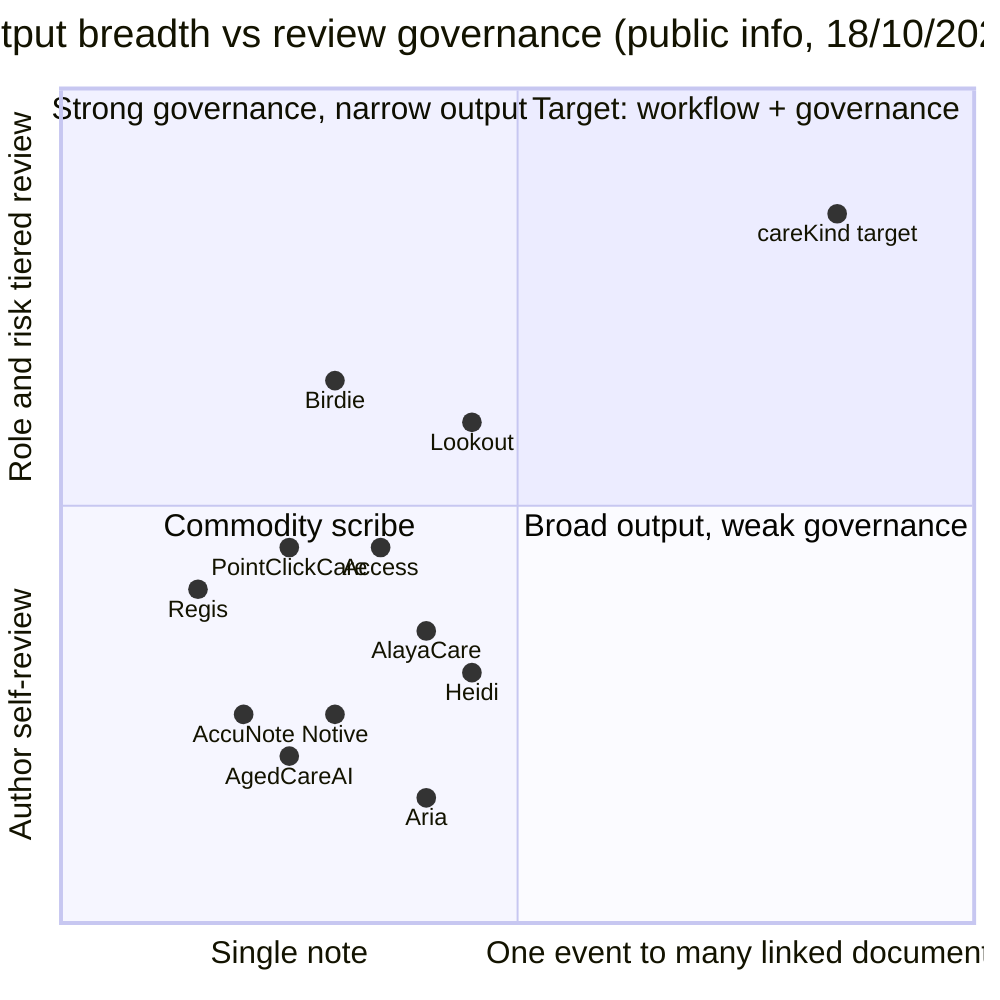

Owner: Strategy · Status: Research draft · Last reviewed: 18/10/2026

# 竞争对手如何解决"养老文书负担"这个问题

> 问题定义（来自 `docs/PRD.md` §1–§2）：澳洲 residential aged care 的 RN / EN / PCW 文书负担重；记录质量差（空洞、复制粘贴、不符合 Strengthened Quality Standards 和 Aged Care Act 2024 的证据要求）；同一事实要在 progress note、incident、SIRS、care plan、charts 等多张表重复填写；RN 要监督 PCW 的记录；各州法规有差异。
>
> 本文回答："竞争对手各自走哪条路解决这个问题，做到哪一步，哪里还空着"。全部来自公开资料（截至 18/10/2026），**没有试用任何产品**。来源编号见 [sources.md](sources.md)。
>
> 标注约定：**[声称]** = 厂商官网/新闻稿的营销声明；**[媒体]** = 第三方媒体或客户自己的公开发布；**[推断]** = 本文作者根据公开资料推断；"未公开" = 公开渠道查不到；⚠️ = 有线索但需核实。所有"节省 X 分钟"数字都是自报，未经独立验证。
>
> 运营参考，不是法律意见。涉及 SIRS、限制性措施、TGA 的描述只说明竞品怎么做，不构成合规结论。

---

## 0. 一页结论

1. **"口述 → 一条草稿 → 作者本人审核"已经是行业默认做法**。从 Heidi、Notive、AccuNote、Aria 到 PointClickCare、Access，输入几乎都是语音，审核几乎都是"写的人自己看一遍再保存"（S40, S60, S106, S61, S71, S107）。这一层没有差异化空间。
2. **CMS 厂商正在从"单条笔记"走向"填表"**：AlayaCare 的 AI Form Assistant、Access Smart Notes 的 voice-to-form 都是"一段对话 → 填一张表"（S20, S96, S107）。但**没有任何竞品公开做到"一个事件 → 多张关联文书"**（progress note + incident + 跌倒后记录 + 家属沟通 + 交接 + SIRS 时限提示）。
3. **审核链普遍是单级的**。公开资料里没有竞品把"PCW 起草 → RN 按风险分级把关、敏感事件不能批量确认"产品化。Metlifecare 用 Heidi 是 RN 自己写自己审（S98），Notive 是护工自审（S60）。
4. **合规处理大多停留在"声称"层面**：AgedCareAI、AccuNote 说"按 Aged Care Act 2024 / Strengthened Quality Standards 设计"，但没有公开字段级映射（S64, S106）；Heidi 2026-08 发了 SIRS 内容和模板，但文章本身的时限前后不一致（S97）。**限制性措施（restrictive practices）和州法差异，没有任何竞品公开提及。**
5. **监管环境在收紧**：TGA 2026-10-16 发布的审查发现，12 个被审 scribe 中 8 个的功能可能构成医疗器械，且没有一家自认，免责声明不能作为豁免（S99）；卫生部 FOI 文件和 Digital Rights Watch 报告都点出隐私透明度不足、数据出境、口音识别偏差（S101–S103）。"不越界、可追溯、数据在澳洲"从加分项变成门槛。

---

## 1. 五条解决路径总览

| 路径 | 代表 | 怎么解决问题 | 根本优势 | 根本局限 |
|---|---|---|---|---|
| **A. CMS 内置 AI** | AlayaCare、Telstra Health、Leecare、AutumnCare、PCS、Mirus；海外 PointClickCare、Access、Birdie | 在 system of record 里加口述、摘要、填表 | 不用复制粘贴，直接写进正式记录 | 只服务自家客户；澳洲 residential CMS 多数 AI 仍未上线或只有转写 |
| **B. 通用医疗 ambient scribe** | Heidi、Lyrebird、Dragon Copilot、TeleScribe、Telstra Smart Scribe | 录下诊疗对话或口述，生成临床笔记，再加养老模板 | 资金和模型能力强，品牌认知高 | 围绕"临床人员—患者问诊"设计，不是围绕班次和 PCW→RN 链路；正受 TGA 审查 |
| **C. 养老 / 护理专用 AI 新创** | Notive、AccuNote、AgedCareAI、Aria Care；海外 CareTrust AI；跨行业的 Beam、Minikai | 针对养老文书做语音笔记、交接、事故标记、政策问答 | 贴近场景，声称 AU 数据驻留 | 多数没有公开客户、定价、集成细节；复制粘贴或"叠加层" |
| **D. 机构自建** | Regis RegiCare Assist、Uniting Buddy、Bupa knowledge agent | 用 Microsoft 技术栈做汇总、多语言口述、政策问答 | 完全可控，贴合内部流程 | 成本难持续；Regis 仍需手动上传；不对外销售 |
| **E. 相邻工具（事件来源 / 事故管理）** | Riskonnect 类 GRC、Teton（传感器）、SOFIHUB、PainChek | 从系统或传感器产生事件，按预设类别分类 | 结构化、可审计 | 不解决"护士怎么写"；分类规则式 |

---

## 2. 路径 A：CMS 内置 AI

### 2.1 澳洲 residential CMS

| 维度 | AlayaCare Residential | Telstra Health | Leecare | AutumnCare | Person Centred Software | Mirus（MirusPlus） |
|---|---|---|---|---|---|---|
| 输入 | 浏览器麦克风口述（S20） | 现有养老产品无生成式口述；GP 端 Smart Scribe（S14） | 无 AI | 未发现 AI（S6） | Speech-to-text 转写（S17） | 未公开 |
| 输出 | AI Note Assistant：结构化 progress notes；AI Form Assistant：口述填表；AI Resident Insights / Overview：汇总变化（S20, S95, S96 ⚠️） | 报表（Care Insights）；NLP 风险预测研究工具（S13） | — | — | 转写文字，无生成式起草（S17） | "AI 与数据"模块内容未说明（S33, S116） |
| 单条 vs 多表 | 单条笔记 + 单表填充；未见一事件多表 | — | — | — | — | — |
| 审核/签署 | "every AI action is logged and human-approved"（S95，[声称]）；未说明谁审、能否绕过 | — | — | — | — | — |
| 合规处理 | 未公开 SIRS、限制性措施、Quality Standards 映射（S95） | — | — | — | — | — |
| 州法差异 | 未公开 | 未公开 | 未公开 | 未公开 | 未公开 | 未公开 |
| 数据驻留/隐私 | 页面称符合 Privacy Act 1988、数据隔离，**未写存储位置**（S95） | 未公开 | 未公开 | 未公开 | 未公开 | 未公开 |
| 集成 | 原生 | 原生；PainChek、My Health Record（S9） | 原生 | 原生 | 原生；英国端与 Teton 传感器数据对接（S115） | 原生 + API 模块（S33） |
| 定价 | AI 功能标为 "Premium Feature"，价格未公开（S95） | 未公开 | 未公开 | 未公开 | 未公开 | 未公开 |
| 客户/规模 | 330+ ANZ 客户（S19，[声称]） | 80,000+ 床；2026-02 Whiddon 23 院选用 Clinical Manager（S9, S110） | 480+ 机构（S1） | 未公开 | 澳洲 150+ 院（2019 数据 ⚠️，S18） | 未公开 |
| 2026-04 以后动态 | 2026-06 Note Assistant early access（S20）；网络研讨会页称 Form Assistant 和 Resident Overview "now built into the platform"（S96，仅搜索摘要 ⚠️）；Layla 已对 AU/NZ AlayaCare Cloud（居家）用户开放（S117） | 2026-05 发布 Corus，养老版 2028 年（S11）；本次未发现养老 scribe | 本次未发现 AI 发布 | 本次未发现 | 本次未发现 AI 笔记发布 | 官网 AI 内容仍是将来时（S116） |

**这条路径解决了什么**：AlayaCare 解决了"复制粘贴"和"表单字段重复填"的一部分——口述直接进系统，并开始自动填表。

**没解决什么**：（1）PCW→RN 的分级审核；（2）一个事件同时生成多份关联文书；（3）SIRS、限制性措施的专门流程。其余澳洲 CMS（Telstra、Leecare、AutumnCare、PCS、Mirus）**截至 18/10/2026 公开渠道仍没有生成式文书功能**，2026–2028 的空窗期判断（PRD §2 结论 2）仍成立。

### 2.2 海外 CMS 参照

| 维度 | PointClickCare Vox Advantage（北美） | Access Smart Notes（英国） | Birdie SmartPlans（英国居家） | CareTrust AI（新加坡） |
|---|---|---|---|---|
| 输入 | 移动 App 捕捉护理互动（ambient）（S71） | 床旁口述 / 对话录音（S72） | 评估对话录音（S74） | 语音日志、入院记录（S76） |
| 输出 | 平台内临床文档 | **voice-to-form**：把对话填进表单字段（文本、勾选、下拉、日期、表格等；不支持照片、body map、签名）（S107） | care plan 问题答案，引用原文（S74） | care plan 草稿、SBAR 交接 |
| 审核/签署 | 每条笔记都要护理团队签署才进病历（S71） | 用户核对后提交；**每个字段可回放对应音频片段核对**（S107）；录音前确认同意（S108 ⚠️） | 每条建议主动签署；高风险问题不给 AI 建议（S74） | "humans approve everything"（S76，[声称]） |
| 合规 | 内置居民同意 | 私有 GPT-4o 实例，"GDPR-compliant environments"（S107） | 转写永久保留 | 声称持 MOH HCSA 牌照 |
| 定价 | 未公开 | 按音频处理小时计费的附加项（S107）；早前页面写按护工或床位计年费（S72），两者需核实 ⚠️ | £3.50/录音小时（S74） | 未公开 |
| 动态 | 2026-08-12 有限发布，计划 2026-10 商用（S71）；截至 18/10 未查到正式 GA 公告 ⚠️ | 本次未发现澳洲上线 | — | 未见进入澳洲 |

**启示**：海外 CMS 已经把"同意 + 签署 + 字段级回放"做成标准。**Access 的"逐字段回放音频"是目前公开资料里最接近 careKind 突破 4（证据级记录）的设计**，careKind 要做到"逐句可追溯 + AI 改写高亮 + 数值逐字照录"才能拉开差距。

---

## 3. 路径 B：通用医疗 ambient scribe

| 维度 | Heidi Health | Lyrebird Health | Microsoft Dragon Copilot | TeleScribe |
|---|---|---|---|---|
| 输入 | 房间内 ambient、桌面口述、远程通话音频、挂绳录音夹（断网继续录）；母语口述输出英文（S40） | ambient + 口述（S50） | ambient 转 flowsheet（护理版）（S54） | 口述（S59） |
| 输出 | care notes、incident reports、family letters、care plans；模板含 care note、falls risk、伤口、家属更新（S40） | 病历、信件、care plans（S50） | flowsheet、笔记（S54） | 笔记、care plan、交接 |
| 单条 vs 多表 | 多种文书各自生成；**未见一事件自动拆成多份关联文书**（[推断]） | 单条 | 单表（flowsheet） | 单条 |
| 审核 | "ready for your review"，未描述签署流程（S40）；Metlifecare 案例中 RN 审核、编辑、批准后才写入（S98） | 临床人员自审 | 暂停、预览、编辑后提交（S54） | 未说明 |
| 合规处理 | 2026-08-13 发布 SIRS 文章：称 Heidi "drafts the notification log"、"flags the right timeframe"、**"never decides what's reportable"**；但同一篇文章的最终报告时限写成 84 天和 60 天两种，P1 24 小时起算点也前后不一（S97） | 发布 TGA 解读博客（S53） | 未提及 | 未提及 |
| 州法 | 未公开 | 未公开 | 未公开 | 未公开 |
| 数据驻留 | 早前页面称有 AU/NZ 选项（S40）；18/10 复访的养老页未写存储位置，只链到合规页 ⚠️ | 仅在澳洲处理和存储（S50，[声称]） | 未公开 | 澳洲托管（S59，[声称]） |
| 集成 | 养老页"Does Heidi connect to our clinical system?"无答案（S40 复访）；computer-use agent（S48） | GP/医院系统，无养老 CMS（S50） | 医院 EHR | 未说明 |
| 定价 | 页面无价格；第三方称约 $150/月 ⚠️（S42, S49） | 未公开 | 未公开 | $79/月（S59） |
| 客户/规模 | Metlifecare（NZ）4 家护理院（S98）；澳洲医院：Metro South 等（S47）；**未查到澳洲 residential 客户** | Gold Coast Health 等（S52） | 澳洲有护士版支持页，但未查到澳洲上线公告（S118 ⚠️） | 未公开 |
| 2026-04 以后动态 | 2026-05 Metlifecare 扩展；2026-08 SIRS 内容；2026-09 Series C 与增长资金合计约 3.4 亿美元（S44）；2026-09 Heidi II agent（S48）；**2026-10 TGA 审查名单在列**（S99） | **2026-10 TGA 审查名单在列**（S99） | Dragon Medical One 在 TGA 审查名单中（S99） | — |

**这条路径解决了什么**：把"打字慢"和"班末回忆"解决得最好，模型能力和资金最强。Heidi 已经从"笔记"向"事故报告 + SIRS 模板 + 政策问答"延伸，正在进入 careKind 的事故报告空白区。

**没解决什么**：（1）PCW 不是 Heidi 养老页列出的推荐用户（列的是 RN、Care Partners、社区支持、专职医疗、GP），审核由写的人自己做（S40）；（2）以"一次就诊"而非"一个班次、多位老人"组织；（3）ambient 需要居民同意，认知障碍比例高的场景更难（S98）；（4）**TGA 审查让"加诊断/建议功能"的扩张路径变得有风险**（S99）。

---

## 4. 路径 C：养老 / 护理专用 AI 新创

| 维度 | Notive | AccuNote | AgedCareAI | Aria Care | Beam（新进入者） |
|---|---|---|---|---|---|
| 输入 | 护工口述，实时转写（S60） | 模板、自由输入、语音（S106） | 文字或语音提问（S64 复访） | 语音或要点（S61） | 对话/个案记录（S104） |
| 输出 | 结构化交接笔记（情绪、营养、皮肤、活动等分区）；事故和 RN 跟进标记；PDF 合规报告（S60） | 结构化 progress note 草稿；review prompts 提示遗漏；管理者治理看板（S106） | 起草笔记、信件、报告；按机构政策问答；Governance 模块管政策、CIP、风险、董事会文件（S64 复访） | progress notes、交接、事故草稿、daily snapshot；翻译、Easy Read；"Dignity + Risk Guardian"标出含糊或缺依据的措辞（S61 复访） | Magic Notes 个案笔记、报告准备；实时翻译（Interpret）（S104, S105） |
| 单条 vs 多表 | 单条 + 标记 | 单条 | 单条/文件 | 多类文书分别生成 | 单条 |
| 审核 | **护工**审核后锁定，锁定后不可改（S60） | 员工保存前自查；声明"不保证合规"（S106） | "A person always reviews and approves"（S64，[声称]） | 只出草稿，用户负责；Growth 档有 review inbox（S61） | 未说明（S104） |
| 合规处理 | 声称"designed to comply" Privacy Act 和 ACQSC 标准；无 SIRS（S60） | 提及 7 条 Strengthened Quality Standards 生效；无字段级映射（S106） | 声称按 Aged Care Act 2024 和 Strengthened Quality Standards 设计；无 SIRS、限制性措施（S64） | Starter 档有 "reportable-incident detection"，以 NDIS 为主，无 SIRS（S61） | 未说明 |
| 州法 | 未公开 | 未公开 | 未公开 | 未公开 | 未公开 |
| 数据驻留 | 悉尼；语音转写后删除（S60，[声称]） | 澳洲服务器（S106，[声称]） | 未写存储位置；"不用于训练公共 AI"（S64） | 未写物理位置（S61） | 数据在澳洲加密存储；Notes 有 ISO 27001（S104，[声称]） |
| 集成 | 未提及（浏览器访问） | **声称"works alongside" Telstra Health Clinical Manager、AlayaCare、PCS，视机构配置**；未说明是 API 还是导出（S106 ⚠️） | Chrome 扩展、iOS/Android App；无 CMS 点名（S64） | 无，"Not yet"，复制粘贴（S61） | 未说明 |
| 定价 | 7 天免费 pilot，之后按机构规模（S60） | 14 天试用，价格未公开（S106） | 未公开 | $0 / $19 / $29 / $149 / $349 / $699 每月 + Enterprise（币种未注明 ⚠️）（S61） | 未公开 |
| 客户/规模 | 未点名；SA、VIC founding facilities（S60） | 未公开 | 未公开 | 未公开 | Life Without Barriers pilot；全球 75,000 名支持工作者、350+ 机构（S104，[声称]） |
| 2026-04 以后动态 | 页面示例笔记日期 14/04/2026，无功能更新（S60） | 首页新增 CMS "alongside" 表述（首次在本仓库记录）（S106） | 定位从"9 模块套件"改为 Intelligence + Governance 两块，早前的 Whisper 语音模块未再出现（S64 复访 ⚠️） | 定价不变 | **2026-04-30 进入澳洲，墨尔本设亚太办公室**（S104） |

**其他**：Minikai（墨尔本，2025-02 种子轮 A$2.5m，NDIS/残障行政 agent 为主）（S113）；Sparks Scribe、NDISNotes、SupportNotes 面向 NDIS 个人（S65–S67）。CareTrust AI 仍只在新加坡（S76 复访）。

**这条路径解决了什么**：把"澳洲数据驻留 + 不训练 + 养老语言"做成了标准话术；Notive 的分区交接和进度看板、Aria 的"含糊措辞检查"、AccuNote 的"遗漏提示"都在回应"记录空洞"问题。

**没解决什么**：审核仍是作者自审；合规映射只是声称；没有一事件多表；集成要么没有、要么含糊（AccuNote）。

---

## 5. 路径 D：机构自建

| 维度 | Regis RegiCare Assist | Uniting Buddy | Bupa knowledge agent（新增） |
|---|---|---|---|
| 解决的环节 | **下游**：RN 读笔记负担，按临床问题汇总，68 页压到 3 页（S68, S69） | **上游**：CALD 护工多语言口述转笔记（Hindi、Nepali、Indonesian、Mandarin、Cantonese）（S70） | **旁路**：政策问答，答案附内部指引来源（S109） |
| 技术 | Copilot Studio + Foundry，Cognizant 集成（S69） | Engage Squared + Microsoft（S70） | 未公开 |
| 审核 | RN 仍需阅读全文（S68） | 未公开 | 不涉及记录 |
| 集成 | 手动上传报告（S69） | 内部系统 | 未公开 |
| 规模 | 约 150 名员工，72 院（S69） | 1,200+ 用户（S70） | 57 家护理院（S109） |
| 动态 | 本次未发现新公开信息 | 2026 NFP Technology Awards 获奖（S70） | 2026-08-17 发表；未提文书计划（S109） |

**启示**：大型机构在三个不同环节各自补洞，说明需求真实，也说明**没有一个现成产品把"上游起草—中间审核—下游汇总"连起来**。Bupa 选择先做政策问答而不是笔记，可能反映了对 AI 写临床记录的谨慎（[推断]）。

---

## 6. 路径 E：相邻工具

- **事故管理 / GRC 软件**（如 Riskonnect）声称按预设 SIRS 类别自动分类事故严重程度（[声称]，S119）。这是规则式分类，careKind 按护栏 G6 **不判定、不代报 SIRS**，只提示时限。
- **传感器 / 监测**：PCS 英国端接 Teton 传感器数据进 mCare（S115），Teton 2026-07 推出查询运营数据的 agent Samwise（S114，付费墙 ⚠️）；未见进入澳洲。南澳 2021–2022 年试过的 AI 音视频监测被报道产生大量误报（S120 ⚠️）。
- **PainChek**：通过 CMS 集成覆盖约 80% 床位，仍是"做 CMS 伙伴"的样板（S80）。

---

## 7. 横向对照：问题的六个子项各被谁解决了

| 子问题 | 已有较好做法 | 部分做法 | 公开资料中无人解决 |
|---|---|---|---|
| 写得慢、班末回忆 | Heidi、Notive、AccuNote、Aria、Access、PCC（语音起草） | — | — |
| 记录空洞、复制粘贴 | — | Aria "Dignity + Risk Guardian"、AccuNote review prompts、Notive 分区结构、Access 逐字段回放（S61, S106, S60, S107） | **逐句追溯到原话 + AI 改写高亮 + 数值逐字照录**（澳洲 residential） |
| 同一事实重复填多张表 | — | AlayaCare Form Assistant、Access voice-to-form（一段话填一张表）（S96, S107） | **一个事件 → 多份关联文书且事实一致** |
| RN 监督 PCW | — | Notive 的 RN 跟进标记（S60）；Regis 帮 RN 读（S69） | **PCW 起草 → RN 分级审核、敏感事件逐条确认、不能绕过** |
| SIRS / 限制性措施 / Quality Standards | — | Heidi SIRS 模板与时限提示（S97）；AgedCareAI、AccuNote 声称按标准设计（S64, S106） | **限制性措施记录提醒**；**字段级 Quality Standards outcome 映射** |
| 州法差异 | — | — | **全部未公开**（记录保存期、健康记录法、监控设备法等） |

---

## 8. 定位图

**X 轴**：输出广度——单条笔记（0）↔ 一个事件生成多份关联文书（1）。
**Y 轴**：审核治理深度——作者自审 / 免责声明（0）↔ 按角色和风险分级、不可绕过（1）。
坐标是根据公开资料的**主观判断**（[推断]），用来看相对位置，不是测量结果。careKind 为**目标位置**，尚未实现。

同一张图的表格版（另加集成姿态）：

| 玩家 | 输出广度 | 审核治理 | 集成姿态 |
|---|---|---|---|
| Heidi | 中（多类文书分别生成） | 低到中（作者自审；客户可配 RN 审） | 独立 + computer use |
| AlayaCare | 中（笔记 + 单表填充） | 中（"logged and human-approved"） | CMS 原生 |
| Access / PCC | 中低 | 中（签署、同意、逐字段回放） | CMS 原生（海外） |
| Birdie / Lookout | 中 | 中高（风险分级 / six points of control） | 原生（英国居家 / 澳洲居家） |
| Notive / AccuNote / Aria / AgedCareAI | 低到中 | 低（作者自审或免责声明） | 独立 / 含糊 / 复制粘贴 |
| Regis（自建） | 低（只汇总） | 中（RN 读全文） | 手动上传 |
| **careKind（目标）** | **高（一事件多表）** | **高（PCW→RN 分级、敏感事件逐条）** | 独立起步 → CMS 伙伴 |

---

## 9. 行业共识（大家都在做，已经不是差异点）

1. **语音输入**是默认入口（几乎所有玩家）。
2. **"AI 只出草稿，人确认后才保存"**是所有公开竞品的说法（S40, S60, S61, S64, S71, S106, S107）。差别只在**谁**确认、能不能绕过。
3. **澳洲数据驻留 + 不用客户数据训练**是澳洲新创的标准话术（S60, S62, S106, S104）；但多数只是官网声称，存储位置未写或写得含糊（AgedCareAI、Aria、AlayaCare 养老页）（S64, S61, S95）。
4. **刻意避开诊断和处方**（Heidi、AgedCareAI 都写明）（S48, S64）。
5. **ambient 要先取得居民同意**（Metlifecare、PCC、Access）（S98, S71, S108）。
6. **结构化分区模板**（情绪、营养、皮肤、活动；falls risk、伤口）（S60, S40）。

## 10. 空白点（公开资料中没有人做到）

1. **两级审核按风险分级**：PCW 起草 → RN 把关，敏感事件（跌倒、伤害、行为、限制性措施、疑似虐待）逐条确认，不能批量通过。对应 PRD 突破 3。
2. **一事件多表、事实一致**：一段口述同时生成 progress note、incident 草稿、跌倒后记录、家属沟通、交接要点、SIRS 时限提示。最接近的是 AlayaCare / Access 的"一段话填一张表"。对应 PRD 突破 2。
3. **州法差异和限制性措施**：没有竞品公开处理各州记录保存期、健康记录法、监控设备法，也没有竞品提限制性措施记录提醒。这是 careKind 用 `03-legal-compliance/references/state-by-state-comparison.md` 做成配置的机会。
4. **证据级可追溯**（澳洲 residential）：逐句追溯原话、AI 改写高亮、数值逐字照录、完整审计链。Access 的逐字段回放是海外最接近的样板。对应 PRD 突破 4。
5. **班次覆盖视图**：Notive 有"本班完成进度"（S60），但没有"哪些老人本班还没有任何记录"。对应 PRD 突破 5。
6. **residential 专用工具的多语言口述**：仍只有 Heidi（通用）和 Uniting Buddy（自建、居家）公开支持（S40, S70）。而 Digital Rights Watch 报告指出 scribe 对非英语口音的识别准确率更低（S101），说明这一块难，也说明做好了有价值。

## 11. 竞品踩过的坑（公开报道）

| # | 坑 | 证据 | 对 careKind 的含义 |
|---|---|---|---|
| 1 | **功能越界成医疗器械**：TGA 审查 12 个 scribe，8 个可能构成医疗器械，没有一家自认；"免责声明不足以决定是否属于医疗器械"；下一步是 targeted compliance（S99）。被审名单含 Heidi、Lyrebird、Dragon Medical One，但 TGA 没有说是哪 8 个 | [媒体] S99, S100 | 护栏 G2/G11 必须写进产品而不是写进免责声明；营销不能说 detect / predict |
| 2 | **隐私透明度不足、数据出境**：卫生部 2026-02 Senate Estimates 简报称部分供应商宣传"隐私合规"但数据处理不透明，部分临床人员不知道数据去了海外云（S102, S103）；Digital Rights Watch 联系 7 家 scribe 公司，只有 2 家回答数据问题，无一披露底层模型（S101） | [监管/媒体] | careKind 要主动公开模型、子处理方、存储区域（vendor register），把透明度当卖点 |
| 3 | **拒绝 AI 就拒绝服务**：有患者拒绝 AI scribe 后无法获得服务（S101） | [媒体] | 老人或家属可以退出录音，退出后照常手动记录（rules/03 §2 问题 8） |
| 4 | **口音识别偏差**：非英语口音、言语差异人群准确率更低（S101） | [媒体，报告未见原始数据 ⚠️] | CALD 护工是核心用户，必须有分口音的评测门槛，低置信度要人工确认 |
| 5 | **AI 生成文件被 Commission 退回**：行业顾问称 Commission 退回明显 AI 起草、答不出追问的政策和申请文件；评估员看"是否有证据证明每条 outcome 已做到"（S92） | [媒体，顾问转述] | 空洞的"标准话术"会适得其反；记录必须保留护士的具体观察 |
| 6 | **合规内容本身出错**：Heidi 的 SIRS 文章中最终报告时限有 84 天和 60 天两种写法，P1 24 小时起算点前后不一（S97） | [声称内容自相矛盾] | careKind 的任何时限提示必须以本地法规原文为准（PRD §9.1 r 164-25 / r 165A-25），并有人复核 |
| 7 | **自建成本难持续、仍要手动上传**（Regis）（S68, S69） | [媒体] | "自建 vs 采购"的 TCO 论证 |
| 8 | **AI 告警误报**：南澳 AI 监测试点被报道误报过多（S120 ⚠️） | [第三方数据库] | 不做根据内容自动告警（护栏 G3、rules/03 §4） |
| 9 | **护士过度依赖、笔记"无菌化"** | [行业评论] S93 | 保留原话、标出缺失项，而不是"写得漂亮" |

**本次检索未发现**澳洲养老 AI 文书厂商的公开数据泄露事件或 ACQSC 针对某个 AI 产品的执法。⚠️ 未发现不等于不存在。

## 12. 对 careKind 的差异化启示（对照 PRD 五个突破）

| PRD 突破 | 竞品现状 | 差异化强度 | 要做的事 |
|---|---|---|---|
| 1 Shift Capture（整班录音、自动分配到老人） | Heidi 有断网继续录的挂绳夹，但以"一次就诊"组织（S40）；Notive 按居民逐条（S60）；无人公开做"整班一次录音 → 自动分配" | **高**，但风险也高（监控设备法、他人语音、同意） | 本地缺监控设备法资料（rules/legal-reference-map 缺口）是上线门槛；Access/PCC/Metlifecare 都把"同意"放在录音之前，careKind 的模式 A（只存护士本人语音）要能讲清楚 |
| 2 说一次，处处归档 | 只有"一段话填一张表"（S96, S107） | **高** | 这是最清楚的空白，应作为 demo 主线：一次跌倒口述 → 六份文书草稿并排展示 |
| 3 PCW→RN 两级分级审核 | 全部是作者自审或单级签署 | **高** | 可借鉴 Birdie"高风险不给 AI 建议"、Lookout"six points of control"；在销售材料里对比"谁审核" |
| 4 证据级记录 | Access 逐字段回放（英国）；澳洲 residential 无 | 中到高（Access 一旦来澳洲会缩小差距） | 逐句追溯 + 改写高亮 + 数值照录 + 审计链；回应 TGA 审查和 Commission 对 AI 文件的怀疑 |
| 5 班次覆盖视图 | Notive 有进度看板（S60） | 中 | 强调"哪些老人没有记录"是文书提示，不是临床判断（G11 措辞） |

**其他启示**
- **AccuNote 的 CMS"alongside"表述**说明"与澳洲主流 CMS 并存"已成为新创的销售话术。careKind 需要尽快确认 Telstra Health Clinical Manager、Leecare、AutumnCare 的写回或导出路径，否则会在采购问卷里落后（S106 ⚠️）。
- **Heidi 进入 SIRS 内容**意味着"事故报告 + SIRS"空白在变窄。careKind 的差异要落在"事故事实与 progress note 同源、RN 逐条确认、不判定可报性"上，而不是"有 SIRS 模板"（S97）。
- **TGA 审查是机会窗口**：通用 scribe 若为避险收缩功能，"严格只整理原话"的垂直工具更容易通过机构的采购和临床治理审查（[推断]，S99）。
- **定价**：海外出现"按录音小时"计费（Birdie £3.50、Access 按音频处理小时）（S74, S107），与 Aria 的按人头月费并存。careKind 不以价格竞争（PRD §3.2），但需要准备按床位 / 按录音小时两种对比口径。

## 13. 需要持续监测的信号

- TGA 公布 targeted compliance 结果或点名产品（S99）。
- AlayaCare Form Assistant 正式 GA 的公开日期（S96 ⚠️）。
- AccuNote 公布与 Telstra Health / AlayaCare / PCS 的具体集成方式（S106 ⚠️）。
- Heidi 公布澳洲 residential 客户或 CMS 集成；养老页"是否连接临床系统"给出答案（S40）。
- PointClickCare Vox Advantage 正式 GA；Access Smart Notes 进入澳洲。
- Beam 在澳洲公布 aged care 客户（S104）。
- OAIC 对 AI scribe 同意的指引；Privacy Act 第二阶段改革（S101）。
- ACCIS（Aged Care Clinical Information System）要求：目前是"recommended minimum software requirements"，不是强制；原则之一是"数据录入一次、安全复用"（S111, S112）。如果转为强制或进入采购清单，CMS 合作和"说一次，处处归档"的叙事都会受影响；2026-07 起官方把名称从 Standards 改为 Requirements（S111 ⚠️）。

## 14. 研究局限
- 没有试用任何产品，全部基于公开页面；部分页面由抓取工具摘要（见 sources.md 注释），关键数字引用前请人工打开原页。
- S96、S108、S110、S111、S116、S118、S119、S120 只来自搜索摘要，未抓取全文，已标 ⚠️。
- 定位图坐标是主观判断。
