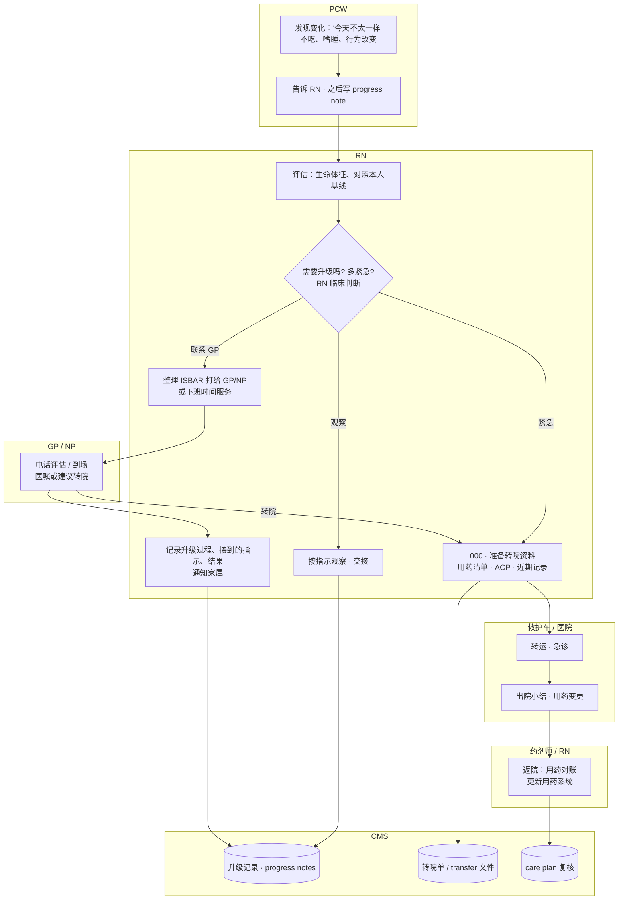
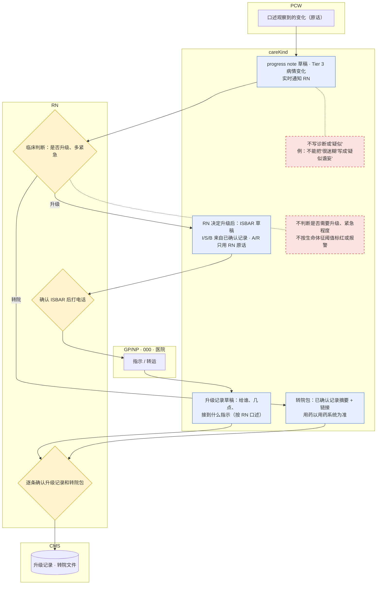
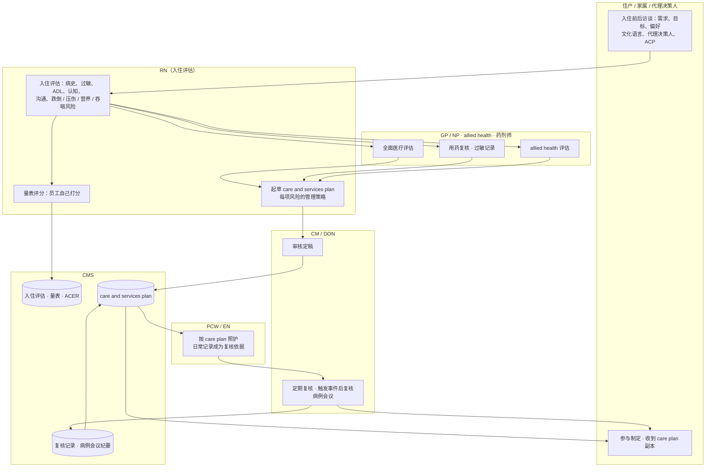
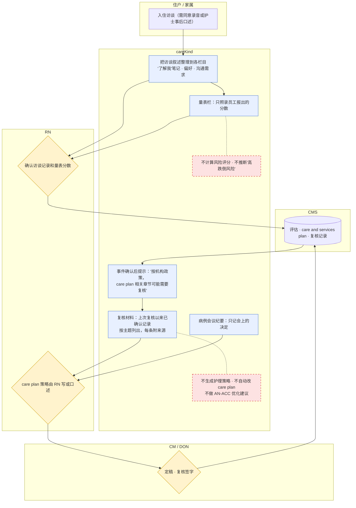
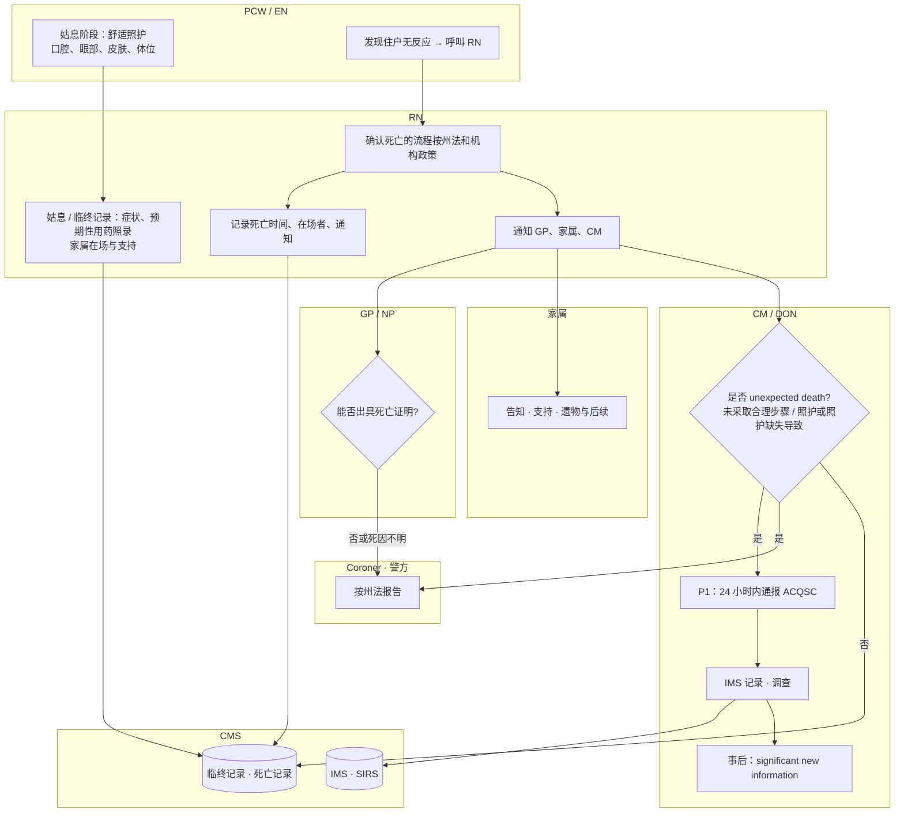
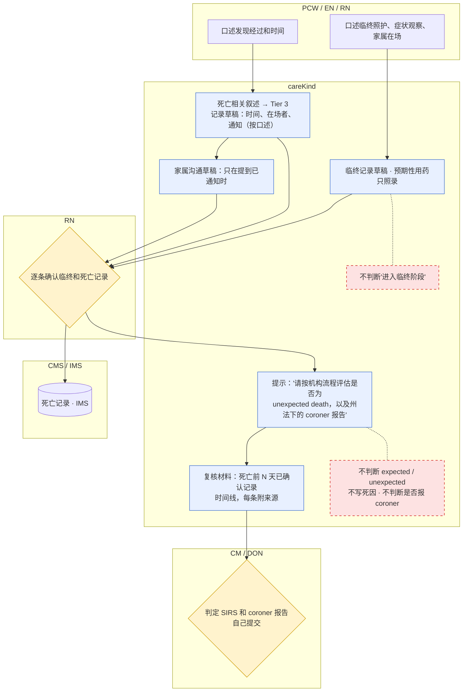
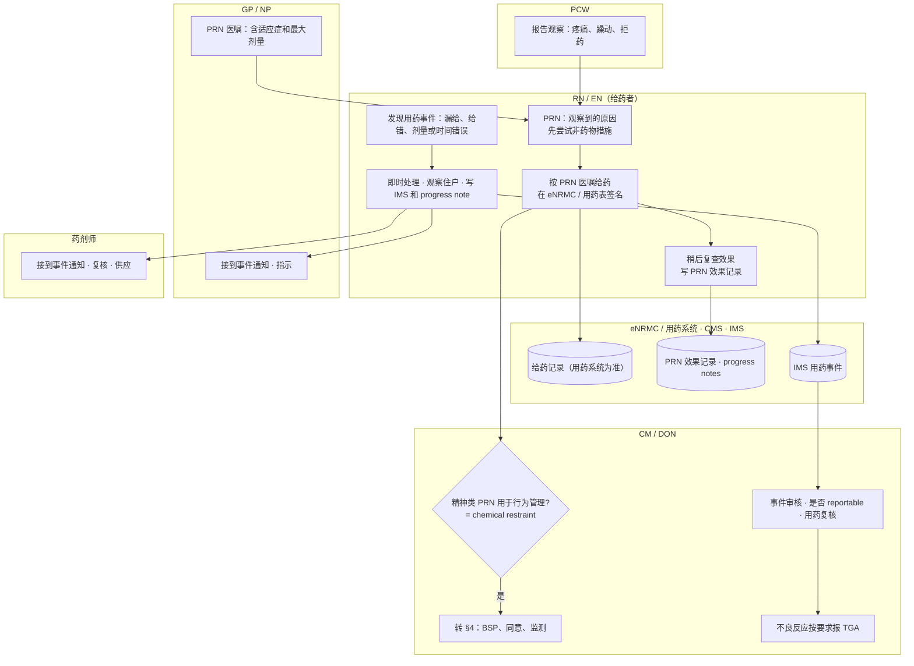
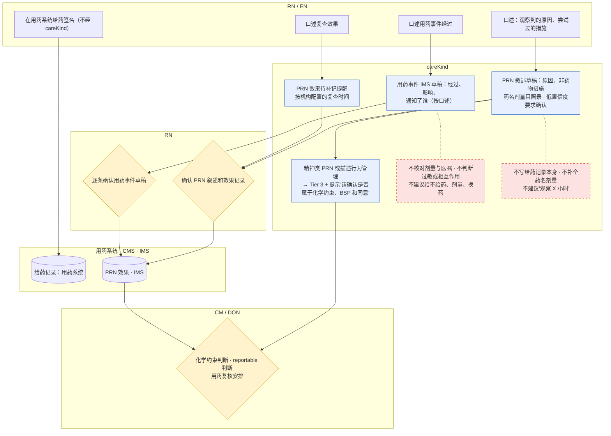

Owner: Lightman · Status: Research draft · Last reviewed: 18/10/2026

# 护理文书流程图（续）：§5–§8 病情恶化、入住与 care plan、死亡、用药与 PRN

> 本文件是 [`care-documentation-process-flows.md`](care-documentation-process-flows.md) 的第 2 部分（主文件超过 1000 行后拆分）。图例、角色表、来源简称（Rules、Act、SQS、SIRS-G22、SIRS-QG、QLD-DET、MedGP、PRN-S、TAX、CR 等）见主文件 §0；人工确认门汇总和 PRD 缺口见主文件 §10、§11。
> 运营参考，不是法律意见，也不是临床指引。证据等级：护士访谈 **n = 0**（`10-feedback/` 为空），标"推测，需试点验证"的痛点都没有一线数据。

## 目录
5. [病情恶化与升级（转院）](#5-病情恶化与升级转院)
6. [入住 → care plan 定稿 → 定期复核](#6-入住--care-plan-定稿--定期复核)
7. [死亡：expected vs reportable（coroner）](#7-死亡expected-vs-reportablecoroner)
8. [用药事件与 PRN 记录](#8-用药事件与-prn-记录)

---

## 5. 病情恶化与升级（转院）

### 5.1 as-is

### 5.2 时限、文书与依据
| 步骤 | 时限 | 产生的文书 | 依据 |
|---|---|---|---|
| 识别与升级 | "timely" | 升级记录（员工原话、生命体征、升级给谁、何时、接收方指示、结果） | SQS 3.2.5；SQS 3.3（Outcome statement："risks… changes and deterioration… are escalated and communicated"）；TAX §4.9 |
| 通知 GP 和 supporters | "timely"；还要能获得下班时间和紧急临床服务 | 通知记录、家属沟通记录 | SQS 5.4.4(c)(d) |
| 复评 | 恶化时、转院时 | 评估记录 | SQS 5.4.5 |
| 转院 | 转院时 | 用药清单（必须可获取）；ACP 文件要共享；结构化交接 | SQS 5.3.1(b)；SQS 3.1.6(d)；SQS 3.3.2(d) |
| 返院 | 转院后 | 用药复核；care plan 复核 | SQS 5.3.2(a)；SQS 3.1.5(d) |
| 阈值工具 | — | QLD 的红/黄分区表**只是临床工具**，原文写"does not replace clinical judgement"、"IF YOU ARE CONCERNED… CALL THE GP" | QLD-DET |

### 5.3 痛点
| 痛点 | 来源 |
|---|---|
| PCW 最先发现变化，但描述常常笼统（"不太对劲"），RN 打电话前要重新问一遍 | 推测，需试点验证 |
| RN 打电话给 GP 时要从多处临时找背景（近期记录、用药、ACP） | 推测，需试点验证（SQS 5.3.1(b) 和 3.1.6(d) 要求这些信息在转院时可获得） |
| 夜班只有 1 名 RN，升级、记录、照护同时进行 | 推测，需试点验证（24/7 RN 要求见 TAX §6.2，配置之外的人数无依据） |
| 用 QLD 红黄区这类阈值做"自动提醒"在业界很常见，但对 careKind 是 TGA 红灯 | `03-legal-compliance/tga-samd-boundary.md`；TAX §4.7 |

### 5.4 to-be

- **AI 起草点**：progress note、ISBAR（S/B）、升级记录、转院包（Phase 3 范围，主 PRD §8 "转介信"）。
- **必须人确认**：升级与否、紧急程度、ISBAR 的 A/R、转院包内容。
- **AI 绝不做**：数值报警、分诊、建议转院（TGA 红灯；PRD G2、G3）。

---

## 6. 入住 → care plan 定稿 → 定期复核

### 6.1 as-is

### 6.2 时限、文书与依据
| 步骤 | 时限 | 产生的文书 | 依据 |
|---|---|---|---|
| care and services plan 制定 | **住户 start day 当天或之前**（特定情形 28 天内，⚠️ residential 是否适用 s 71(4) 需核实） | care and services plan | Rules r 148-80(1)（第 203–204 页） |
| 给住户副本 | 制定后、每次更新后、住户要求时 | 副本交付记录 | Rules r 148-80(4)（适用所有 registered providers） |
| 12 个月复核 | r 148-80(3)(c) 的"至少每 12 个月复核"**只适用于 (5)(6) 列出的 home and community 等类别**，residential 按 Note 1 引用的 Quality Standards（s 15-20） | — | Rules r 148-80(3)(5)(6) |
| residential 复核 | **"regularly"**，并在需求变化、计划无效、功能或认知恶化、转院、出现新风险或事件、照护责任变化时复核 | 复核记录 | SQS 3.1.5；⚠️ 固定复核周期本地无依据，按机构政策 |
| 全面临床评估 | 开始服务时、定期、需求变化时；含 GP 全面医疗评估 | 评估记录 | SQS 5.4.2 |
| 用药复核与过敏 | 开始服务时、转院时、每年；过敏在开始时记录 | 用药复核、过敏记录 | SQS 5.3.2(a)；5.3.3 |
| ACP | 支持讨论、完成、复核；转院时共享 | ACP 记录 | SQS 3.1.6 |
| ACER | 入住时 | Aged Care Entry Record | TAX §3.1（RESP） |
| AN-ACC | 独立评估员完成 | 护理记录作佐证 | TAX §3.4 |

### 6.3 痛点
| 痛点 | 来源 |
|---|---|
| 入住访谈内容多、信息分散在家属、GP 转介信、医院出院小结里 | 推测，需试点验证 |
| care plan 和日常记录脱节：事件之后忘记复核相关章节 | 推测，需试点验证（SQS 3.1.5(e) 把"事件"列为复核触发条件） |
| 量表评分（Abbey、Braden、跌倒风险）必须由合资格人员做，AI 不能代替 | TAX §3.1、§4.1、§4.6；`rules/03-product-design-rules.md` §6 |
| 用 AI 帮"写高"AN-ACC 分类有资金合规和夸大记录风险 | TAX §3.4 |

### 6.4 to-be

- **AI 起草点**：访谈整理、复核材料汇编、病例会议纪要（Phase 3）。
- **必须人确认**：量表分数、策略、定稿和复核结论。
- **AI 绝不做**：风险评分、生成策略、自动改 care plan（功能 PRD §4.5 r 148-80 一行已写）。
- 🟡 "可能需要复核"的提示要过 TGA 边界审查（TAX §3.2 认为可以，但不能变成"风险上升"之类的判断）。
- ⚠️ 入住访谈录音属于模式 B（环境对话录音，Phase 3，有法律门槛）；MVP 只能用护士事后口述。

---

## 7. 死亡：expected vs reportable（coroner）

### 7.1 as-is

### 7.2 时限、文书与依据
| 步骤 | 时限 | 产生的文书 | 依据 |
|---|---|---|---|
| 临终照护 | 每班或更频繁（TAX） | 舒适措施、症状、口腔眼部皮肤护理、预期性用药（照录）、家属支持 | SQS 5.7.4；TAX §5.3 |
| unexpected death 定义 | — | 包括：未采取合理步骤防止死亡；死亡是 provider 提供的服务或未提供服务导致的 | Act s 16(1)(d)；Rules r 16-5(8)（第 93–94 页） |
| 优先级 | **unexpected death 一律 P1 → 24 小时内** | P1 notice | Rules r 165A-25(2)(d) |
| 什么不算 | 已被妥善评估、监测和管理的疾病导致的死亡（含姑息和临终用药）；与事件无关的后续死亡 | — | SIRS-G22 第 35 页（**旧法时期**，⚠️ 新法下以 r 16-5(8) 为准） |
| 不确定时 | 包括事件后入院、在医院死亡的情况，"should be reported" | — | SIRS-G22 第 35 页（旧法时期，⚠️ 需核实新版指引） |
| 已通报事件的住户后来死亡 | 尽快 | significant new information | SIRS-G22（例子）；SIRS-QG 第 2 页 |
| Coroner | 州法 | coroner 报告 | ⚠️ **本地没有各州 Coroners Act**；SIRS-G22 只写"each state and territory has specific requirements"，SIRS-WF 写"may include involving the police, the coroner" |
| 死亡确认 / 证明 | 州法和机构政策 | 死亡确认记录、死亡证明 | ⚠️ 本地无资料（RN 确认死亡的权限各州不同） |
| 服务终止通知 | — | cessation notification（System Governor 和 Commissioner） | Rules r 149-5（目录标题已核实；⚠️ 时限和字段未核实） |

### 7.3 痛点
| 痛点 | 来源 |
|---|---|
| 同一个死亡可能要分别报告给 coroner、ACQSC、警方，各自时限和字段不同 | SIRS-G22 第 34–35 页（事实，旧法时期措辞） |
| "expected / unexpected"的判断往往要回看过去几天甚至几周的记录，记录笼统时很难判断 | SIRS-G22（例：压伤未处理、跌倒后未评估）；记录质量推测，需试点验证 |
| 临终阶段记录密集，夜班一人值守时补记压力大 | 推测，需试点验证 |

### 7.4 to-be

- **AI 起草点**：临终记录、死亡记录叙述、家属沟通、死亡前时间线汇编。
- **必须人确认**：所有死亡相关记录由 RN 逐条确认；SIRS 和 coroner 由 CM 判定并提交。
- **AI 绝不做**：判断 expected / unexpected、死因、是否进入临终阶段（TAX §5.3）、是否报 coroner。

---

## 8. 用药事件与 PRN 记录

### 8.1 as-is

### 8.2 时限、文书与依据
| 步骤 | 时限 | 产生的文书 | 依据 |
|---|---|---|---|
| PRN 医嘱 | 开具时 | PRN 医嘱写在用药表 PRN 栏或 eNRMC；应包含最大剂量 | MedGP（PRN medicines 一节） |
| 用药记录 | 每次 | 当前、准确、可靠的全部用药记录及治疗的临床原因，**包括 PRN** | SQS 5.3.1(e) |
| PRN 效果 | 给药后复查（时间按机构政策，⚠️ 无全国统一值） | 原因、非药物措施、给药时间（以用药系统为准）、复查时间、效果、不良反应 | TAX §4.5；PRN-S |
| 精神类 PRN | 每次 | 日期、住户、药名、剂量、本次适应症、之前尝试的策略、授权人、给药人、效果（复查时补） | PRN-S（ACQSC 贴纸，**非强制**） |
| 化学约束 | 使用前和使用期间 | 见 §4（Rules r 162-25、r 162-30） | Rules |
| 高风险药物 | 持续 | 识别、监测、减少不当使用精神类药物 | SQS 5.3.4 |
| 用药事件 | 每次 | IMS 记录（r 164-25 最低字段）、通知 RN/GP/药剂师 | Rules r 164-25；TAX §2.4；SQS 2.5.1 |
| 用药复核 | 出现可能与药物有关的不良事件时 | 复核记录 | SQS 5.3.2(e) |
| 不良反应报告 | — | 向 TGA 报告不良药物和疫苗事件的流程 | SQS 5.3.5 |

### 8.3 痛点
| 痛点 | 来源 |
|---|---|
| PRN 给药在用药系统签名，效果却要在另一个地方"稍后"补记，容易漏 | PRN-S："The effect and impact… should be filled in later at review"（事实）；漏记率推测，需试点验证 |
| 精神类 PRN 是否属于 chemical restraint 要逐次判断，并连到 BSP 和同意 | PRN-S；Rules r 162-25 |
| 药名、剂量的转写错误是最高风险的 AI 错误之一 | 危害日志 HAZ-004（`06-app-development/clinical-safety/hazard-log.md`） |
| eNRMC 在 residential 的普及程度和要求不清楚 | TAX §4.5、§8（⚠️ 需核实） |

### 8.4 to-be

- **AI 起草点**：PRN 叙述和效果记录、用药事件 IMS 草稿。
- **必须人确认**：所有含药名或剂量的记录（G3）；化学约束判断；reportable 判断。
- **AI 绝不做**：用药核对、过敏冲突判断（TGA 红灯表）、给药建议、写给药记录（TAX §4.5"careKind 不应替代用药系统"）。
- 🟡 "PRN 效果待补记提醒"是文书完整性提示，需过 TGA 边界审查。

---

下一步：回到主文件 [§9 跨流程的共性痛点](care-documentation-process-flows.md#9-跨流程的共性痛点)、[§10 人工确认门汇总](care-documentation-process-flows.md#10-人工确认门human-in-the-loop-gates汇总)、[§11 PRD 缺口](care-documentation-process-flows.md#11-与-prd-不一致或-prd-缺失的地方建议不改-prd)。
