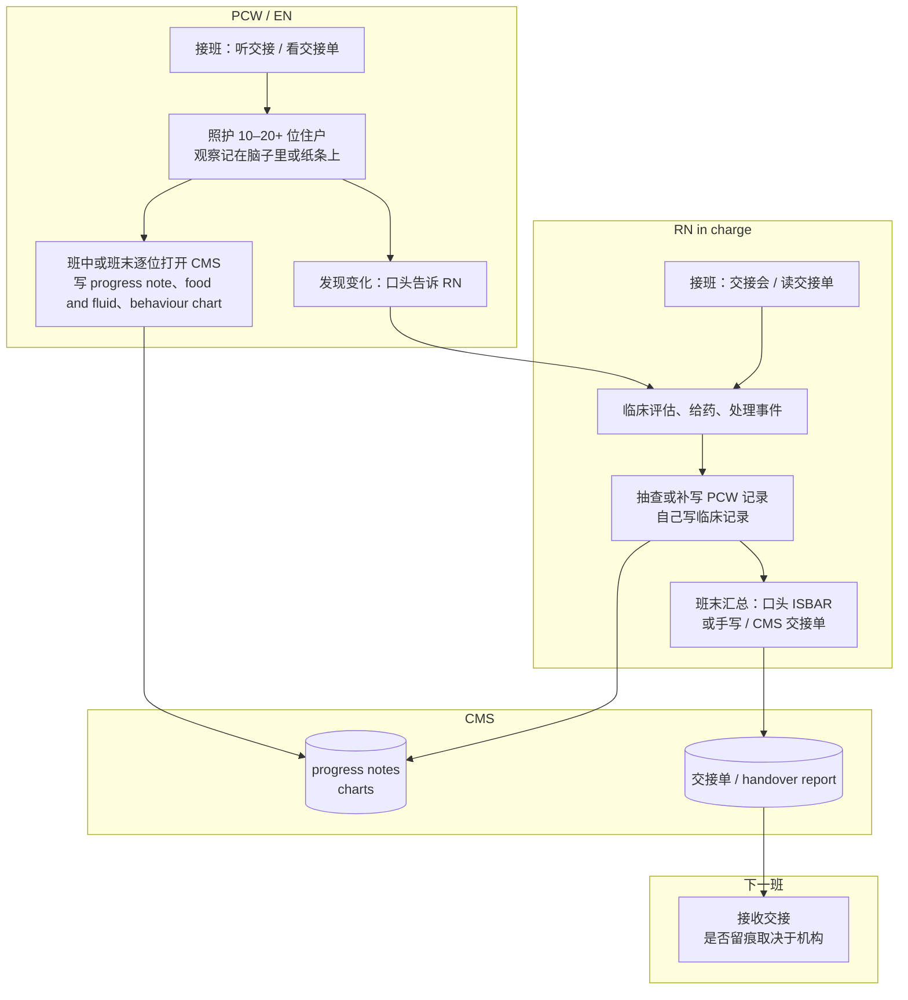
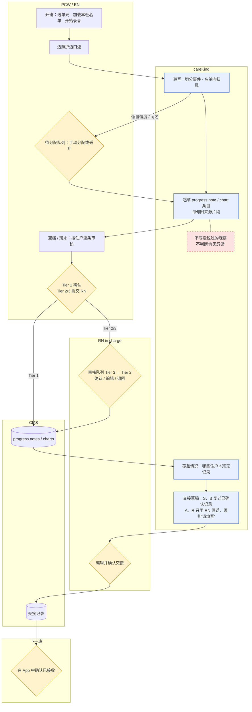
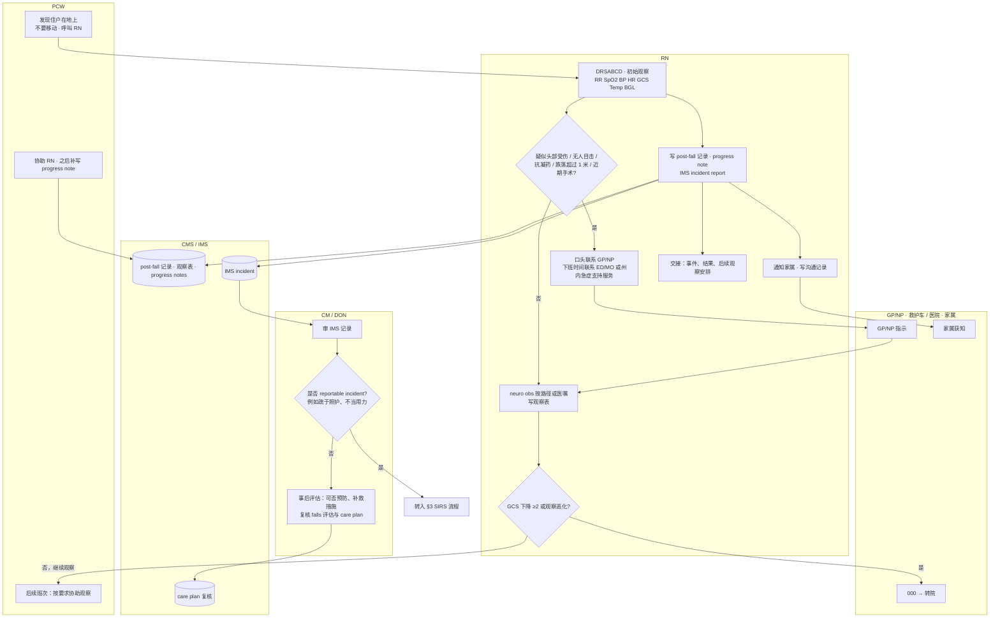
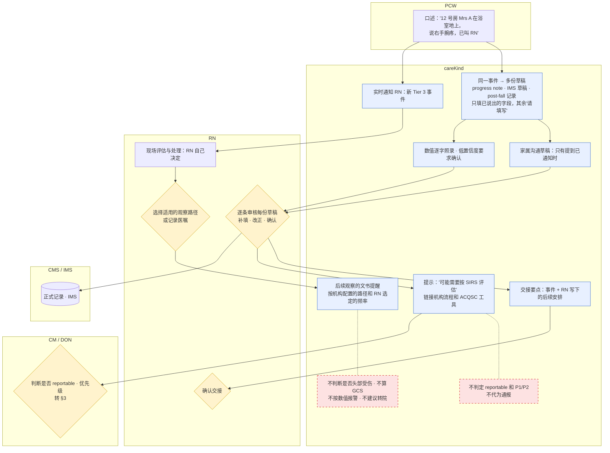
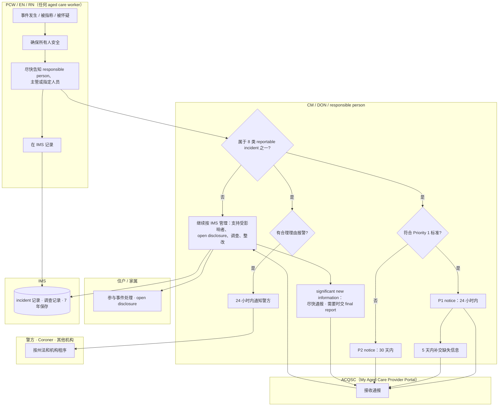
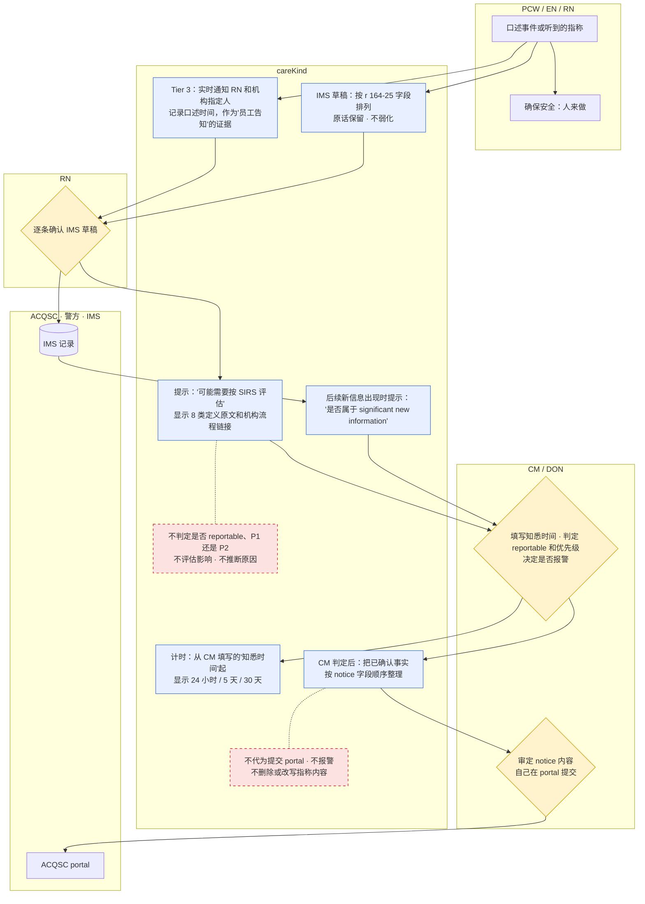
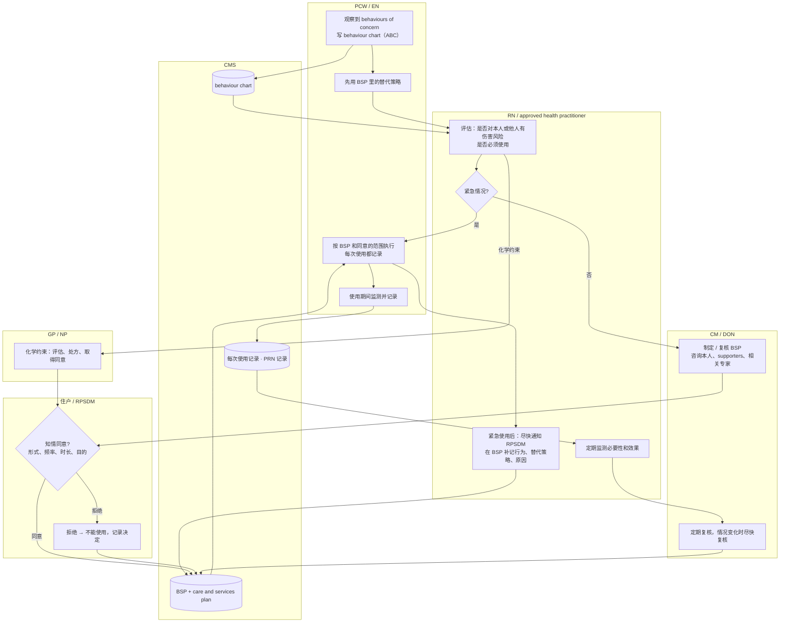
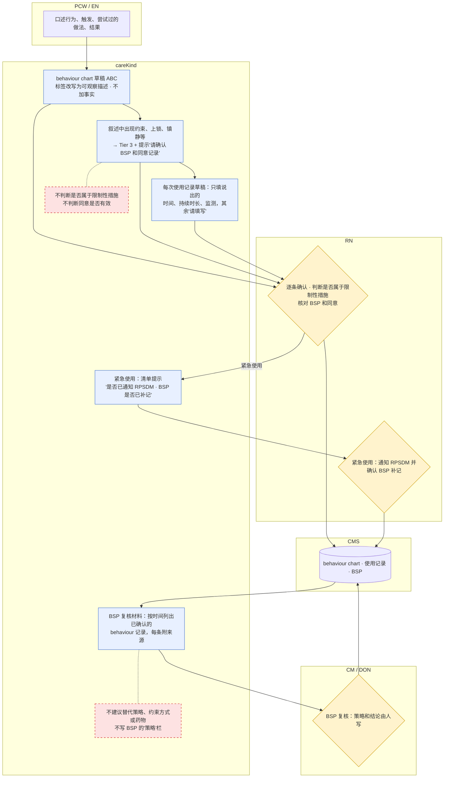

Owner: Lightman · Status: Research draft · Last reviewed: 18/10/2026

# 澳洲住宿养老机构护理文书流程图：现状（as-is）与 careKind 目标流程（to-be）

> 运营参考，不是法律意见，也不是临床指引。时限和条款均已在本地 PDF 原文中核实（路径见每节"依据"）；本地没有原文的写 `⚠️ 需核实`。
> **证据等级**：`10-feedback/` 目前只有 `.gitkeep`（`10-feedback/nurses/`、`providers/`、`team/`、`other/` 都是空的），**护士访谈 n = 0**。所以下文的"痛点"只有三类来源：① 法规或模板原文推出的结构性事实；② 公开报道（经 `01-strategy/competitive-research/` 转引）；③ 推测，统一标注 **"推测，需试点验证"**。
> 本文件不改变 PRD；与 PRD 的差异放在 [§11](#11-与-prd-不一致或-prd-缺失的地方建议不改-prd)。

## 目录
0. [读图说明、角色与来源](#0-读图说明角色与来源)
1. [一个班次的日常记录与交接（ISBAR）](#1-一个班次的日常记录与交接isbar)
2. [跌倒](#2-跌倒)
3. [SIRS reportable incident](#3-sirs-reportable-incident)
4. [限制性措施的使用、同意与复核（含 BSP）](#4-限制性措施的使用同意与复核含-bsp)
5. [病情恶化与升级（转院）](care-documentation-process-flows-5-8.md#5-病情恶化与升级转院)（第 2 部分）
6. [入住 → care plan 定稿 → 定期复核](care-documentation-process-flows-5-8.md#6-入住--care-plan-定稿--定期复核)（第 2 部分）
7. [死亡：expected vs reportable（coroner）](care-documentation-process-flows-5-8.md#7-死亡expected-vs-reportablecoroner)（第 2 部分）
8. [用药事件与 PRN 记录](care-documentation-process-flows-5-8.md#8-用药事件与-prn-记录)（第 2 部分）
9. [跨流程的共性痛点](#9-跨流程的共性痛点)
10. [人工确认门（human-in-the-loop gates）汇总](#10-人工确认门human-in-the-loop-gates汇总)
11. [与 PRD 不一致或 PRD 缺失的地方（建议，不改 PRD）](#11-与-prd-不一致或-prd-缺失的地方建议不改-prd)
12. [待核实清单](#12-待核实清单)

---

## 0. 读图说明、角色与来源

### 0.1 图例
- **as-is 图**：`flowchart` + `subgraph` 泳道，每条泳道一个角色；节点里写"动作 → 产生的文书"。
- **to-be 图**：同样的泳道，加一条 `careKind` 泳道。三种标记（Mermaid `classDef`）：
  - 蓝色 `ai`：**AI 起草点**（只整理员工原话，按 PRD §6.6 起草规则）。
  - 黄色 `gate`：**人工确认门**（对应 PRD §6.3 状态机里的确认动作）。
  - 红色虚线 `never`：**AI 绝不做的事**（TGA 红灯或 provider 法定判断）。
- 时限一栏只写原文里有的数字；"按机构政策"表示原文把它交给机构。

### 0.2 角色
| 角色 | 简称 | 在文书流程中的位置 |
|---|---|---|
| 住户 / 家属（supporters、代理决策人、RPSDM） | Resident / Family | 被告知、参与 care plan、给限制性措施同意、可以申请访问记录 |
| Personal Care Worker / AIN | PCW | 记录大部分日常照护（progress notes、food & fluid、behaviour chart），发现事件后上报 |
| Enrolled Nurse | EN | 在 RN 监督下工作，记录、给药（按机构政策） |
| Registered Nurse（shift RN / RN in charge） | RN | 临床评估、审核 PCW 记录、事件处理、升级、交接、SIRS 初判 |
| Care Manager / Director of Nursing | CM / DON | IMS 审核、SIRS 判定与通报、调查、care plan 和 BSP 复核签字 |
| General Practitioner / Nurse Practitioner | GP / NP | 医疗评估、医嘱、化学约束的处方与同意、死亡证明 |
| 药剂师 | Pharmacist | 用药供应、用药复核与对账（medication reconciliation） |
| 临床管理系统 | CMS | 机构的正式记录系统（progress notes、IMS、charts、care plan、eNRMC 可能是独立系统） |
| Aged Care Quality and Safety Commission | ACQSC | 接收 SIRS 通报（My Aged Care Provider Portal） |
| Coroner（州法） | Coroner | 接收可报告死亡 |
| 医院 / 救护车（000） | Hospital / Ambulance | 急诊转运、出院小结 |
| careKind | careKind | 口述 → 起草 → 分级审核 → 写入 CMS（不做临床或法定判断） |

### 0.3 主要依据（本地文件）
| 简称 | 本地文件 |
|---|---|
| Rules | `03-legal-compliance/references/law-library/aged-care-rules-2025-vol1-compilation-2026-08-01.pdf`（Compilation No. 10，01/08/2026） |
| Act | `03-legal-compliance/references/law-library/aged-care-act-2024-compilation-2026-07-01.pdf` |
| SQS | `03-legal-compliance/references/law-library/strengthened-aged-care-quality-standards-nov-2025.pdf` |
| SIRS-QG | `03-legal-compliance/references/law-library/acqsc-reportable-incidents-sirs-quick-guide-changes-1-nov-2025.pdf` |
| SIRS-WF | `03-legal-compliance/references/paperwork-templates/acqsc-sirs-reportable-incidents-workflow-residential.pdf` |
| SIRS-G22 | `03-legal-compliance/references/paperwork-templates/acqsc-sirs-guidelines-residential-providers-v1-8-2022.pdf`（**旧法时期版本**，只作参考） |
| QLD-PF | `03-legal-compliance/references/paperwork-templates/qld-health-rcf-post-fall-clinical-pathway.pdf`（v5.00，09/2025） |
| QLD-DET | `03-legal-compliance/references/paperwork-templates/qld-health-racf-pathway-recognition-deteriorating-resident.pdf` |
| RPSDM | `03-legal-compliance/references/paperwork-templates/health-consent-for-restrictive-practices-info-for-providers-2026.pdf` |
| PRN-S | `03-legal-compliance/references/paperwork-templates/acqsc-psychotropic-prn-stickers-guide.pdf` |
| MedGP | `03-legal-compliance/references/paperwork-templates/health-guiding-principles-medication-management-racf-2022.pdf` |
| ISBAR | `03-legal-compliance/references/paperwork-templates/sa-health-isbar-clinical-handover-fact-sheet.pdf` |
| TAX | `03-legal-compliance/references/paperwork-taxonomy.md` |
| TGA | `03-legal-compliance/tga-samd-boundary.md`；`03-legal-compliance/references/law-library/tga-digital-scribes-summary.md` |
| CR | `01-strategy/competitive-research/README.md`、`ai-features-comparison.md`（公开报道转引，S92、S93） |

> QLD 和 SA 的路径是**州卫生部门的示例模板**，不是全国统一要求；各机构按本地政策执行（VIC 有 `vic-health-standardised-care-process-falls.pdf`）。图中的观察频率**只用来说明文书负担**，不是 careKind 要推荐的临床做法。

---

## 1. 一个班次的日常记录与交接（ISBAR）

### 1.1 as-is

### 1.2 时限、文书与依据
| 步骤 | 时限 | 产生的文书 | 依据 |
|---|---|---|---|
| 日常记录 | 每班或按需；**没有全国统一频率**（按机构政策） | progress notes；food & fluid / behaviour chart（按 care plan） | TAX §1.1、§4.2、§4.8；SQS 2.7.2 |
| 交接 | 每次换班；转院时 | 交接单（ISBAR：至少 3 个住户识别信息；A、R 是交班人自己的评估和建议） | SQS 3.3.2(d)（handover 必须用结构化沟通系统）；ISBAR fact sheet |
| 班次划分 | AM / PM / Night 的起止时间按机构排班 | — | ⚠️ 无全国规定，机构差异大 |

### 1.3 痛点
| 痛点 | 来源 |
|---|---|
| 交接的 A、R 栏是交班人的临床判断，最容易被"模板化"或漏写 | ISBAR fact sheet 原文结构；TAX §1.2 |
| 班末集中补写，细节遗忘、写错住户、时间不准 | 推测，需试点验证（主 PRD §2 结论 5、功能 PRD §1.1 同为假设，n = 0） |
| 同一观察要在 progress note、chart、交接单里重复写 | 推测，需试点验证（结构上成立：三类文书字段重叠，TAX §1） |
| PCW 英语非母语，写英文记录慢 | 推测，需试点验证 |
| 下一班"是否已接收"没有留痕 | 推测，需试点验证（SQS 3.3.2(d) 只要求结构化，不规定确认方式） |
| 行业担心 AI 记录"空洞"，Commission 退回明显由 AI 生成的文件 | 公开报道（CR，S92、S93；未独立核实） |

### 1.4 to-be

- **AI 起草点**：progress note、chart 条目（只记说出的量）、交接 S/B。
- **必须人确认**：归属不确定（G4）；Tier 1 由 PCW、Tier 2/3 由 RN（G1、G5）；交接由 RN 编辑确认；下一班确认接收。
- **AI 绝不做**：补写观察；在交接 A/R 写自己的评估或建议；把"覆盖情况"说成"被忽视的风险"（G2、G11）。

---

## 2. 跌倒

### 2.1 as-is

### 2.2 时限、文书与依据
| 步骤 | 时限（原文） | 产生的文书 | 依据 |
|---|---|---|---|
| 即时处理 | 立即：DRSABCD；未评估前不要移动 | post-fall 记录"即时处理"栏 | QLD-PF 第 1 页 |
| 初始观察 | 立即 | RR、SpO2、BP、HR、GCS、Temp、BGL；意识、头部外伤、骨折、意识混乱、是否转院、是否有 AHD | QLD-PF |
| 联系 GP/NP | 有凝血障碍、抗凝/抗血小板、跌落 >1 米、疑似头部受伤、近期手术时**口头联系**；记录"通知了谁、何时" | 通知记录 | QLD-PF |
| 疑似头部受伤或无人目击：neuro obs | **第 1 天**：½ 小时 × 2 小时 → 每小时 × 4 小时 → 每 2 小时 × 4 小时 → 每 4 小时 × 14 小时；**第 2 天**：每 4 小时 × 24 小时；或按医嘱（每段"if normal"才进入下一段） | 神经观察表 + 生命体征表 | QLD-PF |
| 无头部受伤 | 每小时 × 4 小时 → 每 2 小时 × 6 小时 → 每 4 小时 × 24 小时；或按医嘱 | 生命体征表 | QLD-PF |
| 恶化 | GCS 下降 ≥ 2 分或观察恶化 → **立即 000** 并口头联系 GP/NP/ED/MO；复核 ACP 文件 | 升级记录 | QLD-PF |
| 管理计划 | **24 小时内**：通知家属（尽快，按约定和机构政策）、记录事件和结果、登记 incident report、在交接时沟通、复核 Falls Assessment and Management Plan；注意 24 小时后才出现的迟发表现 | 家属沟通记录、IMS、交接、care plan 复核 | QLD-PF |
| IMS 最低字段 | 每次事件 | 描述（伤害与后果）、**是否 reportable**、发生和发现的时间日期地点、相关人和证人、评估、行动、沟通、记录人 | Rules r 164-25(1)（第 282 页）；保存 7 年 r 164-25(2) |
| 事后评估 | 无具体时限 | 可否预防、补救措施、是否需通知其他人或机构 | Rules r 164-45(1) |
| 通知 GP 和 supporters | "timely" | 通知记录 | SQS 5.4.4(d) |
| care plan 复核 | 发生影响住户的事件时 | care plan 复核记录 | SQS 3.1.5(e)；SQS 5.5.4(b)(c) |
| QI 数据 | 每季度 | falls and major injury 指标 | TAX §2.3、§6.1 |

### 2.3 痛点
| 痛点 | 来源 |
|---|---|
| 一次跌倒至少涉及 5–6 份文书（post-fall、观察表、progress note、IMS、家属沟通、交接，可能还有 SIRS），事实相同、重复录入 | 法规结构（QLD-PF + r 164-25 + SIRS-WF）；工作量本身**推测，需试点验证** |
| 观察要跨 **48 小时、至少 4–6 个班次**完成，靠交接传递"下一次观察几点" | QLD-PF 的时间表（事实）；漏观察的发生率推测，需试点验证 |
| 无人目击的跌倒，"发现时间"和"发生时间"容易混淆 | r 164-25(1)(c)(d) 要求分开记录；混淆程度推测，需试点验证（功能 PRD HAZ-012 同一假设） |
| "跌倒是否 reportable"不是看跌倒本身，而是看有没有疏于照护、不当用力等；PCW 很难判断，RN 也常不确定 | SIRS-WF 的 8 类；SIRS-G22 第 34–35 页举例（"a consumer falls and is not assessed immediately afterwards…"，旧法时期）；不确定程度推测，需试点验证 |

### 2.4 to-be

- **AI 起草点**：progress note、IMS 草稿（按 r 164-25 字段排列）、post-fall 记录叙述、家属沟通（只在提到时）、交接要点。
- **必须人确认**：Tier 3 由 RN 逐条确认（G5）；观察路径由 RN 选择；reportable 判定由 RN/CM（G6）。
- **AI 绝不做**：判断头部受伤、算 GCS、根据数值标红或报警（G3，QLD-DET 的红黄区属于 TGA 红灯）；建议转院；推断跌倒原因（TAX §2.1）。
- 🟡 **"后续观察的文书提醒"**要过 TGA 边界审查：只按 RN 选定或机构配置的频率提醒"该时间点还没有观察记录"，不判断是否需要观察（`03-legal-compliance/tga-samd-boundary.md` 黄灯"提示可能缺失的字段"）。

---

## 3. SIRS reportable incident

### 3.1 as-is

### 3.2 时限、文书与依据
| 步骤 | 时限 | 产生的文书 | 依据 |
|---|---|---|---|
| 8 类 reportable incident | — | unreasonable use of force；unlawful sexual contact / inappropriate sexual conduct；psychological or emotional abuse；unexpected death；stealing or financial coercion；neglect；restrictive practice（不符合规则的使用）；unexplained absence。**已发生、被指称或被怀疑**都算 | Act s 16(1)；SIRS-WF |
| 员工告知 | "as soon as possible"，告知 responsible person、主管或经理、或指定人员 | 内部上报记录 | Rules r 165A-20（第 299 页） |
| P1 定义 | 造成需要医疗或心理治疗才能解决的身心伤害或不适；有合理理由报警；性接触或不当性行为；unexpected death；unexplained absence（有合理理由报警） | — | Rules r 165A-25(2)；SIRS-QG 第 2 页 |
| "治疗"的含义 | 只有 medical practitioner、NP、RN、psychologist、social worker 才能提供的治疗才算 | — | SIRS-QG 第 3 页 |
| 认知障碍 | 不能因为住户无法表达就认为没有伤害或伤害较轻 | 影响评估（ACQSC Impact Assessment Tool） | Rules r 165A-25(3)；SIRS-QG 第 3 页 |
| **P1 notice** | **知悉后 24 小时内** | 内容：provider、事件类型、伤害及后果、即时措施、是否已报警、后续措施、通报人、时间地点、相关人员、认知水平 | Rules r 165A-25(1)(4)（第 299–300 页） |
| P1 补充信息 | **24 小时起算后 5 天内**（或 Commissioner 另定） | additional information notice | Rules r 165A-25(6) |
| **P2 notice** | **知悉后 30 天内**（SIRS-QG 写"30 calendar days"） | 字段同 P1 | Rules r 165A-30（第 301 页） |
| significant new information | "as soon as reasonably practical" | 新信息通报 | SIRS-QG 第 2 页；Rules r 165A-40（第 302 页，标题已核实，正文 ⚠️ 未逐条读） |
| final report | Commissioner 要求时 | final report | Rules r 165A-45（标题已核实，⚠️ 正文未逐条读） |
| 报警 | 有合理理由时，**知悉后 24 小时内**；之后才知道的，从知道理由起 24 小时内 | 警方报告细节记入 IMS（r 164-25(1)(m)） | Rules r 164-40(2)(3)（第 284 页） |
| 不需报告的情形 | — | — | Rules r 165A-35（⚠️ 正文未核实，不要依赖） |
| 提交渠道 | — | My Aged Care Provider Portal | SIRS-WF |

### 3.3 痛点
| 痛点 | 来源 |
|---|---|
| **24 小时从"provider 知悉"起算**。如果 PCW 当时只口头说了、记录到班末才写，组织层面"知悉"的时间点和判定开始的时间点可能错开 | Rules r 165A-20、r 165A-25(1)（事实）；实际延误多大推测，需试点验证 |
| IMS（r 164-25）和 SIRS notice（r 165A-25(4)）字段大量重叠，但要在两个系统里分别填 | 两条规则原文对比（事实）；工作量推测，需试点验证 |
| ACQSC 明确说好的通报"requires more than simply transcribing the details taken from progress notes"，影响评估要人做 | TAX §2.2 引 ACQSC neglect example（2022 年版） |
| neglect 定义在 2025-11 变了，旧培训材料和旧 decision support tool 可能没跟上 | SIRS-QG 第 3 页；`acqsc-sirs-decision-support-tool-summary.md`（页面横幅写"正在更新"） |
| 对认知障碍住户，影响可能要"over a period of time"才看得出来，需要连续的行为观察记录 | SIRS-QG 第 3 页 |

### 3.4 to-be

- **AI 起草点**：IMS 草稿、notice 字段顺序整理（只在 CM 判定之后）、新信息提示。
- **必须人确认**：RN 确认事实；CM 填写知悉时间、判定 reportable 和优先级、决定报警、自己提交（G6）。
- **AI 绝不做**：判定、提交、评估影响、推断原因、把"指称"改写成弱化的说法（HAZ-006）。
- ⚠️ "知悉时间"由谁、按什么标准填，需要律师确认（见 §11 第 2 条）。

---

## 4. 限制性措施的使用、同意与复核（含 BSP）

### 4.1 as-is

### 4.2 时限、文书与依据
| 步骤 | 时限 | 产生的文书 | 依据 |
|---|---|---|---|
| 定义 | — | 任何限制个人权利或行动自由的做法；5 类：chemical、environmental、mechanical、physical、seclusion | Act s 17；TAX §4.4（RP-DoH） |
| 使用条件 | 每次使用前 | 只作最后手段；先用替代策略并**记在 BSP**；必要、相称、最少限制、最短时间；本人或 RPSDM 的知情同意（含时长、频率、预期结果） | Rules r 162-15(1)（第 269 页） |
| 非化学约束 | 使用前 | approved health practitioner（熟悉本人）的评估记入 BSP | Rules r 162-20 |
| 化学约束 | 使用前 | GP/NP 评估、决定、处方、取得同意；BSP 记录评估、决定、行为、原因、处方（药名、剂量、何时可用） | Rules r 162-25 |
| 使用期间 | 持续 | 监测痛苦或伤害、副作用、情绪行为变化、生活质量、功能、ADL；定期监测、复核并**记录**必要性；化学约束要把效果反馈给处方者 | Rules r 162-30 |
| 紧急使用 | **"as soon as practicable"** | 通知 RPSDM（本人无能力时）；BSP 补记行为、替代策略、原因、照护安排、通知记录 | Rules r 162-35；r 162-15(2)(3)（只在紧急情况存续期间豁免） |
| BSP 复核 | 定期；**情况变化后尽快** | BSP 修订 | Rules r 162-70 |
| BSP 咨询 | 制定或修订时 | 咨询记录 | Rules r 162-75 |
| 同意记录 | 同意或拒绝时 | 记入 BSP 和 care and services plan；不同或额外的使用要单独同意；RPSDM 可随时撤回 | RPSDM fact sheet |
| SIRS | 不当使用时 | 见 §3（Act s 16(1)(g)） | Act s 16(1)(g) |
| 标准 | — | 最后手段、最少限制、知情同意、监测复核 | SQS 3.2.7 |

### 4.3 痛点
| 痛点 | 来源 |
|---|---|
| 一次使用要在 behaviour chart、使用记录、BSP、care plan、可能还有 PRN 记录里分别体现 | Rules r 162-15 至 r 162-35 + RPSDM（事实）；工作量推测，需试点验证 |
| 紧急使用后"尽快通知 RPSDM 并补 BSP"，容易在交接中丢失 | r 162-35（事实）；丢失率推测，需试点验证 |
| 一线员工不一定意识到某个做法属于限制性措施（例如锁门、床栏、把助行器拿开） | 推测，需试点验证 |
| behaviour chart 写成标签（"aggressive"）而不是可观察的行为 | TAX §4.2 引 DSA "describe the behaviour, not the label" |

### 4.4 to-be

- **AI 起草点**：ABC 条目、每次使用记录叙述、BSP 复核材料汇编（只复述已确认记录）。
- **必须人确认**：是否属于限制性措施、同意是否覆盖本次使用、紧急使用后的通知、BSP 内容。
- **AI 绝不做**：判断合规或违规（只提示）、建议策略或药物（TAX §4.3）、自动改 BSP 或 care plan。

---

## 5–8. 病情恶化、入住与 care plan、死亡、用药与 PRN

> 为满足单文件 ≤ 1000 行，§5–§8 放在 [`care-documentation-process-flows-5-8.md`](care-documentation-process-flows-5-8.md)：
> - [§5 病情恶化与升级（转院）](care-documentation-process-flows-5-8.md#5-病情恶化与升级转院)
> - [§6 入住 → care plan 定稿 → 定期复核](care-documentation-process-flows-5-8.md#6-入住--care-plan-定稿--定期复核)
> - [§7 死亡：expected vs reportable（coroner）](care-documentation-process-flows-5-8.md#7-死亡expected-vs-reportablecoroner)
> - [§8 用药事件与 PRN 记录](care-documentation-process-flows-5-8.md#8-用药事件与-prn-记录)

---

## 9. 跨流程的共性痛点
| # | 共性痛点 | 证据性质 | 对 careKind 的含义 |
|---|---|---|---|
| 1 | **同一事实多处录入**：跌倒、用药事件、限制性措施、死亡都要在 progress note、chart、IMS、SIRS、家属沟通、交接里重复写 | 法规字段重叠是事实（r 164-25 vs r 165A-25(4)；r 162-15 至 r 162-35）；耗时推测 | 主 PRD 突破 2 方向正确；**需要按事件类别补齐 §14 映射** |
| 2 | **跨班次的"开放事件"**：post-fall 观察 48 小时、PRN 效果复查、紧急约束后的 RPSDM 通知、P1 的 5 天补充、事后 care plan 复核，都跨越多个班次 | 时限是事实（QLD-PF、Rules）；交接丢失推测 | PRD 的数据模型以班次为单位，**缺少"跨班次事件 / 待办"的概念** |
| 3 | **判断和记录混在一起**：reportable、P1/P2、是否属于限制性措施、expected death、是否升级，都是人的判断，但都写在同一份记录里 | Rules 原文把判定责任放在 provider | careKind 必须把"事实草稿"和"判断字段"分开，判断字段永远由人填 |
| 4 | **"知悉时间"有法律后果**：SIRS 24 小时、报警 24 小时都从知悉起算 | Rules r 165A-25(1)、r 164-40(2) | 录音时间戳可能被视为知悉证据，产品设计要先问律师 |
| 5 | **AI 记录可信度**：行业已经对 AI 生成的空洞记录有警惕 | 公开报道（CR，S92、S93） | 原话追溯和"请填写"比"写得流畅"更重要 |
| 6 | 一线是否愿意口述、口述是否比打字快 | **n = 0**（`10-feedback/` 为空） | 所有效率假设都要在试点前测基线 |

---

## 10. 人工确认门（human-in-the-loop gates）汇总

> 对齐主 PRD §6.3 状态机（Transcribed → Attributed / Unassigned → Drafted → PendingPCW / PendingRN → Confirmed → Exported / Amended）和 §9 护栏 G1–G11。"建议"一栏是本研究提出的，**PRD 里还没有**。

| # | 门 | 谁 | 涉及流程 | PRD §6.3 状态转换 | 护栏 | 本研究的建议 |
|---|---|---|---|---|---|---|
| H1 | 住户归属不确定 → 手动分配或丢弃 | 口述者本人；Tier 3 的丢弃需 RN | 全部 | Unassigned → Attributed / Discarded | G4 | Tier 3 内容的丢弃要 RN 确认并写原因（§11 第 4 条） |
| H2 | Tier 1 常规记录确认 | PCW（机构允许时）/ EN / RN | §1 | PendingPCW → Confirmed | G1 | — |
| H3 | Tier 2 临床观察确认 | RN（EN 按机构政策） | §1、§5、§8 | PendingRN → Confirmed | G1、G3 | 所有含药名、剂量、生命体征数值的记录至少 Tier 2 |
| H4 | **Tier 3 敏感事件逐条确认** | 只有 RN | §2、§3、§4、§5、§7、§8 | PendingRN → Confirmed / Returned | G1、G5 | Tier 3 应**实时**推送给 RN，不等班末（§11 第 1 条） |
| H5 | 退回与补充 | RN 退回，作者补充 | 全部 | Returned → PendingRN | G1 | 退回批注必填（PRD §7.2 已写） |
| H6 | **SIRS：知悉时间、是否 reportable、P1/P2、是否报警、提交** | CM / DON / responsible person | §2、§3、§4、§7、§8 | 不在状态机内（PRD 未定义） | G6 | 加一个"合规判断"子流程，判断字段只能人填，careKind 只计时和整理 |
| H7 | 限制性措施：是否属于、同意是否覆盖、紧急使用后通知 RPSDM | RN；BSP 由 CM | §4、§8 | 不在状态机内 | G2、G6 精神 | "请确认 BSP 和同意"之外，加紧急使用清单 |
| H8 | 升级与转院决定 | RN（与 GP/NP） | §5 | 不在状态机内 | G2、G3 | careKind 只在 RN 决定之后起草 ISBAR |
| H9 | 交接 A/R 和交接确认；下一班确认接收 | RN；下一班 | §1、§2 | Session Closing → Closed | G2 | 跨班次待办随交接一起交出（§11 第 3 条） |
| H10 | care plan / BSP 的策略和复核结论 | RN 起草，CM 定稿 | §4、§6 | 不在状态机内 | G2 | careKind 只汇编材料，不写策略 |
| H11 | 已确认记录的更正 | 作者或 RN；已导出的生成 CMS 更正任务 | 全部 | Confirmed → Amended → Exported | G7 | 已进入 IMS 或 SIRS 的记录被更正时，提示"是否属于 significant new information" |
| H12 | 写入 CMS / IMS | 系统，在 Confirmed 之后 | 全部 | Confirmed → Exported | G1 | 用药系统不在写入范围 |

**最关键的 5 个门**：H4（Tier 3 逐条 + 实时）、H6（SIRS 判定和提交只由人做）、H1（归属不确定时不猜，Tier 3 不能被随手丢弃）、H3（数值和药名必须人确认）、H7（限制性措施的同意和紧急使用）。

---

## 11. 与 PRD 不一致或 PRD 缺失的地方（建议，不改 PRD）

> 以下是建议，供 Lightman 和临床顾问决定是否修订 `docs/PRD.md` 或功能 PRD；改护栏需要 ADR（`rules/04-prd-rules.md` §1）。

| # | 发现 | PRD 位置 | 建议 |
|---|---|---|---|
| 1 | **Tier 3 的审核时机**：PRD §7.1 写"空档 / 班末逐位老人审核"，但 r 165A-20 要求员工"as soon as possible"告知，SIRS 和报警的 24 小时从知悉起算 | 主 PRD §7.1、§7.3；功能 PRD §4.3 ⑤ | Tier 3 草稿生成后**实时通知 RN**（和机构指定人）；明确 careKind 的通知**不替代**员工按机构程序口头上报 |
| 2 | **"知悉时间"没有定义**：§7.3 显示 SIRS 计时，但没说从哪个时间点起算；录音时间戳可能被认定为 provider 知悉的证据 | 主 PRD §7.3、§4"合规内建" | 计时起点由 CM 手动填写；careKind 保留"口述时间""RN 首次查看时间"作审计证据；⚠️ 需律师确认这对 provider 的法律含义（加入功能 PRD 法律缺口） |
| 3 | **缺少跨班次事件**：post-fall 观察 48 小时、PRN 效果复查、紧急约束后通知 RPSDM、P1 5 天补充、事后 care plan 复核 | 主 PRD §6.2 数据模型（以 ShiftSession 为单位） | 新增"Follow-up / 待办"实体，挂在 Event 上，随交接移交，班末覆盖视图显示未完成项（只做文书提醒，🟡 需 TGA 边界审查） |
| 4 | **Tier 3 内容可被删除**：功能 PRD §4.3 ④ 允许"删除（例如误录）"，§6.3 Unassigned → Discarded 由"护士"操作；PCW 可能在 RN 看到前删除一段虐待指称 | 功能 PRD §4.3 ④；主 PRD §6.3 | 分类为 Tier 3 的片段，丢弃只能由 RN 做并写原因；被丢弃的 Tier 3 片段保留在审计日志中 |
| 5 | **MVP 没有 incident 草稿，但试点中一定会发生跌倒**：MVP 只有 progress notes 和交接，incident 在 Phase 2 | 主 PRD §8；功能 PRD §4.5、§11 | MVP 明确规则：Tier 3 事件仍生成 progress note 并逐条 RN 确认，同时显示"请在机构 IMS 另行记录"；试点协议写明 IMS 仍由机构原流程完成 |
| 6 | **MVP 单级审核与 G5 的关系不清**：§13 开放问题 3 建议"MVP 只做单级"，但 G5 要求敏感事件由 RN 逐条确认 | 主 PRD §13 第 3 条 vs §9 G5 | 写明"单级"指不做 PCW → RN 的流转，但 Tier 3 仍只能由 RN 确认（G5 优先） |
| 7 | **§14 映射缺行**：没有用药事件 / PRN、死亡（expected vs unexpected）、病情恶化后的转院、入住与 care plan 复核 | 主 PRD §14 | 增加：用药事件（progress note + incident + 提示"请确认是否 reportable"）；精神类 PRN（提示化学约束、BSP、同意）；死亡（Tier 3 + SIRS 提示 + 州法 coroner 提示）；转院（ISBAR + 转院包） |
| 8 | **"临终照护"一行没有任何提示**，但 unexpected death 一律是 P1 | 主 PRD §14 | 死亡相关叙述归 Tier 3，提示"请按机构流程评估是否为 unexpected death"（只提示，不判定） |
| 9 | **PRN 效果归 Tier 2**，但精神类 PRN 用于行为管理属于 chemical restraint | 主 PRD §6.5 | 精神类 PRN 或描述"为了让她安静"等行为管理目的的给药叙述，升为 Tier 3 并走限制性措施提示（关键词触发是流程路由，不是临床判断） |
| 10 | **限制性措施只提示"BSP 和同意"**，没有紧急使用路径（r 162-35：尽快通知 RPSDM、补记 BSP） | 主 PRD §6.5、§14 | 增加紧急使用清单提示，列为跨班次待办 |
| 11 | **报警 24 小时**（r 164-40(2)）、**P1 5 天补充**（r 165A-25(6)）、**significant new information**、**final report** 在 PRD 里都没有 | 主 PRD §7.3（只写 P1 24 小时、P2 30 天） | 提示文字补齐这几个时限；Amended 或新信息出现时提示 CM |
| 12 | **没有"用药系统不是写入目标"的护栏**：TAX §4.5 说 careKind 不应替代用药系统，PRD 没有写成护栏 | 主 PRD §9 | 增加护栏："不生成给药记录、不做用药核对；用药信息以 eNRMC / 用药系统为准" |
| 13 | **care plan 复核周期**：功能 PRD §4.5 引 r 148-80，但其中"12 个月复核"只适用于 home and community 类别 | 功能 PRD §4.5（care plan 一行） | 补一句：residential 的复核频率按 SQS 3.1.5 和机构政策，不要在产品里写死"12 个月" |
| 14 | **post-fall 观察提醒和 PRN 效果提醒属于 🟡**，PRD 的 TGA boundary check 没有列 | 功能 PRD §5 | 加入 TGA 表：只按 RN 选定或机构配置的时间提醒"该时间点没有记录"，不判断是否需要观察 |
| 15 | **IMS 草稿字段**：PRD 引 r 164-25(1)，其中 (b)"是否 reportable"、(g) 评估、(k) 调查是判断字段 | 功能 PRD §4.5 incident 一行 | 这些字段在草稿中永远留空并标"由 RN / CM 填写" |
| 16 | 入住访谈要录音就属于模式 B（Phase 3），MVP 只能事后口述 | 功能 PRD §4.2 | 在 §8 分期中写明入住访谈的处理方式 |
| 17 | 小问题：主 PRD 头部写 `Draft v0.1`，变更记录已到 v0.2 | 主 PRD 头部 | 头部版本号与变更记录对齐 |

---

## 12. 待核实清单
- ⚠️ Rules r 165A-35（不需报告的情形）、r 165A-40、r 165A-45 正文未逐条读，只核实了标题和 SIRS-QG 的概述。
- ⚠️ "becoming aware"对 provider 的具体含义（哪个员工知道算 provider 知道）——需律师确认。
- ⚠️ 各州 Coroners Act、RN 确认死亡的权限、死亡证明流程——本地无资料。
- ⚠️ Rules r 149-5 服务终止（含死亡）通知的时限和字段。
- ⚠️ r 148-80(1)(b) 的 28 天例外（Act s 71(4)）是否适用于 residential。
- ⚠️ residential care plan 固定复核周期——本地法规未见，按机构政策。
- ⚠️ post-fall 观察频率各州、各机构不同；本文只引用 QLD 示例，VIC 以 `vic-health-standardised-care-process-falls.pdf` 和机构政策为准。
- ⚠️ SIRS-G22 是旧法时期版本，关于 unexpected death 和 coroner 的例子在新版指引中可能改变。
- ⚠️ eNRMC 在 residential 的普及程度和监管要求。
- ⚠️ 公开报道（Commission 退回 AI 文件，CR S92）未独立核实，对外引用前要复核原始来源。
- 🧪 所有"推测，需试点验证"的痛点，在第一批访谈（`10-feedback/nurses/`）和试点基线测量中验证；验证后的洞察写入 `06-app-development/research/synthesis.md` 并引用原始反馈路径。
