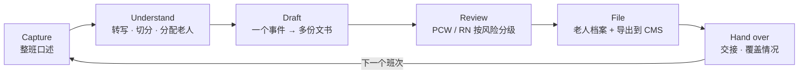
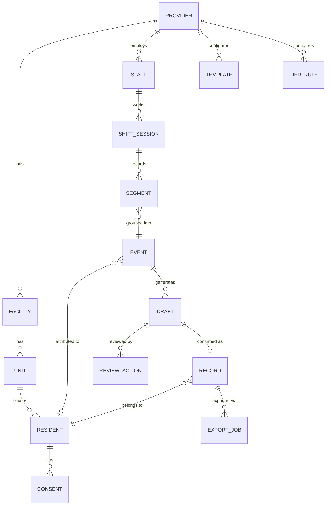
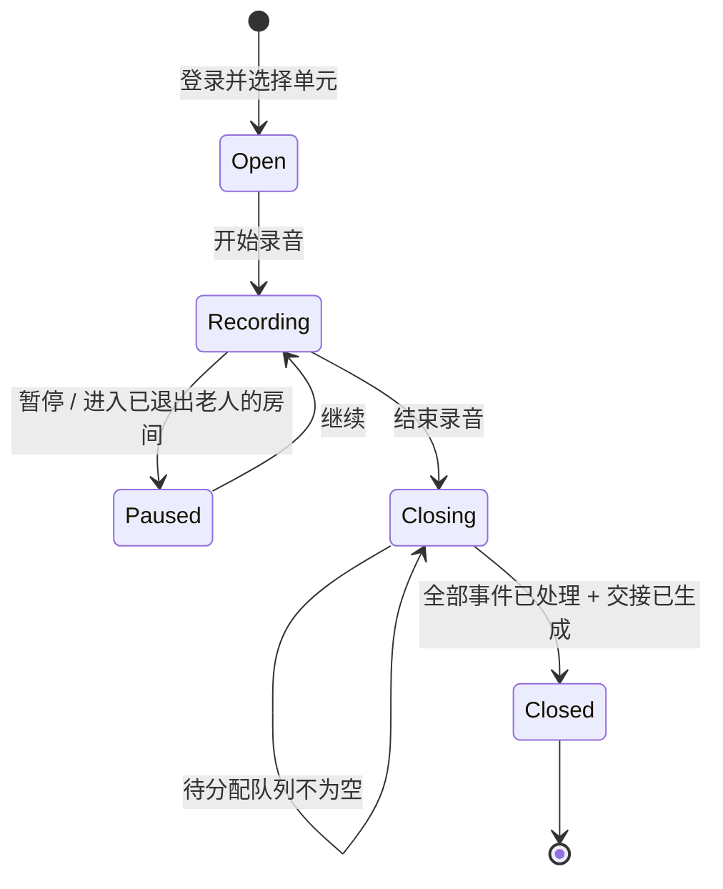
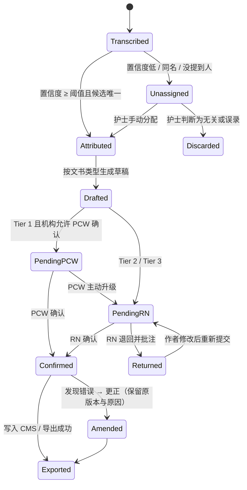
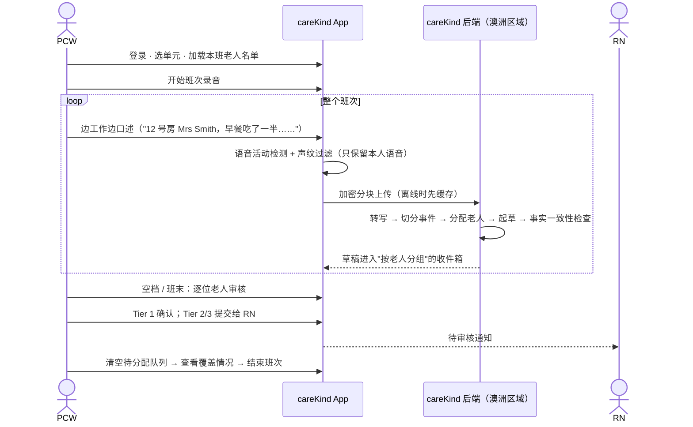
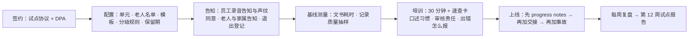
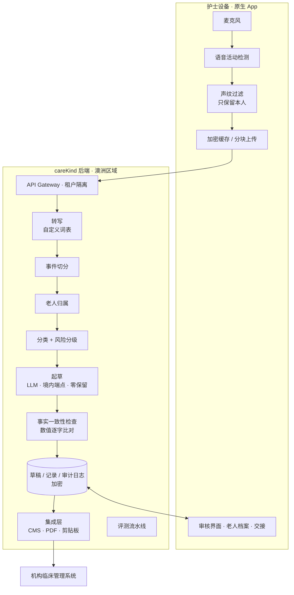

# careKind AI — 产品需求文档（主 PRD）

Owner: Lightman (Product Owner) · Tech: Lin (Tech Lead) · Status: **Draft v0.1** · Last reviewed: 04/10/2026
读者：所有做运营、产品、开发的人。这是 careKind **做什么、为什么、怎么做**的唯一参考。

> 功能级详细规格放在 [`docs/prds/`](prds/)。法律、临床安全、安全细节分别以 `03-legal-compliance/`、`06-app-development/clinical-safety/`、`04-security/` 为准，本文只引用。
> 证据等级：本 PRD 基于法规与竞品**案头调研**（`03-legal-compliance/references/`、`01-strategy/competitive-research/`），**还没有任何护士访谈数据（n = 0）**。所有"用户会……"都是待验证的假设。

---

## 目录
1. [一句话与定位](#1-一句话与定位)
2. [市场判断：从调研得出的五个结论](#2-市场判断从调研得出的五个结论)
3. [发展方向：我们要成为什么](#3-发展方向我们要成为什么)
4. [亮点与突破](#4-亮点与突破)
5. [用户与角色](#5-用户与角色)
6. [产品逻辑](#6-产品逻辑)
7. [Workflows](#7-workflows)
8. [功能清单与分期](#8-功能清单与分期)
9. [护栏：不可违反的规则](#9-护栏不可违反的规则)
10. [系统架构与数据流](#10-系统架构与数据流)
11. [指标](#11-指标)
12. [商业模式与 GTM 假设](#12-商业模式与-gtm-假设)
13. [风险与开放问题](#13-风险与开放问题)
14. [附录：文书映射表](#14-附录文书映射表)

---

## 1. 一句话与定位

**一句话**：护士照常工作、随口说出观察，careKind 把整个班次的口述自动整理成**每位老人**的规范记录，护士确认后归档。

**定位**：*The shift-to-record layer for Australian aged care.*
careKind 不是又一个"AI 记笔记工具"（scribe）。我们是一层**班次文书操作层**，连接护理现场和机构的临床管理系统（CMS）：

```
护理现场（口述、观察）  ──►  careKind（理解 · 分配 · 起草 · 审核 · 留痕）  ──►  CMS（正式记录）
                                         │
                                         └──►  老人档案时间线 · 交接 · 覆盖情况
```

| 我们是 | 我们不是 |
|---|---|
| 按班次、按老人组织的文书流水线 | 一次口述生成一条笔记的单点工具 |
| PCW 起草、RN 把关的两级审核系统 | 让护士自己对 AI 负责的免责声明 |
| 每句话都能追溯到原话的证据级记录 | "看起来专业"但空洞的 AI 文本 |
| CMS 的 AI 伙伴 | CMS 的替代品 |
| 文书工具（不是医疗器械） | 诊断、风险预测、治疗建议 |

---

## 2. 市场判断：从调研得出的五个结论

来源：`01-strategy/competitive-research/README.md`、`ai-features-comparison.md`、`03-legal-compliance/references/paperwork-taxonomy.md`。

### 结论 1："口述 → 一条笔记"正在快速变成大路货
- Heidi（墨尔本，2026-09 融资约 3.4 亿美元）已经有 aged care 页面，覆盖 care notes、事故、care plan 和母语口述，在新西兰 Metlifecare 扩到 4 家护理院。
- Notive（阿德莱德）的价值主张和我们几乎相同：residential、语音生成笔记、交接、悉尼数据。
- Aria Care 公开定价每月 $19 到 $699，压低了价格预期。
- **含义**：如果我们只做"口述生成笔记"，就是在和资金多一个数量级的对手拼同一件事。**差异化必须在工作流层面，不在单条笔记层面。**

### 结论 2：澳洲 CMS 的 AI 功能有 2026–2028 年的空窗期
- AlayaCare 2026-06 才推出 AI Note Assistant 早期版本；Telstra Health 的养老 AI 要到 2028 年；Leecare 公开表示在找 AI 合作伙伴；AutumnCare 没有动态；PCS 只有语音转文字。
- PainChek 靠 CMS 集成覆盖了约 80% 的床位，证明"做 CMS 的伙伴"这条分发路径走得通。
- **含义**：窗口期内成为 **CMS 的 AI 文书伙伴**，比单打独斗更快、更难被替代。窗口关上之后，独立工具的采购理由会变弱。

### 结论 3：真实的工作流是"PCW 写、RN 负责"，但没有竞品把它产品化
- Heidi 由临床人员自己审核，Notive 由护工自审，Aria 只有免责声明。
- Residential 里大量记录由 PCW 完成，临床责任在 RN。
- **含义**：**两级审核 + 按风险分级**是公开资料中没有被占领的空白，也正好回应 Quality Standard 2 和 5 的临床治理要求。

### 结论 4：行业担心的是"AI 记录空洞、不可信"，不只是"太费时间"
- 有行业顾问报告称，Commission 会退回明显由 AI 生成的文档；护理界也担心 AI 笔记"空洞、缺乏护士观察"。
- TGA（2026-01-30 更新）的边界是：只整理不解释就不是医疗器械，生成临床人员没说过的诊断或治疗内容就是。
- **含义**：**"保留护士原话、可追溯、不编造"**既是监管要求，也可以是卖点。我们卖的是**证据级记录**，而不是"写得漂亮"。

### 结论 5：同一个事实要在很多张表里重复写
- 一次跌倒可能要写：progress note、incident report、跌倒后记录、家属沟通记录、交接，可能还有 SIRS 通报（Priority 1 要在 24 小时内）。
- **含义**：真正的时间浪费在**重复录入**和**班末回忆**，而不只是"打字慢"。

---

## 3. 发展方向：我们要成为什么

### 3.1 三阶段演进
| 阶段 | 产品形态 | 核心价值 | 护城河 |
|---|---|---|---|
| **① Shift Autopilot**（MVP → 试点，2026 Q4–2027 Q2） | 整班口述 → 按老人自动分配 → 两级审核 → 导出 | 下班前写完全部记录 | 班次级工作流、分配准确率、临床安全案例 |
| **② Resident Living Record**（2027 H2） | 每位老人一份可追溯的时间线；交接、家属沟通、事故流程 | 照护连续性 + 审计证据 | 模板库、CMS 集成、证据级留痕 |
| **③ CMS 的 AI 文书层**（2028+） | 嵌入多家 CMS 的 AI 文书能力（API / 合作伙伴） | 一次说出，处处归档 | 渠道合作、多 CMS 适配、合规资质（ISO 27001 等） |

### 3.2 战略选择（以及我们放弃什么）
| 选择 | 理由 | 放弃 |
|---|---|---|
| 只做 aged care residential，先做 VIC | 法规、模板、角色都是垂直专属；VIC 便于现场支持 | 不做 GP、医院、NDIS（暂时） |
| 做 CMS 的伙伴，不做 CMS | 空窗期 + PainChek 先例 | 不自建完整的临床管理系统 |
| 做文书，不做临床判断 | TGA 边界；种子期承受不了 SaMD 成本 | 不做风险评分、预测、告警（至少到 ③ 之前不做） |
| 以分配准确率和证据质量竞争，不以价格竞争 | 低价竞品已经在压价 | 不做每月 $19 的个人版 |
| 不用客户数据训练通用模型 | 信任是采购门槛 | 放弃"数据飞轮"叙事 |

---

## 4. 亮点与突破

### 🌟 突破 1：从"一条一条记"到"整班自动归档"（Shift Capture）
**现状**：现有工具都是"打开 App → 选老人 → 说一段 → 生成一条"，护士每条记录都要切换上下文。
**careKind**：班次开始时开一次录音，之后边做边说。系统自动切分事件、**分配到对应老人**，到空档或班末时，按老人分组等护士确认。
**为什么是突破**：护士不再需要"去记录"，记录变成照护过程的副产品。
详细规格：[`prds/2026-10-04-shift-capture-and-resident-records.md`](prds/2026-10-04-shift-capture-and-resident-records.md)

### 🌟 突破 2：说一次，处处归档（Say it once, file it everywhere）
一段口述 = 一个**事件**，一个事件可以生成**多份文书**：
> "Mrs Smith 下午 3 点在浴室滑倒，右手腕擦伤，意识清醒，已通知 RN 和她女儿。"
> → progress note · incident report 草稿 · 跌倒后记录 · 家属沟通记录 · 交接要点 · ⏱ "可能需要按 SIRS 评估"的提示

每份文书里的事实都来自同一个事件，所以内容一致，不需要重复录入。映射规则见 [§14](#14-附录文书映射表)。

### 🌟 突破 3：PCW 起草 → RN 把关的两级审核，按风险分级
- **Tier 1 常规**（如饮食、活动、情绪）：PCW 可以确认（如果机构政策允许）。
- **Tier 2 临床观察**（如疼痛、皮肤、生命体征叙述）：PCW 提交，RN 审核。
- **Tier 3 敏感事件**（跌倒、伤害、行为、限制性措施、疑似虐待、病情变化、临终）：RN 必须**逐条**审核，并进入事故或升级流程。

机构可以配置分级。这是公开竞品里没有看到的设计，也直接对应 Quality Standard 5 的临床治理要求。

### 🌟 突破 4：证据级记录（Evidence-grade documentation）
- 每一句都可以追溯到**原话和音频片段**；AI 改写的部分高亮显示。
- 数值（体温、血糖、摄入量、药名、剂量）**逐字照录**，识别不确定时要求人工确认。
- 完整的审计链：谁说的 → AI 起草了什么 → 谁改了什么 → 谁在什么时候确认。
- 卖点：**"经得起 ACQSC 审计的 AI 记录"**，回应行业对 AI 记录空洞的担忧。

### 🌟 突破 5：班次覆盖视图（Care coverage）
班末显示：本班哪些老人还没有任何记录。这是**文书流程提示**（不是临床判断，符合 TGA 边界），但能帮护理经理发现被忽略的老人，从"写记录"延伸到"照护覆盖"。

### ✨ 其他亮点
| 亮点 | 说明 |
|---|---|
| 多语言口述 | PCW 用母语说（优先 Hindi、Nepali、Mandarin、Cantonese、Indonesian 等，需按访谈确认），输出规范英文，原文和译文对照 |
| Person-centred 语言 | 把标签化措辞改写成可观察的描述（"describe the behaviour, not the label"），但不增加事实 |
| 老人档案时间线 | 每位老人一份按时间排列、可追溯来源的记录汇总，支持交接、家属沟通、访问请求和导出 |
| 隐私优先的录音 | 设备端声纹过滤，只保留护士本人的语音；音频短期保留；数据全部在澳洲境内 |
| 合规内建 | SIRS 时限提示、限制性措施提醒、记录字段对齐 Aged Care Rules |

---

## 5. 用户与角色

| 角色 | 在产品里做什么 | 最在乎 |
|---|---|---|
| **PCW**（护理员） | 整班口述、确认 Tier 1、提交 Tier 2/3 | 简单、快、可以用母语、不怕写错 |
| **EN** | 口述、在授权范围内审核 | 同上 + 专业规范 |
| **RN** | 口述、审核 PCW 提交的记录、处理敏感事件、生成交接 | 能信任 AI 草稿；审核快；不背锅 |
| **护理经理 / DON** | 单元总览、覆盖情况、记录质量抽查、模板管理 | 审计、质量、员工留任 |
| **Provider 管理员 / IT / 隐私** | 用户、名单、分级规则、保留期、同意状态、集成 | 安全、数据驻留、合同 |
| **老人和家属**（不登录 MVP） | 被告知、可以退出、可以申请访问记录 | 尊严、隐私、照护质量 |

---

## 6. 产品逻辑

### 6.1 核心闭环


### 6.2 数据模型（核心实体）


| 实体 | 关键字段 | 说明 |
|---|---|---|
| `Resident` | id、姓名、偏好称呼、房间、照片、语言、同意状态、所在单元 | careKind 不是主数据源，从 CMS 同步或手动维护 |
| `Staff` | id、角色（PCW/EN/RN/Manager/Admin）、语言、声纹（可选，需明示同意） | 声纹属于生物特征敏感信息 |
| `ShiftSession` | 员工、单元、开始/结束时间、模式（A 口述 / B 环境）、状态 | 一个员工的一个班次 |
| `Segment` | 音频块、时间戳、转写、置信度、说话人 | 语音活动检测切出来的片段 |
| `Event` | 片段列表、老人归属 + 置信度、记录时间、事件时间、类别、风险分级 | **核心单位：关于一位老人的一次观察** |
| `Draft` | 事件、文书类型、内容、来源映射（每句 → 片段）、状态 | 一个事件可以生成多个草稿 |
| `ReviewAction` | 草稿、操作人、操作（确认/编辑/退回/改归属/拆分/合并/删除）、差异、时间 | 完整审计链 |
| `Record` | 老人、文书类型、最终内容、作者、审核人、确认时间、来源 | 写入档案时间线 |
| `ExportJob` | 记录、目标（CMS / PDF / 剪贴板）、状态、回执 | 集成层 |
| `TierRule` | 类别 → 分级 → 谁可以确认 | 机构可以配置 |
| `Consent` | 老人、范围（AI 文书 / 录音）、状态、来源（本人/代表）、日期 | 退出时自动影响录音行为 |

### 6.3 状态机

**班次会话**


**事件 → 草稿 → 记录**


> 已确认的记录**不能删除或覆盖**，只能通过 Amended 更正，原版本和更正原因永久保留在审计日志中。这是对 Quality Standard 2.7.2（准确完整）和审计追溯的要求。

### 6.4 老人归属逻辑（最关键的算法）
```
输入：事件的转写文本 + 本班老人名单 + 前后文事件
1. 抽取提及：全名 / 姓氏 / 偏好称呼 / 房间号 / 床号 / 指代（"她"、"隔壁那位"）
2. 在【本班名单内】匹配候选（永远不匹配名单外的人）
3. 打分：明确的名字 + 房间号 > 只有名字 > 只有房间号 > 上下文指代
4. 规则：
   - 唯一候选且分数 ≥ 阈值              → 自动分配（审核时显示照片和房间号确认）
   - 同名或近似名（例如两位 Mrs Smith） → 强制人工
   - 只有指代、没有明确提及             → 继承前一事件的归属，但标记"请确认"
   - 一段话提到多位老人                 → 拆分成多个事件
   - 找不到候选                         → 待分配队列
5. 护士每一次改归属都记录下来，用于本机构的评测（不用于训练通用模型）
```
发布门槛：**自动分配准确率 ≥ 99%**；错配进入正式记录 = P1 临床安全事件。

### 6.5 风险分级规则（默认值，机构可配置）
| 分级 | 类别示例 | 谁可以确认 | 批量确认 | 后续流程 |
|---|---|---|---|---|
| **Tier 1 常规** | ADL、饮食、活动、情绪、社交、睡眠 | PCW（如机构允许）/ EN / RN | ✅（仍会逐条展开显示） | — |
| **Tier 2 临床观察** | 疼痛、皮肤、排泄变化、食欲变化、生命体征叙述、PRN 效果 | RN（EN 视机构政策） | ❌ | — |
| **Tier 3 敏感事件** | 跌倒、伤害、行为事件、限制性措施、疑似虐待或忽视、病情变化、失踪、临终 | **只有 RN，逐条确认** | ❌ | 生成 incident 草稿；显示 SIRS 提示和计时；提醒检查 BSP 和同意记录 |

> 分级判断用于**审核流程路由**，不是临床判断，对外不能描述成"检测风险"。

### 6.6 起草规则（Draft rules）
1. **只用原话里的事实**：不添加、不推断、不补全。
2. **数值逐字照录**；识别置信度低就要求确认。
3. **客观、person-centred**：标签改写成可观察的描述（"她很难搞" → "她拒绝了两次洗澡，说水太凉"），但**不能增加没观察到的内容**。
4. **ISBAR 的 A 和 R、care plan 的"策略"栏**：只用员工原话，没说就显示"请填写"。
5. **敏感事件不弱化**：保留护士原话中的关键描述。
6. **术语用新法用语**：older person、registered provider、aged care worker。
7. **每句附来源映射**（句子 → 片段 ID）。

---

## 7. Workflows

### 7.1 PCW 的一个班次（主流程）


### 7.2 RN 审核流程
1. RN 打开**审核队列**，按 Tier 3 → Tier 2 → 其他排序，并显示等待时长。
2. 每条草稿并排显示：草稿 ↔ 原话（可以回放音频）↔ AI 改写的高亮。
3. 操作：确认 / 编辑后确认 / 退回（必须写批注）/ 改归属 / 拆分。
4. 处理 Tier 3 时，自动打开**事故流程**（见 7.3）。
5. RN 自己的口述也走同样的流程，Tier 2/3 可以自审（按机构政策）。
6. 班末 RN 生成**交接**（见 7.4）。

### 7.3 敏感事件流程（以跌倒为例）
```mermaid
flowchart TD
    A[PCW 口述：Mrs Smith 浴室滑倒] --> B[系统：分配给 Mrs Smith<br/>分类为 Tier 3 · 跌倒]
    B --> C1[progress note 草稿]
    B --> C2[incident report 草稿]
    B --> C3[跌倒后记录草稿<br/>只填已说出的字段，其余显示"请填写"]
    B --> C4[家属沟通记录草稿<br/>只有提到已通知时才生成]
    B --> C5[交接要点]
    C2 --> D{RN 逐条审核}
    D -->|退回| A2[PCW 补充信息]
    A2 --> D
    D -->|确认| E[⏱ 显示提示：可能需要按 SIRS 评估<br/>P1 24 小时 · P2 30 天<br/>链接 ACQSC 决策工具]
    E --> F[🧑 RN / 管理者自己判断是否属于需上报事件<br/>careKind 不判定、不代为上报]
    D -->|确认| G[写入档案 · 导出到 CMS / 事故管理系统]
```

### 7.4 交接流程（班末）
1. RN 点击"生成交接"→ 选择范围（整个单元 / 指定老人）。
2. 系统从**本班已确认的记录**生成 ISBAR：
   - I：老人识别信息（至少 3 项）
   - S、B：复述已确认记录
   - A、R：**只用 RN 原话**；没有就显示"请填写"
3. 优先显示：Tier 3 事件 → Tier 2 变化 → 未记录的老人。
4. RN 编辑并确认 → 导出或共享给下一班 → 下一班在 App 中确认已接收（留痕）。

### 7.5 护理经理流程（每天 / 每周）
- **每天**：单元总览：各班完成率、待审核积压、Tier 3 事件清单、未记录老人。
- **每周**：抽样质量检查（随机抽 N 条记录，查看原话和草稿的差异）、退回原因统计、分配错误统计。
- **按需**：打开任意老人档案 → 时间线 → 按范围导出（审计、家属请求、转院）。

### 7.6 家属沟通流程（Phase 2）
护士口述中提到"已通知女儿" → 生成家属沟通记录草稿 → 确认后写入档案。
（MVP 不做自动给家属发消息，只做**记录**沟通。）

### 7.7 机构上线流程（Implementation）

详见 `07-marketing-ops/customer-success/pilot-playbook.md`。

### 7.8 异常流程
| 情况 | 系统行为 |
|---|---|
| 待分配队列不为空 | 不能结束班次；提示逐条分配或丢弃 |
| 确认后发现分配错了 | 走 **Amended**：移到正确老人名下，原记录标注更正原因；如果已导出到 CMS，生成更正任务；评估是否构成隐私事件（走 `incident-triage`） |
| 老人选择退出 AI 文书 | 名单上标注；在该老人相关的事件中不起草，提示护士手动记录；模式 B 下进入其房间时自动暂停 |
| 网络中断 | 设备端加密缓存，恢复后续传；草稿不丢失；状态栏显示"待上传" |
| 设备丢失 | 远程注销 + 擦除本地缓存；走事故流程 |
| AI 服务不可用 | 显示状态；护士退回手动记录；恢复后补处理已上传的音频 |
| 护士报告"AI 写错了" | 一键报告 → 进入 AI 事故流程 → 加入评测集 |
| 识别到疑似虐待或忽视 | 作为 Tier 3 交给 RN；**系统不判定、不自动上报**；显示机构的上报流程链接 |

---

## 8. 功能清单与分期

| 模块 | MVP（试点） | Phase 2 | Phase 3 |
|---|---|---|---|
| **Capture** | 模式 A 整班口述 + 声纹过滤；按住说话（降级选项）；离线缓存 | 快捷标记硬件（耳机键 / 挂绳麦克风）；自动暂停区域 | 模式 B 环境对话录音（有法律门槛） |
| **Understand** | 转写（自定义词表）；事件切分；老人归属；待分配队列 | 多语言口述（3–5 种语言） | 更多语言 |
| **Draft** | Progress notes；交接要点 | Incident 草稿 + SIRS 提示；跌倒后记录；behaviour chart（ABC）；food & fluid；家属沟通 | Care plan 变化汇总（只标出变化）；病例会议纪要；转介信 |
| **Review** | 按老人分组的收件箱；原话对照；高亮；改归属、拆分、合并 | 两级审核（PCW → RN）+ 分级规则；退回批注 | 机构自定义审批链 |
| **File** | 老人档案时间线；PDF / 剪贴板导出 | 首个 CMS 集成 | 多家 CMS 合作 / API |
| **Hand over** | 交接摘要（ISBAR）；覆盖情况 | 下一班确认接收 | — |
| **Manage** | 名单、模板、保留期、同意状态、审计日志 | 护理经理单元总览；质量抽样 | 多机构报表 |
| **Trust** | 事实一致性检查；审计链；境内数据 | 评测看板 | ISO 27001 |

**MVP 退出标准（进入 Phase 2）**：试点达到 [§11](#11-指标) 的门槛，0 起错配进入正式记录，并获得 1 家付费转化意向。

---

## 9. 护栏：不可违反的规则

| # | 规则 | 依据 |
|---|---|---|
| G1 | 没有人工确认，AI 草稿不能进入正式记录 | AHPRA AI 指引；产品原则 |
| G2 | 不生成员工没有说过的临床事实、诊断、风险评分或治疗建议 | TGA digital scribes 边界 |
| G3 | 不对数值做补全；不根据数值报警 | TGA；危害日志 HAZ-004 |
| G4 | 老人归属不确定时不猜；只在本班名单内匹配 | 危害日志 HAZ-009（Proposed） |
| G5 | 敏感事件必须由 RN 逐条确认，不能批量确认 | 临床治理 / Quality Standard 5 |
| G6 | 不判定、不代为上报 SIRS；只提示时限 | SIRS 责任在 provider |
| G7 | 已确认的记录只能更正，不能删除或覆盖 | 审计追溯 / Quality Standard 2.7.2 |
| G8 | 他人语音不存储（模式 A）；音频短期保留 | 监控设备法、APP 3/11 |
| G9 | 所有数据和模型推理都在澳洲境内；不用客户数据训练通用模型 | APP 8；ADR-0001 |
| G10 | 录音不用于员工绩效监控 | 工作场所监控法；员工信任 |
| G11 | 对外不说 detect / predict / risk / monitor condition；不声称帮助达到 care minutes 目标 | TGA 预期用途；ACL；care minutes 指引 |

### 9.1 法律依据（本地参考文件）
> 规则见 `rules/04-prd-rules.md`。条款已在本地 PDF 原文中核实。运营参考，不是法律意见。

| 护栏 | 本地文件 | 条款 / 页码 |
|---|---|---|
| G1 人工确认 | `03-legal-compliance/references/law-library/ahpra-ai-in-healthcare-summary.md` · `03-legal-compliance/references/law-library/acsqhc-ai-safety-scenario-ambient-scribe-2025-08.pdf` · `03-legal-compliance/references/law-library/nmba-code-of-conduct-for-nurses-2018.pdf` | AHPRA 2024；ACSQHC 2025-08 |
| G2 / G3 不生成没说过的内容 | `03-legal-compliance/references/law-library/tga-digital-scribes-summary.md` | TGA 页面 2026-01-30 |
| G6 不判定 SIRS | `03-legal-compliance/references/law-library/aged-care-rules-2025-vol1-compilation-2026-08-01.pdf` | r 164-25（第 282 页）、r 165A-25（第 299 页） |
| G7 只能更正不能删除 | 同上；`03-legal-compliance/references/law-library/strengthened-aged-care-quality-standards-nov-2025.pdf` | r 154-150（第 234 页，记录保存 7 年）；Outcome 2.7 |
| G8 他人语音不存储 | `03-legal-compliance/references/law-library/oaic-app-guidelines-consolidated-2026-05.pdf` | APP 3、APP 11；⚠️ 监控设备法本地无资料 |
| G9 数据在澳洲境内、不训练 | `03-legal-compliance/references/law-library/oaic-app-guidelines-consolidated-2026-05.pdf` · `03-legal-compliance/references/law-library/oaic-checklist-privacy-use-of-commercial-ai-products-2024.pdf` | APP 8 |
| G11 对外表述 | `03-legal-compliance/references/law-library/tga-digital-scribes-summary.md` · `03-legal-compliance/references/paperwork-templates/health-care-minutes-information-for-workers.pdf` | TGA 预期用途；care minutes 工人须知 |

各功能的详细法律依据见对应的功能 PRD（例如 [`prds/2026-10-04-shift-capture-and-resident-records.md`](prds/2026-10-04-shift-capture-and-resident-records.md) §4.5）。**本地资料缺口**：监控设备法、工作场所监控法、生物特征信息，见 `rules/legal-reference-map.md`。

---

## 10. 系统架构与数据流



技术选型和取舍以 ADR 为准（`02-operating-system/decisions/0001-*`、`06-app-development/engineering/adr/`）。待决策：原生 App vs PWA（后台长时间录音很可能需要原生）、声纹方案、ASR 和 LLM 供应商的澳洲区域可用性。

---

## 11. 指标

| 层级 | 指标 | 试点目标 |
|---|---|---|
| ⭐ 北极星 | **每位护士每班节省的文书分钟数**（含审核时间，对比基线） | {{TBD：基线后设定}} |
| 安全 | 错配进入正式记录 | **0** |
| 安全 | 严重临床安全事件（AI 错误导致或可能导致伤害） | **0** |
| 质量 | 自动分配准确率 | ≥ 99% |
| 质量 | 事件遗漏率 | ≤ 2% |
| 质量 | 草稿采纳率（只有小幅编辑） | ≥ 70% |
| 质量 | 护理经理盲评记录质量 | 不低于基线 |
| 效率 | 自动分配率 | ≥ 80% |
| 效率 | 记录及时性（事件到确认的中位时长） | 比基线缩短 {{TBD}} |
| 效率 | RN 审核积压（班末未审核数） | 跟踪 |
| 采用 | 周活跃护士率 | ≥ 60% |
| 商业 | 试点 → 付费转化 | ≥ 1 家 |

测量方法必须写清楚并可审计（营销合规：没有测量方法的数字不能对外使用）。

---

## 12. 商业模式与 GTM 假设

| 项目 | 假设 | 待验证 |
|---|---|---|
| 买方 | Residential provider（2–20 个 home）；决策链：DON → COO/CEO → IT/隐私 | 访谈 |
| 定价单位 | **按床位每月**（与机构预算口径一致），而不是按用户 | 定价实验 |
| 价格区间 | {{TBD}}；需要明显高于"个人版 AI 笔记"，用分配准确率、两级审核和审计证据支撑 | 试点报价 |
| 试点 | 8–12 周付费或折扣试点，成功标准提前写进合同 | 首个试点 |
| 首批区域 | VIC（墨尔本及周边） | — |
| 渠道 | ① 直销中小 provider ② 2027 年起谈 CMS 合作（Leecare 优先接触，其次 AutumnCare、PCS） | BD |
| 品牌叙事 | "把时间还给照护" + "经得起审计的记录" + "护士始终掌控" | 营销合规检查 |

---

## 13. 风险与开放问题

### 风险
| 风险 | 影响 | 应对 |
|---|---|---|
| Heidi 进入澳洲 residential 并接入 CMS | 高 | 聚焦整班归档 + 两级审核 + aged care 模板深度；抢先拿下首批 VIC 机构和一家 CMS 合作 |
| CMS 原生 AI 免费内置 | 高 | 成为 CMS 的伙伴而不是对手；在空窗期内拿下合作 |
| 整班录音的法律与接受度 | 高 | 模式 A 只保留护士本人语音；先拿律师意见；保留"按住说话"作为降级选项 |
| 分配准确率达不到 99% | 高 | 降低自动分配率换取准确率；培训口述习惯（先说房间号或名字）；名单内匹配 |
| 护士不愿意整班录音（H1 不成立） | 中到高 | 原型阶段就做 A/B：整班录音 vs 按住说话 |
| 自动化偏差（草率确认） | 中 | 分级审核、敏感事件逐条确认、抽样审计 |

### 开放问题
1. 护士更喜欢整班录音还是按住说话？→ **第一批访谈和原型测试的头号问题**
2. careKind 是过渡层还是记录系统？→ ADR（MVP 建议做过渡层）
3. 两级审核要不要进 MVP？（本 PRD 建议：MVP 只做单级，但数据模型从第一天就支持两级）
4. 用手机还是专用设备？
5. 本班老人名单从哪里来？
6. 首个合作的 CMS 选哪家？

---

## 14. 附录：文书映射表

一个事件可以生成哪些文书（"说一次，处处归档"的规则）：

| 事件类别 | Progress note | Incident | 跌倒后记录 | Behaviour (ABC) | Food & fluid | 家属沟通 | 交接 | 提示 |
|---|---|---|---|---|---|---|---|---|
| 日常照护 / ADL | ✅ | | | | | | 有变化时 | — |
| 饮食饮水 | ✅ | | | | ✅（只记说出的量） | | 有变化时 | — |
| 情绪或行为 | ✅ | 有伤害时 | | ✅ | | 提到通知时 | ✅ | 涉及约束 → "请确认 BSP 和同意记录" |
| 疼痛 / 皮肤 / 临床观察 | ✅ | | | | | 提到通知时 | ✅ | — |
| **跌倒** | ✅ | ✅ | ✅ | | | 提到通知时 | ✅ | ⏱ SIRS 评估提示 |
| 伤害 / 疑似虐待或忽视 | ✅ | ✅ | | | | 提到通知时 | ✅ | ⏱ SIRS 评估提示 + 机构上报流程 |
| 限制性措施 | ✅ | 视情况 | | ✅ | | | ✅ | "请确认 BSP、同意和监测记录" |
| 病情变化 / 升级 | ✅ | | | | | 提到通知时 | ✅ | — |
| 家属来访或沟通 | ✅ | | | | | ✅ | 有需要时 | — |
| 临终照护 | ✅ | | | | | 提到通知时 | ✅ | — |

所有文书字段的法规依据、频率和 AI 适合度见 `03-legal-compliance/references/paperwork-taxonomy.md`。

---

## 变更记录
| 日期 | 版本 | 变更 | 作者 |
|---|---|---|---|
| 04/10/2026 | v0.1 | 初版：方向分析、亮点与突破、产品逻辑、workflows | Claude（Lightman 审阅中） |
| 04/10/2026 | v0.2 | 按 `rules/04-prd-rules.md` 补充 §9.1 法律依据（本地参考文件） | Claude |

## 审批
| 角色 | 姓名 | 日期 |
|---|---|---|
| Product Owner | Lightman | |
| Tech Lead | Lin | |
| 临床顾问 | {{TBD}} | |
