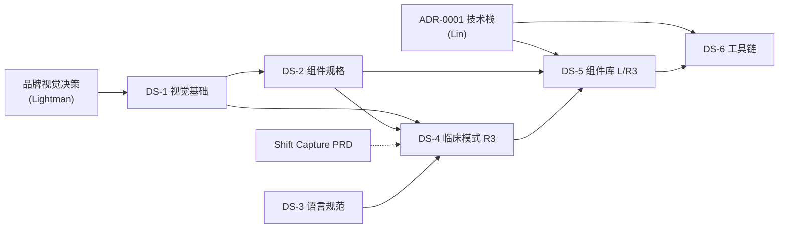

# PRD：careKind AI 设计系统（总 PRD · 任务拆分与分配）

Owner: Lightman (PO) · Status: **Draft** · Last reviewed: 11/10/2026
Parent: [`docs/PRD.md`](../PRD.md) · Related: [`06-app-development/design/ux-principles.md`](../../06-app-development/design/ux-principles.md) · [`07-marketing-ops/brand/brand-guide.md`](../../07-marketing-ops/brand/brand-guide.md) · [`rules/06-adlc-rules.md`](../../rules/06-adlc-rules.md) · [`registry.md`](registry.md)

> 一句话：为 careKind AI 建一套**护士能在单手、戴手套、被打断的真实场景里用对**的设计系统：视觉基础 → 通用组件 → 临床确认与 AI 内容模式 → 语言规范 → 代码组件库与工具。这份总 PRD 定义范围、拆成 6 个子 PRD，并按 ADLC 分配规则分配。

---

## 1. 问题

### 1.1 谁、在什么场景
- **护士（RN / EN / PCW）**：一个班次要在界面上确认几十条记录。如果"确认"太容易点、AI 写的内容和自己说的内容分不清，就会出现自动化偏差（HAZ-005）和错配（HAZ-003）。
- **开发者（Lin、Gary、Windston）**：没有统一的颜色、间距、组件和文案规则，每个人各做各的，后面返工成本高，也容易在界面文字里踩 TGA 禁用词。
- **客户（aged care provider）**：评估产品时会看界面是否专业、可信、无障碍（Disability Discrimination Act 1992，目标 WCAG 2.2 AA）。

### 1.2 证据（诚实标注）
| 证据 | 来源 | 强度 |
|---|---|---|
| UX 原则已定：单手/戴手套/被打断、审核并排、AI 新增高亮、WCAG 2.2 AA、低带宽、尊重语言 | `06-app-development/design/ux-principles.md` | 强（内部已确认的原则） |
| 视觉方向只有一句话"温暖、可信、柔和"，Logo、主色、字体都是 `{{TBD}}` | `07-marketing-ops/brand/brand-guide.md` | 强 |
| 技术栈未定（ADR-0001 待写）；架构同时提到 iOS / Android / Web PWA | `06-app-development/engineering/architecture.md`、`engineering/adr/README.md` | 强 |
| 护士对界面的看法 | 尚无访谈（`10-feedback/` 为空） | **n = 0，以下都是假设** |
| 确认过快、AI 内容难辨认会导致错误进入记录 | `clinical-safety/hazard-log.md` HAZ-003、HAZ-005 | 中（危害分析，未经实测） |

**必须先验证的假设**
- **H1**：护士能一眼分清"我说的"和"AI 整理的"（用标注 + 高亮）。
- **H2**：确认动作的设计能让"确认"成为有意识的动作，又不会慢到没人愿意用。
- **H3**：同一套 tokens 和组件规格可以同时用在 iOS / Android / Web（取决于技术栈 ADR）。

---

## 2. 目标与指标

### 2.1 目标
1. 一套**与技术栈无关**的设计基础（tokens、组件规格、模式、语言规范），先于代码落地。
2. 临床关键界面（审核、确认、归属选择、AI 内容）有**固定模式**，不被各开发者自由发挥。
3. 全部组件满足 WCAG 2.2 AA，并为戴手套、单手场景定更严的标准。
4. 界面文字天然符合 TGA 边界和 person-centred 语言。

### 2.2 范围外
- Logo 与品牌识别本身（Lightman 的品牌决策，见 §12 Q1；设计系统只消费其结果）。
- 营销网站的视觉（对外内容走 `marketing-content-publish`）。
- 技术栈选型（ADR-0001，Lin）。

### 2.3 指标
| 指标 | 测量方法 | 目标 |
|---|---|---|
| ⭐ 组件通过 WCAG 2.2 AA 检查的比例 | 自动检查（如 axe）+ 人工清单，逐组件记录 | 发布的组件 **100%** |
| 触控目标尺寸达标率 | 按 DS-2 规定的最小尺寸，逐组件测量 | 100%；最小尺寸 {{TBD：DS-2 通过戴手套测试后设定}} |
| 界面文字通过 TGA 检查 | `tga-boundary-check` 对组件库内所有文案 | 无 🔴；🟡 有书面结论 |
| 临床模式的可用性 | 对 ≥ {{TBD：3}} 位 aged care 护士的原型测试：能否在不看提示的情况下分清 AI 内容并完成确认 | {{TBD：测试后设定，不预设数字}} |
| 子 PRD 按阶段推进 | registry | 无超过 10 个工作日不动的子 PRD |

---

## 3. 用户故事
| 角色 | 用户故事 |
|---|---|
| 护士 | 作为护士，我想一眼看出哪些内容是我说的、哪些是 AI 整理的，**以便**我只确认我认可的内容。 |
| 护士 | 作为护士，我想戴着手套单手也能点中按钮，**以便**不用摘手套。 |
| 开发者 | 作为开发者，我想直接用现成的组件和 tokens，**以便**不用每次重新决定颜色和间距。 |
| Lightman | 作为 PO，我想界面文字默认不会出现 TGA 禁用词，**以便**不用逐条审文案。 |
| 客户 | 作为 provider，我想看到产品满足无障碍要求，**以便**通过我们的采购尽调。 |

---

## 4. 方案

### 4.1 拆分为 6 个子 PRD
| 编号 | 子 PRD（登记表里的 slug） | 内容 | 方向 | 复杂度 | 风险 |
|---|---|---|---|---|---|
| **DS-1** | `2026-10-11-ds-foundations` | 视觉基础与 design tokens：色彩（含状态色、深浅色）、字体、间距、圆角、图标、对比度检查；用中立格式（如 W3C design tokens JSON）以便任何技术栈使用 | product-ux | S | R1 |
| **DS-2** | `2026-10-11-ds-component-specs` | 通用组件规格：按钮、表单、导航、列表 / 表格、反馈、空状态、加载、离线 / 同步状态；触控尺寸、焦点、屏幕阅读器 | product-ux | S | R1 |
| **DS-3** | `2026-10-11-ds-content-guidelines` | 内容与语言规范：person-centred 语言、TGA 禁用词与安全替代、"AI 草稿"标注文案、错误 / 空状态文案库、澳式英语、界面语言与记录语言分离 | docs-ops | S | R2 |
| **DS-4** | `2026-10-11-ds-clinical-patterns` | **临床确认与 AI 内容模式**：AI 标注、新增 / 改写高亮、原文并排、低置信度标记、老人归属选择与同名提示、敏感事件逐条确认、确认动作设计、安全失败 / 退回手动 | product-ux（+ 与 Lin 评审） | M | **R3**（触及 G1/G4/G5） |
| **DS-5** | `2026-10-11-ds-component-library` | 代码组件库（按选定技术栈实现 DS-2、DS-4） | frontend / mobile | L | R3 |
| **DS-6** | `2026-10-11-ds-tooling` | 文档站 / 组件预览、无障碍自动检查、视觉回归、tokens 构建与发布、CI | infra-security（DevOps） | 现在 L，技术栈确定后预计 M | R2 |

前置决策（不是 PRD）：
- **ADR-0001 技术栈选型**（Lin，`06-app-development/engineering/adr/`）：DS-5、DS-6 的前置，决定组件库是 Web、React Native 还是多端。
- **品牌视觉决策**（Lightman）：Logo、主色、字体（`brand-guide.md` 现为 `{{TBD}}`），DS-1 的输入。

### 4.2 分配结果（按 `rules/06-adlc-rules.md` §3–§6）
**当前团队约束**：Gary = junior，wip_limit = 1，r3 不可；Lin = senior，tracks 未填；Windston = 级别未填；Lightman = 只能接 docs-ops，WIP 2 已有 2 个 PRD（ADLC、本总 PRD）。

| 子 PRD | 评分结论 | 建议 assignee | 状态 |
|---|---|---|---|
| 总 PRD（本文） | docs-ops，M，R1 | **Lightman** | 已登记（draft） |
| **DS-1** | 复杂度 S（范围 1、技术面 0、不确定性 1、依赖 0 = 2），R1。唯一通过过滤的是 Gary：方向匹配 40 + 级别匹配 25 + 负载 20 + 连续 0 = **85/100** | **Gary** | 已登记（idea，assignee = Gary） |
| **DS-2** | S（1+0+0+1 = 2），R1。方向同 DS-1，但 Gary 的 WIP 上限 1，**DS-1 完成后**才能接 | **Gary（排队，接在 DS-1 之后）** | 登记，assignee = Gary，idea |
| **DS-3** | S（1+0+0+0 = 1），R2，docs-ops。通过过滤的只有 Lightman，但他 WIP 已满（2）；要现在开始需要你明确"插队"，或等 ADLC PRD 进入 `in_review` | **Lightman（需你确认 WIP 例外）** | 登记，assignee = Lightman，idea |
| **DS-4** | M（1+0+2+2 = 5），**R3**。junior 不可；唯一的 senior 是 Lin，但 ① Lin 的 primary_tracks 未填 ② 他已有 Shift Capture（若评为 L 则占满 WIP）③ R3 需要另一位 senior 评审，团队里没有第二位，要 `🧑 需外部评审` | **暂不分配**。候选：Lin（accountable），Gary 做视觉探索（不承担责任） | 登记，assignee = —，idea，Blocked 写明原因 |
| **DS-5** | L（2+1+2+2 = 7），R3。只有 senior 可接；同上；且依赖 ADR-0001 | **暂不分配**。技术栈定后重新评分，按"基础组件 / 临床组件"拆分 | 登记，assignee = —，idea，Blocked |
| **DS-6** | 现在 L（1+1+2+2 = 6）；技术栈定后 M（约 1+1+1+1 = 4），R2。方向最匹配 Windston（infra-security），但**他的级别未填**，规则不允许猜 | **候选 Windston**（条件：level ≥ mid 且栈已定） | 登记，assignee = —，idea，Blocked |

**为什么现在能分出去的只有两个**：这是容量和级别的真实约束，不是规则太严。Gary 一次只能做 1 个；Lin 在 R3 评审和 ADR 上是瓶颈；Windston 的画像不全。按顺序推进见 §10。

### 4.3 设计原则（继承，不重复定义）
以 `ux-principles.md` 为准：单手 / 戴手套 / 被打断、审核并排、AI 透明、WCAG 2.2 AA、多语言界面、尊重语言、低带宽。DS-1 至 DS-4 要把这些原则变成**可检查的规格**。

---

## 4.5 法律依据（本地参考文件）
> 用 `legal-reference-check` 流程生成，规则见 `rules/04-prd-rules.md` §2。以下文件已实际打开查阅。运营参考，不是法律意见。

| 主题 | 本地文件 | 条款 / 页码 | 对本功能的约束 |
|---|---|---|---|
| TGA 预期用途（界面文字与组件） | `03-legal-compliance/references/law-library/tga-digital-scribes-summary.md` | 「核心原文」 | 只转写 / 整理不属于医疗器械；若界面"分析或解释"（诊断、治疗建议）则是。→ 组件库**不提供**风险评分、预警、趋势判断类组件；DS-3 的禁用词表覆盖 diagnose / detect / predict / risk score / monitor condition |
| 人对 AI 输出的责任 | `03-legal-compliance/references/law-library/ahpra-ai-in-healthcare-summary.md` | 「五项要点」1 Accountability；「关键原文」 | 从业者负责核对记录。→ DS-4：确认必须是有意识的动作，敏感内容逐条确认，AI 内容必须可辨认 |
| 主 PRD 护栏 | `docs/PRD.md` §9 | G1、G2、G4、G5 | DS-4 触及这些护栏 → R3 |
| 无障碍（内部结论） | `03-legal-compliance/compliance-register.md` | D3（Disability Discrimination Act 1992，目标 WCAG 2.2 AA） | 全部组件按 WCAG 2.2 AA 设计和检查 |
| 产品设计前必答问题 | `rules/03-product-design-rules.md` | §2、§3、§5 | 8 个必答问题逐条回答；界面文字跑 `tga-boundary-check`；禁用词表 |
| 隐私 | `rules/01-operations-rules.md` §1；`rules/02-code-rules.md` §6 | 演示 / 测试数据 | 设计稿、原型、Storybook 示例**只用合成数据**，不得出现真实住户或员工信息 |

### 本地资料缺口
- ⚠️ **Disability Discrimination Act 1992 原文**和 **WCAG 2.2 标准**：本地资料库没有（`compliance-register.md` D3 标 🔴 但只有内部结论）→ 本地无资料，需律师 / 官方来源确认；**上线门槛**：DS-1/DS-2 完成时，对照 W3C WCAG 2.2 官方原文核实具体成功标准（如目标尺寸、对比度）后再写进规格。

### 可能过时的资料
- `tga-digital-scribes-summary.md`（页面 2026-01-30，超过 6 个月；TGA 正在做 Digital Scribe Review）。DS-3 定稿前用 `compliance-review` 复核。

---

## 5. TGA boundary check
- 对照 `03-legal-compliance/tga-samd-boundary.md`：**🟢**（设计系统本身）
- 理由：设计系统只定义外观、交互和语言，不处理数据、不生成临床内容。
- **约束**：组件库不得包含评分、预警、趋势、风险标签类组件；"AI 草稿"相关文案只能表述"整理 / 起草 / 你来确认"，不能表述"检测 / 预测 / 监测"。这些由 DS-3 的禁用词表和评审强制。
- 运营参考，不是法规意见。

## 6. 隐私影响
- 设计系统本身不收集新数据，不新增子处理方。
- 设计工具（如 Figma）和文档站是否会接触客户数据：**不会**，只用合成数据。若引入新的设计 / 文档工具，按 `04-security/vendor-subprocessor-register.md` 评估是否属于内部工具。
- 组件的默认行为要隐私友好（例如不在界面上展示不必要的住户标识）；细节在 DS-4。

## 7. 临床危害
设计系统间接影响临床安全。以下为**提议**的危害，状态 `Proposed`，由临床顾问接受后才写入危害日志（目前顾问空缺）。

| 临时编号 | 危害 | 原因 | 潜在伤害 | 控制措施 | 状态 |
|---|---|---|---|---|---|
| DS-H1 | 护士分不清哪些内容来自自己、哪些是 AI 整理 | AI 标注不明显、高亮对比度不足 | 错误内容被确认（关联 HAZ-001） | DS-4 固定 AI 标注与高亮模式；可用性测试；颜色之外加文字 / 图标 | Proposed |
| DS-H2 | "确认"太容易误触，或者被养成习惯性点击 | 按钮位置、尺寸、连续确认 | 自动化偏差（关联 HAZ-005） | 确认动作设计（间距、需要有意识的动作）、敏感事件逐条确认；抽样审计 | Proposed |
| DS-H3 | 老人归属选错 | 同名、相似房号、选择控件不清晰 | 记录挂错人（关联 HAZ-003） | 照片 / 房号并列确认、同名提示（DS-4） | Proposed |
| DS-H4 | 无障碍不达标导致部分护士无法使用 | 对比度、字号、屏幕阅读器缺失 | 记录延误 | WCAG 2.2 AA 检查进入 CI（DS-6） | Proposed |

写入 `hazard-log.md` 的编号：待临床顾问接受后填写。

## 8. AI 评测
- 设计系统不改变 AI 行为，不新增模型评测。
- 但 DS-4 的"AI 内容可辨认"需要**可用性测试**代替评测（见 §2.3），测试数据用合成记录。

## 9. 无障碍与多语言
- 目标 WCAG 2.2 AA；字号可调；高对比度；屏幕阅读器。
- 界面语言与记录语言分开设置（`ux-principles.md`）；组件必须支持更长的翻译文本（布局不溢出）。
- 文案：对外 / 界面用澳式英语；内部文档中文。

## 10. 上线计划与回滚
**推进顺序（按团队容量，不是按理想顺序）**
| 阶段 | 内容 | 谁 | 前置 |
|---|---|---|---|
| 现在 | 总 PRD 评审；DS-1 开始；ADR-0001 开始 | Lightman / Gary / Lin | 品牌视觉决策（Lightman） |
| DS-1 完成后 | DS-2；DS-3（可并行，Lightman） | Gary / Lightman | — |
| 技术栈定后 | DS-6 重新评分；DS-5 拆分后分配 | Windston（待级别确认）/ 待定 | ADR-0001、Windston 画像 |
| 视觉基础和 Shift Capture 评审进展后 | DS-4 | Lin 负责（建议）；需外部评审人 | Lin 容量、第二位评审人 |

回滚：全部是文档、设计和代码，按版本管理；组件库用语义化版本，破坏性变更需要升主版本并通知使用方。

## 11. 替代方案
| 方案 | 不选的原因 |
|---|---|
| 直接用现成 UI 库（如 Material、Ant Design）不做设计系统 | 临床确认与 AI 内容模式是产品差异点，现成库没有；仍可作为 DS-5 的底层，在 ADR 里评估 |
| 一个人从头做到尾 | 违反 ADLC 复杂度 / 方向规则；多方向（设计、语言、工程）也不现实 |
| 先写代码再补设计 | 技术栈未定，且临床模式需要先做可用性验证 |

## 12. 开放问题（需要人回答）
| # | 问题 | Owner | 影响 |
|---|---|---|---|
| Q1 | 品牌视觉：Logo、主色、字体由谁定、什么时候定？ | Lightman | **阻塞** DS-1 的最终 tokens |
| Q2 | Windston 的 level？ | Lightman + 本人 | **阻塞** DS-6 的推荐 |
| Q3 | Lin 的 primary_tracks？Shift Capture PRD 的复杂度（我的评分是 L：范围 2 + 技术面 2 + 不确定性 2 + 依赖 1 = 7，**待你确认**）？ | Lin / Lightman | 决定 Lin 是否有容量接 DS-4 |
| Q4 | Gary 写代码的方向（frontend / fullstack）？ | Gary | DS-5 贡献者安排 |
| Q5 | DS-3 要不要现在开始（需要 Lightman 的 WIP 例外），还是等 ADLC PRD 进入 review？ | Lightman | DS-3 时间 |
| Q6 | R3 的第二位评审人：外部 senior？临床顾问？ | Lightman | DS-4、DS-5 |
| Q7 | 目标平台：iOS / Android / Web PWA 都要，还是先 PWA？ | Lin + Lightman | ADR-0001、DS-5 范围 |

## 13. 风险
- **Gary 一人承担视觉与规格两个 PRD**，且是 junior：靠顺序推进和评审控制；DS-4 的 R3 部分不让他承担责任。
- **Lin 是瓶颈**（ADR、R3 评审、Shift Capture）：已在分配里体现；需要第二位 senior 或外部评审。
- **技术栈未定就开始组件设计**：所以 DS-1/DS-2 用中立格式，DS-5 推迟。
- **品牌视觉未定**：DS-1 可以先做结构（token 命名、比例、对比度规则），颜色值待 Q1。

## 14. 变更记录
| 日期 | 变更 | 作者 |
|---|---|---|
| 11/10/2026 | 初稿（AI 起草，Lightman 待审）；拆分 6 个子 PRD 并按 ADLC 规则评分 | Claude Code |

## 15. 审批
| 角色 | 姓名 | 日期 |
|---|---|---|
| 产品 | | |
| Tech Lead | | |
| 临床顾问 | 空缺（DS-H1–H4 待接受） | |
