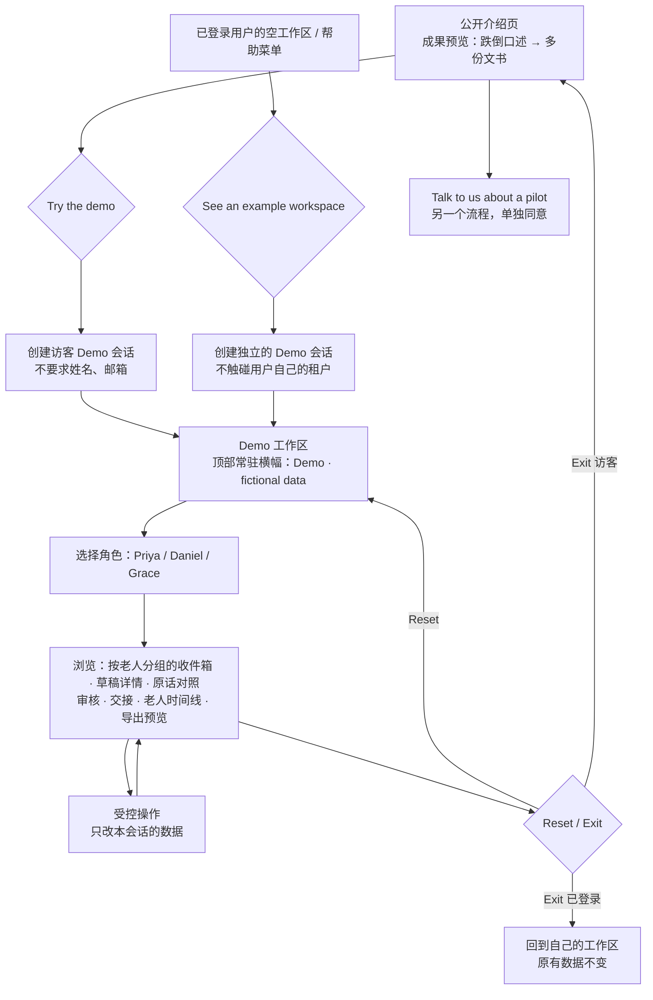
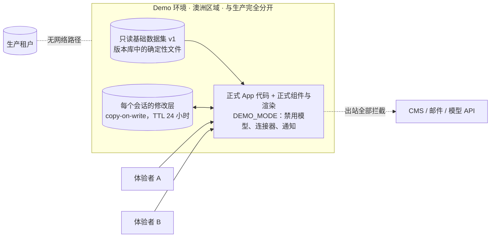

# PRD：Demo 工作区与合成示例数据（Demo Workspace & Synthetic Data）

Owner: Lightman (PO) · Status: **Draft** · Last reviewed: 18/10/2026
Parent: [docs/PRD.md](../PRD.md)
Related: [Shift Capture + 老人档案](2026-10-04-shift-capture-and-resident-records.md) · [已确认记录导出与 CMS 集成](2026-10-18-record-export-and-cms-integration.md) · [设计系统](2026-10-11-carekind-design-system.md) · `06-app-development/product/document-templates/` · `07-marketing-ops/marketing/marketing-compliance.md` · `06-app-development/design/DESIGN.md`

> 一句话：任何人不用注册、不用提交个人资料，就能一键进入一个**明确标注为虚构**的示例工作区——Wattle Grove Residential Care（虚构）的一个完整 PM 班次：口述转写 → 按老人分组的草稿 → RN 审核 → 多份文书 → 交接摘要 → 老人时间线。体验者可以点开、编辑、确认、重置，修改只作用于自己的隔离会话；Demo 不调用按量计费的模型 API，不产生任何真实发送或导出。
>
> 依据：owner 全局规则"结果可见、Demo 必备、高质量示例数据"（2026-10-17）；`rules/01-operations-rules.md` §1（演示只用合成数据）。运营参考，不是法律意见。

---

## 1. 问题

### 1.1 谁、在什么场景、遇到什么问题
- **护理经理 / DON / RN（买方和推动者）**：在试点前只能看到功能清单或截图，看不到"一个班次结束后到底得到什么"。他们需要亲手点开一条跌倒记录，看到它和原话怎么对应、RN 怎么改、交接里写了什么，才能判断是否值得试点。
- **销售与客户成功**：演示目前没有脚本，也没有合规的示例数据（`07-marketing-ops/sales/sales-process.md` "演示脚本 {{TBD}}"）；临时编的数据容易前后矛盾、混入真实信息，或展示还没做出来的能力（ACL 误导风险）。
- **产品团队**：竞品研究认为"一次跌倒口述 → 六份文书草稿并排展示"是最清楚的空白，应作为 demo 主线（`how-competitors-solve-it.md` §7 第 2 条）。
- **已注册的机构用户**：首次进入时工作区是空的，不知道正常使用后会是什么样子。

### 1.2 证据（诚实标注）
| 证据 | 来源 | 强度 |
|---|---|---|
| 访谈 | 无（`10-feedback/` 为空） | **n = 0，以下都是假设** |
| "说一次，处处归档"是公开资料中没有被占领的空白，适合作为 demo 主线 | `01-strategy/competitive-research/how-competitors-solve-it.md` §0 第 2 条、§7 | 中（公开资料，未试用竞品） |
| 竞品多以免费试用代替 Demo（Notive 7 天、AccuNote 14 天） | `competitor-matrix.md` 三 | 中 |
| TGA 2026-10-16 审查发现 8/12 个 scribe 可能构成医疗器械；免责声明不能作为豁免 → Demo 里说的话同样是预期用途证据 | `how-competitors-solve-it.md` §0 第 5 条（S99）；`tga-samd-boundary.md` | 中到强 |
| 已有完整、一致的虚构示例（Edna 跌倒、Tomasz 行为事件、Daniel → Sofia 交接） | `06-app-development/product/document-templates/daily-progress-note.md` §6、`clinical-abc-behaviour-chart.md`、`daily-shift-handover-isbar.md` | 强（可直接作为数据集基础） |

**假设**：D1 体验者能在 5 分钟内理解"输入 → 审核 → 结果"；D2 可操作的 Demo 比截图和视频更能推动试点对话；D3 访客不需要注册也愿意体验。

---

## 2. 目标与指标

### 2.1 目标
1. 公开介绍页上就能看到完整成果，并一键进入可操作的 Demo。
2. Demo 展示的是**当前真实可交付的能力**，用正式组件和正式渲染；计划中的能力单独标明。
3. 不碰任何真实数据，不产生任何业务副作用，不产生按量模型费用。

### 2.2 指标（测量用隐私友好的聚合事件，不记录个人信息）
| 指标 | 定义与测量方法 | 目标 |
|---|---|---|
| ⭐ 核心路径完成率 | 进入 Demo 的会话中，完成"打开 Edna 的跌倒草稿 → 查看原话 → 确认 → 查看交接"的比例；聚合事件计数 | {{TBD：上线 4 周后设定}} |
| Demo → 试点对话 | 从 Demo 点击"Talk to us about a pilot"的会话比例 | 跟踪 |
| **真实数据进入 Demo** | 抽查 + 自由文本中出现疑似真实信息的上报 | **0**（出现即按隐私事件处理） |
| **Demo 产生外部副作用** | Demo 环境的出站请求（CMS、邮件、模型 API）；网络出口日志 | **0** |
| **跨会话泄漏** | 一个会话看到另一个会话的修改；自动化隔离测试 | **0** |
| 数据集一致性 | 自动校验脚本：同一事实在所有文书中一致（时间、人名、数值） | 100% 通过才可发布 |

---

## 3. 用户故事
| 角色 | 用户故事 |
|---|---|
| 访客（护理经理） | 作为护理经理，我想不注册就点进一个示例班次，看到一次跌倒如何变成多份记录，**以便判断是否值得试点**。 |
| 访客（RN） | 作为 RN，我想自己扮演 Daniel 审核 Priya 的草稿：看原话、改措辞、确认，**以便感受审核要花多少功夫**。 |
| 访客 | 作为体验者，我想随时重置到初始状态，也想随时退出回到介绍页。 |
| 已登录用户 | 作为已注册的机构用户，我想在空工作区里点"See an example workspace"，看完后回到自己的工作区，**自己的数据不受影响**。 |
| 销售 | 作为销售，我想用同一个 Demo 讲同一个故事，**以便演示前后一致、合规**。 |
| 合规负责人 | 作为合规负责人，我想确认 Demo 的每段文字都跑过 marketing-copy-check 和 tga-boundary-check。 |

---

## 4. 方案

### 4.1 范围
| ✅ 本 PRD | ❌ 不做 |
|---|---|
| 公开介绍页的成果预览（静态渲染的完整示例）+ "Try the demo" 入口 | 在 Demo 中调用 ASR / LLM（实时转写、重新起草） |
| 访客 Demo 会话（无需注册、无需个人资料），一键进入 | Demo 中使用麦克风录音 |
| 已登录用户的"See an example workspace"入口（空状态和帮助菜单） | 真实的 CMS 导出、邮件、通知、家属消息 |
| 角色切换：Priya（PCW）· Daniel Reyes RN · Grace Liu（Care Manager） | 用 Demo 收集销售线索（试点联系表单是另一个流程） |
| 受控操作：确认、编辑、退回、改归属、分配待分配片段、生成交接（从预生成结果中取）、导出预览 | 模仿任何真实 CMS 厂商的界面或名称 |
| 每个会话隔离、可重置、自动过期 | 展示尚未实现的能力而不标注 |
| 受版本管理的确定性数据集 + 一致性校验 | |

### 4.2 进入与退出流程


- **身份持续显示**：每个页面顶部常驻横幅 "Demo workspace · Wattle Grove Residential Care is fictional · Nothing here is real or sent anywhere"，右侧是 `Reset demo` 和 `Exit demo`；当前角色显示在横幅里（"You are viewing as Daniel Reyes RN (fictional)"）。横幅不能关闭。
- **退出**：访客回到介绍页；已登录用户回到自己的工作区，并显示 Toast "You've left the demo. Your workspace is unchanged."。
- **不冒用真实用户**：Demo 角色只存在于 Demo 环境，没有登录凭据，不对应任何真实账号。

### 4.3 三类标注（每个元素都要标）
| 标注 | 含义 | 例子 | 界面文字 |
|---|---|---|---|
| **Pre-generated example** | 我们事先准备好的内容 | 转写、AI 草稿、交接初稿、导出回执 | "Pre-generated example" 标签 |
| **Your action (demo data only)** | 体验者真实执行的操作，走正式的审核状态机和渲染代码，但只作用于本会话 | 编辑、确认、退回、改归属、PDF 预览 | Toast："Saved in your demo only" |
| **Simulated** | 产品里会发生、Demo 里不执行的动作 | "Send to CMS"、"Notify RN"、录音、重新起草 | "Simulated — nothing was sent" / "Not available in the demo" |
| **Planned — not yet available** | 主 PRD §8 中属于 Phase 2 及以后的能力 | incident 草稿、跌倒后记录、ABC、food & fluid、家属沟通记录、SIRS 准备 | 卡片角标 "Planned (Phase 2) — preview only" |

> 规则：MVP 只有 progress notes、交接、老人时间线、PDF / 复制导出（主 PRD §8）。Phase 2 文书可以出现在 Demo 中，但**必须**带 "Planned" 角标，不能出现在介绍页的"现在可用"区块里（owner 规则第 7 条；ACL）。每次版本发布时同步更新标注（§10）。

### 4.4 数据集：Wattle Grove 的一个 PM 班次
**建议路径（未创建，由 assignee 决定）**：
- 叙事脚本（人读，临床顾问审）：`06-app-development/product/demo-scenarios/wattle-grove-pm-shift-2026-10-18.md`
- 机器数据（App 读取）：`06-app-development/app/fixtures/demo/wattle-grove/v1/`（`manifest.json`：数据集版本、所用模板版本、校验和；`residents.json`、`staff.json`、`segments.json`、`events.json`、`drafts.json`、`review-actions.json`、`records.json`、`handover.json`、`timeline.json`、`export-profiles/example-cms-fictional.json`）
- 一致性校验脚本：同一事实（时间、人名、数值、通知对象）在所有文书中一致；所有姓名带"fictional"标记；不出现模板目录以外的字段。

**结构来源**：全部字段取自 `06-app-development/product/document-templates/`（`daily-progress-note.md`、`daily-shift-handover-isbar.md`、`incident-report-ims.md`、`incident-post-fall-record.md`、`clinical-abc-behaviour-chart.md`、`daily-family-communication-log.md`、`daily-food-fluid-chart.md`、`incident-sirs-assessment-prep.md` 等）。模板改字段时，数据集同步改版本（§10）。

**人物（全部虚构）**：Priya（PCW）· Daniel Reyes RN · Sofia Martins RN（夜班，交接接收人）· Grace Liu（Care Manager）· Dr Amelia Brooks（GP）· Karen Hall（Edna 的女儿）。

**住户名单（8 位，全部虚构）**：Mrs Edna Hall（88 岁，Room 12, Wattle wing，WG-0412）· Mr Tomasz Nowak（81 岁，痴呆，有 BSP，Room 7, Banksia wing (memory support)，WG-0287）· Mrs Joan Walsh 与 Mrs June Walsh（演示近似名 → 待分配队列）· Mrs Rosa Bianchi（演示已选择退出 AI 文书 → 不起草，提示手动记录）· Mr Arjun Mehta · Mrs Mei Chen · Mr George Papadopoulos（日常 Tier 1 记录，演示覆盖情况）。具体背景（偏好称呼、语言、"了解我"笔记）在叙事脚本中写全，前后一致。

**班次时间线（18/10/2026，15:00–23:00）**
| 时间 | 事件 | Tier | 生成的文书（标注） |
|---|---|---|---|
| 15:10（口述 15:35） | Edna 浴室跌倒，右手腕擦伤，意识清醒；按铃，Daniel 到场；已通知 RN 和女儿 | 3 | progress note（MVP）· 交接要点（MVP）· incident · 跌倒后记录 · 家属沟通 · SIRS 评估提示（Planned） |
| 15:45–16:05 | Daniel 补充 assessment（GCS 等，**只用 Daniel 原话**），通知 Dr Brooks 15:45、Karen 15:55、Grace 16:00，确认 | — | 审核动作（预生成，可由体验者重做） |
| 16:40 | Tomasz 在门口推门、拍门、喊要回家；Priya 引导到花园，16:58 平静；之后说左膝"no good today"，告诉 Daniel | 3（行为）+ 2（疼痛） | progress note（MVP）· ABC（Planned）· "Please check the BSP and consent record" 提示 · 交接要点 |
| 17:20 | "Mrs Walsh had her shower, skin's a bit dry"（没说名字和房间） | — | **待分配队列**：Joan / June 两个候选，必须人工选择 |
| 17:50 | 提到 Rosa 的口述 | — | 不起草，显示 "Rosa has opted out of AI documentation — please write this note yourself" |
| 18:05 | Edna 晚餐吃了一半 shepherd's pie、全部 custard；Priya 帮她切食物 | 1 | progress note（MVP）· food & fluid（Planned）；保留模板示例中的"归因需确认"高亮 |
| 18:30–21:30 | Arjun、Mei、George 的日常记录 | 1 | progress notes；George 本班无记录 → 覆盖情况提示 |
| 22:45 | Daniel 生成交接给 Sofia：Edna、Tomasz 置顶；A / R 只有 Daniel 原话，没说的显示 "Please complete" | — | 交接 ISBAR（MVP，与 `daily-shift-handover-isbar.md` §6 一致） |
| — | Edna 的老人时间线：本班已确认记录 + 前 7 天的少量虚构记录 | — | 时间线（MVP）；"近期情况汇总"只复述，每句附来源 |
| — | 导出预览：Edna 的 note 的 PDF 和分字段复制；"Send to CMS" 模拟 | — | 见导出 PRD §12 |

**音频**：Demo 不调用 TTS，也不录音。MVP 只显示转写文本，"Play audio" 显示 "Audio isn't included in the demo"。如果以后要加音频，用员工按脚本朗读的录音并取得书面同意，标注为 "Recorded by careKind staff reading a fictional script"。

**数据集怎么生成**：在当前订阅会话里由人和 Claude 起草叙事和草稿 → 临床顾问审核（措辞、Tier、"只写说过的"）→ 写成确定性文件并提交版本库。运行时**不生成**任何内容。

### 4.5 隔离、重置与环境

1. **环境分离**：Demo 跑在独立部署和独立数据库里，没有生产凭据、没有 CMS 连接器、没有模型 API 密钥；网络出口默认拒绝。这是"不产生副作用、不产生模型费用"的结构性保证，不只靠代码开关。具体方案（独立部署还是隔离租户）→ **建议 Lin 写技术 ADR**。
2. **会话隔离**：每个会话一个修改层，键是随机会话 ID；读取 = 基础数据 + 本会话修改。会话之间不共享任何可写状态。
3. **重置**：清空本会话修改层，回到 v1 初始状态；不影响其他人。
4. **过期**：会话 24 小时无操作后删除修改层（包括体验者输入的文字）。
5. **滥用控制**：按 IP 限制创建会话的频率 {{TBD}}；如需机器人防护，供应商要按 `04-security/vendor-subprocessor-register.md` 评估（会接触 IP 地址）。
6. **已登录用户**：从自己的工作区进入时，新建一个独立 Demo 会话（在 Demo 环境中），不在用户的生产租户里写入任何东西。

### 4.6 防止真实信息进入 Demo
- 能输入文字的地方（编辑草稿、退回批注）都显示："This is a demo. Do not enter real resident or staff information."
- 不提供上传、录音、导入名单。
- 输入内容只保存在本会话修改层，24 小时内删除，不进日志和分析。
- 发现疑似真实信息：删除该会话并按 `incident-triage` 处理。

### 4.7 公开介绍页的成果预览
- 位置靠近价值说明和"Talk to us about a pilot"按钮。
- 内容：Edna 跌倒口述原话 → progress note（AI 改写处高亮、"Please complete" 字段）→ Daniel 确认后的版本 → 交接要点。每块都标 "Fictional example"，Phase 2 文书标 "Planned"。
- 不写任何效率数字（没有基线数据，`docs/PRD.md` §11）；不说 "automatic"、"compliant"。文案示例："You speak. careKind sorts your notes by resident. You review and approve every note."

### 4.8 界面与组件
- 复用正式组件和渲染（`06-app-development/design/COMPONENTS.md`：Alert 用于横幅、Badge 用于标注、Toast、Dialog 用于重置确认）；AI 内容标记按 `DESIGN.md` §7.4。
- Demo 横幅不能和正式工作区的状态样式混淆：使用设计系统中的品牌层样式，具体由 DS 工作包定义（新增组件先补规格）。

---

## 4.5 法律依据（本地参考文件）✅
> 按 `legal-reference-check` 步骤手动执行（18/10/2026）。运营参考，不是法律意见。

| 主题 | 本地文件 | 条款 / 页码 | 对本功能的约束 |
|---|---|---|---|
| 演示只用合成数据 | `rules/01-operations-rules.md`；`07-marketing-ops/marketing/marketing-compliance.md` | §1；"隐私"检查项 | 所有人物、机构、记录都是虚构并标注；不出现真实住户或员工 |
| 营销合规（ACL、TGA、care minutes） | `07-marketing-ops/marketing/marketing-compliance.md`；`12-skills/marketing-copy-check/SKILL.md` | 发布前检查清单 | Demo 和介绍页文案是对外内容 → 上线前必须跑 `marketing-copy-check`；没有测量方法的数字不能用；不说"保证合规""全自动"；不说帮助达到 care minutes 目标 |
| TGA 预期用途 | `03-legal-compliance/tga-samd-boundary.md`；`03-legal-compliance/references/law-library/tga-digital-scribes-summary.md` | 预期用途声明；TGA 页面 30/01/2026 | 营销、演示时说的话都构成预期用途证据 → Demo 不能展示或描述诊断、风险评分、预测；SIRS 只显示流程提示 |
| 文书字段 | `06-app-development/product/document-templates/*.md`；`03-legal-compliance/references/paperwork-taxonomy.md` | 各模板 §4 字段表、§6 示例 | 数据集只用模板字段；🧑 人工字段在预生成数据中由虚构 RN 填写，并保持"AI 不能起草"的标记 |
| 模板版权 | `rules/legal-reference-map.md`"版权提醒"；`06-app-development/product/document-templates/CLAUDE.md` | — | Demo 不使用 `paperwork-templates/` 的原文或版式 |
| 隐私：访客数据 | `03-legal-compliance/references/law-library/oaic-app-guidelines-consolidated-2026-05.pdf` | APP 3（收集必要性）、APP 5（收集通知）、APP 11.2（第 11.29–11.32 段，不再需要时销毁） | 不要求姓名和邮箱；只收集运行会话必需的数据（会话 ID、IP 日志）；输入内容 24 小时删除；隐私政策说明 Demo 的数据处理 |
| 信息准确、可追溯（产品真实行为） | `03-legal-compliance/references/law-library/strengthened-aged-care-quality-standards-nov-2025.pdf` | Action 2.7.2(b)，第 18–19 页 | Demo 展示的追溯、高亮、确认流程必须和正式产品一致，不能展示只在 Demo 成立的效果 |
| 记录义务（示例内容的正确性） | `03-legal-compliance/references/law-library/aged-care-rules-2025-vol1-compilation-2026-08-01.pdf`；`03-legal-compliance/references/paperwork-requirements-by-event.md` | r 154-1000(1)(d)（印刷页 242–243）；r 164-25(1)（印刷页 282） | 示例中关于保存、IMS 字段的说明要和法规一致；判断字段（reportable 等）在示例中由人填写 |
| 人工确认 | `docs/PRD.md` §9 G1、G5、G6 | — | Demo 中 Tier 3 也必须逐条确认，不提供"一键全过"；不演示自动上报 |

### 本地资料缺口
- ⚠️ **Australian Consumer Law / ACCC 误导性陈述指引**：本地无资料，需律师确认 → **上线门槛**（介绍页和 Demo 中"Planned"标注、"Fictional example"标注是否足以避免误导）。
- ⚠️ **Spam Act 2003**：本地无原文。本 PRD 不在 Demo 中收集联系方式；试点联系表单另行处理并单独确认。
- ⚠️ **Cookie / 分析工具**：本地无专门资料；先用不设 cookie 的聚合统计，或经律师确认后在隐私政策披露。

### 可能过时的资料
- `marketing-compliance.md` 最后复核 04/10/2026；上线前确认没有新增要求。

## 5. TGA boundary check ✅
```
Verdict: 🟢（Demo 机制本身）；继承功能 PRD 中的 🟡 项（SIRS 时限提示）
Reasons:
- Demo 不增加任何新功能，只用预生成数据展示已有功能。
- 但 Demo 和介绍页的文字是预期用途证据（tga-samd-boundary.md "预期用途由我们的全部表述决定"）。
- 数据集中的 SIRS 提示沿用模板措辞："may need to be assessed under your facility's process … careKind does not decide whether it is reportable"。
- 示例中"RN assessment"只用虚构 RN 的原话；AI 草稿中不出现诊断词（模板 §7 禁止生成清单）。
Risky wording → safer alternative:
- "See how careKind detects falls" → "See how a fall is documented"
- "AI writes your notes automatically" → "careKind drafts from what you said; you review and approve every note"
- "Flags high-risk residents" → "Shows which notes need RN review"
- "Saves 2 hours a shift" → 删除（没有测量数据）
Required next step: 上线前对 Demo 全部文字、介绍页和演示脚本跑 tga-boundary-check + marketing-copy-check
```
运营参考，不是法规意见；🟡/🔴 需要法规顾问确认。

## 6. 隐私影响 ✅
| 问题（`rules/03-product-design-rules.md` §2） | 回答 |
|---|---|
| 1 TGA | 见 §5 |
| 2 新数据 | 访客：随机会话 ID、IP（访问日志）、浏览器信息、聚合事件、会话内输入文字。存 Demo 环境（澳洲区域）。保留：修改层 24 小时；访问日志 {{TBD}}；聚合统计不含个人信息。不出境 |
| 3 系统替人做选择？ | 不涉及真实个人 |
| 4 确认步骤 | Demo 中照常需要确认；不能绕过 |
| 5 最坏情况 | 体验者输入真实住户信息；Demo 与生产串数据；Demo 展示未实现能力（§7） |
| 6 provider 法定义务 | 不涉及真实 provider；示例内容要正确反映义务 |
| 7 州差异 | 示例机构设在 VIC（虚构）；示例里州法说明只引用 `state-by-state-comparison.md` |
| 8 退出 | 访客随时 Exit / Reset；无账号可删 |

- **子处理方**：Demo 环境托管沿用生产云供应商（待选型）；机器人防护或分析工具如引入，按选型清单评估并登记。
- **需要更新**：隐私政策（Demo 数据处理一段）；PIA 增补 Demo 环境；`data-classification-and-retention.md` 增加 Demo 数据类别（Internal，含访客 IP）。

## 7. 临床危害 ✅
Demo 不进入真实照护，但会影响用户对产品的理解。新提出的危害（`Proposed`）：

| ID（临时） | 危害 | 原因 | 潜在伤害 | 初始风险 | 控制措施 |
|---|---|---|---|---|---|
| HAZ-P-DEMO-01 | 体验者以为 careKind 会判定 SIRS 或替 RN 写 assessment | 示例内容或文字表达不清 | 上线后自动化偏差、草率确认 | 中 | 标注、SIRS 提示原文、"Please complete"字段保留；TGA 和营销检查 |
| HAZ-P-DEMO-02 | 体验者输入真实住户信息 | 把 Demo 当成工具试用 | 隐私泄露 | 中 | 输入提示；无上传、录音；24 小时删除；事故流程 |
| HAZ-P-DEMO-03 | Demo 和生产串数据 | 共用数据库或凭据 | 隐私泄露；真实副作用 | 高 | 独立环境、出口拦截、隔离测试（§4.5） |
| HAZ-P-DEMO-04 | Demo 展示的能力与实际产品不符 | 产品更新后 Demo 没同步；Phase 2 未标注 | 采购误导（ACL）；试点期望落空 | 中 | "Planned"角标；发布清单含 Demo 同步；正式组件和渲染 |
| HAZ-P-DEMO-05 | 示例内容示范了错误的记录做法 | 示例措辞未经临床审核 | 用户照着示例学 | 中 | 临床顾问审核数据集；一致性校验 |

## 8. AI 评测
Demo **不调用模型**，不新增运行时评测。预生成草稿要通过临床顾问审核（事实一致性：草稿中没有原话以外的事实；数值逐字一致；person-centred）。数据集**不能**作为评测黄金集的替代，也不能出现在评测集中被当作模型实际输出（`evaluation-plan.md`）；标注为"人工准备的示例"。

## 9. 无障碍与多语言
- WCAG 2.2 AA；横幅、标注能被屏幕阅读器读出（"Demo, fictional data"）；手机宽度下横幅不遮挡主要操作。
- 数据集英文为主；可增加一段多语言口述示例（标 "Planned"，直到多语言上线）。

## 10. 上线计划与回滚
1. 写叙事脚本 → 临床顾问审核 → 生成数据集 v1 + 一致性校验通过。
2. 搭建独立 Demo 环境（技术 ADR）→ 隔离与出口测试。
3. **上线门槛**：`marketing-copy-check` 和 `tga-boundary-check` 全部为通过（🧑 Lightman 批准）；ACL 律师意见（§4.5 缺口）；隐私政策更新；§11 验收证据齐全。
4. **同步维护**：每次产品发布的检查清单加一项"Demo 数据集和标注是否需要更新"；模板字段变化 → 数据集版本 +1。
5. **回滚**：发现串数据或真实信息 → 立即下线 Demo，走 `incident-triage`；发现误导文字 → 下线对应区块直到修正。

## 11. Demo 与示例数据（验收路径）
本 PRD 本身就是 Demo 规格；入口、数据集和标注见 §4。验收必须**实际操作**，保存截图证据（桌面 + 手机宽度）：

| # | 步骤 | 通过标准 |
|---|---|---|
| 1 | 从公开介绍页看到成果预览并点击 "Try the demo" | 不要求任何个人资料；横幅出现 |
| 2 | 以 Priya 进入，打开按老人分组的收件箱 → Edna 的跌倒草稿 | 原话对照、AI 改写高亮、"Please complete" 字段、Tier 3 标识、"Planned" 角标都正确 |
| 3 | 切换到 Daniel，补充 assessment 并确认；处理 Walsh 的待分配片段；查看 Rosa 的退出提示 | Tier 3 只能逐条确认；待分配必须选择；Toast 显示 "Saved in your demo only" |
| 4 | 生成交接、打开 Edna 的时间线、打开导出预览并点 "Send to CMS" | 交接与模板 §6 一致；显示 "Simulated — nothing was sent"；网络日志无外部请求 |
| 5 | Reset | 回到初始状态 |
| 6 | 两个浏览器同时操作 | 互相看不到对方的修改 |
| 7 | Exit（访客）；已登录用户从空工作区进入后 Exit | 访客回到介绍页；已登录用户回到自己的工作区，原有数据不变 |
| 8 | 24 小时后访问旧会话 | 修改层已删除 |

验收报告要分别说明：代码完成、Demo 本地可用、已部署、线上验收（四种状态分开报告）。

## 12. 开放问题与需要的决策
1. 🧑 Demo 环境用独立部署还是隔离租户 → **建议 Lin 写技术 ADR**。
2. 🧑 Demo 放在官网域名下还是 App 域名下（Lightman）。
3. 访问日志和聚合统计的保留期、分析工具选型（Privacy Officer）。
4. 是否为销售提供"讲解模式"（固定步骤提示）——可以作为后续增强。
5. 临床顾问人选（数据集审核需要）。

## 13. 建议 registry 登记行
| PRD | 标题 | 阶段 | Assignee | Reviewer | 复杂度 | 风险 | Parent | Blocked | 更新 |
|---|---|---|---|---|---|---|---|---|---|
| 2026-10-18-demo-workspace-and-synthetic-data | Demo 工作区与合成示例数据 | idea | （留空，需 Lightman 确认） | — | **M** | **R2** | — | 临床顾问审核数据集 · 等 Lightman · 18/10/2026 | 18/10/2026 |

- **复杂度 M（5/8）**：范围 2（介绍页、Demo 会话、数据集、隔离环境，跨 4 个以上模块）+ 技术面 1（前后端；不涉及模型）+ 不确定性 1（环境隔离需要 ADR）+ 依赖 1（Shift Capture 和导出 PRD 的功能，设计系统）。
- **风险 R2**：新的访客信息流和对外文案；不接触真实健康数据。若 ADR 选择"与生产共用平台的隔离租户"，则触及租户隔离，应升为 **R3**。

## 14. 审批
| 角色 | 姓名 | 日期 |
|---|---|---|
| 产品 | | |
| 临床顾问 | | |
| CTO | | |

## 变更记录
| 日期 | 版本 | 变更 | 作者 |
|---|---|---|---|
| 18/10/2026 | v0.1 | 初稿 | Claude（待 Lightman 审阅） |
