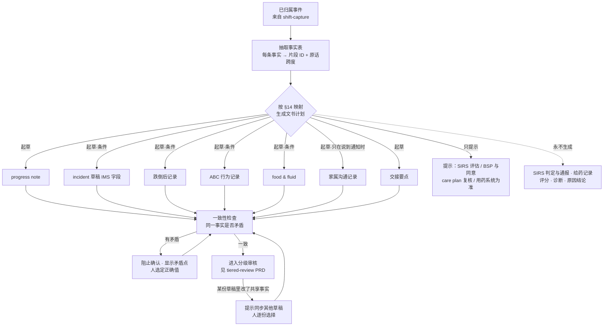

# PRD：说一次，处处归档（一个事件 → 多份关联文书草稿）

Owner: Lightman (PO) · Status: **Draft** · Last reviewed: 18/10/2026
Parent: [docs/PRD.md](../PRD.md)（§4 突破 2、§6.6 起草规则、§14 文书映射表）
Related: [2026-10-04-shift-capture-and-resident-records.md](2026-10-04-shift-capture-and-resident-records.md)（上游：录音、切分、老人归属）· [2026-10-18-tiered-review-and-audit-trail.md](2026-10-18-tiered-review-and-audit-trail.md)（下游：分级审核与审计链）· `06-app-development/product/document-templates/`（字段以模板为准）· `03-legal-compliance/references/paperwork-requirements-by-event.md` · `06-app-development/research/care-documentation-process-flows.md`（§9、§11）

> 一句话：一个**已归属到某位住户**的事件，按主 PRD §14 映射，同时起草所有相关文书（progress note、incident 草稿、跌倒后记录、ABC、food & fluid、家属沟通、交接要点）。所有草稿都从**同一份事实表**生成，系统检查同一事实在各份文书里不矛盾；每句可追溯到原话；没说的字段显示"请填写"；法定判断类文书（SIRS、给药记录等）**只提示、不起草**。
>
> 范围边界：录音、切分、归属见 shift-capture PRD；谁审核、怎么确认、审计链见 tiered-review PRD。本 PRD 只管"事件 → 多份草稿"这一段。

---

## 1. 问题

### 1.1 谁、在什么场景、遇到什么问题
- **PCW / RN**：一次跌倒至少涉及 5–6 份文书（post-fall、观察表、progress note、IMS、家属沟通、交接，可能还有 SIRS），事实相同却要在不同系统里重复录入（`06-app-development/research/care-documentation-process-flows.md` §2.3、§9 第 1 条；`03-legal-compliance/references/paperwork-requirements-by-event.md` §17）。
- 重复录入带来两个风险：**同一事实写得不一致**（时间、左右侧、通知时间），以及**判断和事实混在一起**（reportable、P1/P2、是否属于 chemical restraint 写进了同一份记录）（流程图 §9 第 3 条）。
- **IMS（Rules r 164-25）和 SIRS notice（r 165A-25(4)）字段大量重叠**，但要分别填写（流程图 §3.3）。

### 1.2 证据（诚实标注）
| 证据 | 来源 | 强度 |
|---|---|---|
| 护士访谈 | 无（`10-feedback/` 为空） | **n = 0，下文所有"用户会……"都是假设** |
| 一次跌倒涉及的文书数量、字段重叠 | `paperwork-requirements-by-event.md` §3、§5、§17；Rules r 164-25(1)(a)–(m)（本地 PDF 第 282 页，已核实） | 中（法规结构事实；工作量是推测） |
| 竞品只做到"一段话填一张表"，公开资料里没有"一个事件 → 多份关联文书且事实一致" | `01-strategy/competitive-research/how-competitors-solve-it.md` §7、§10 第 2 条、§12 | 弱到中（公开资料，未试用） |
| Heidi 已进入"事故报告 + SIRS 模板" | 同上 §3、§12 | 中（公开报道） |
| 行业担心 AI 记录"空洞"；Commission 退回明显由 AI 生成的文件 | 同上 §11 第 5、9 条 | 弱（顾问转述，未独立核实） |

**必须验证的假设**
- **H-MD1**：审核 5 份已预填的草稿，比手写 5 份更快，并且不会更草率。
- **H-MD2**：RN 能接受"一处改事实，其他草稿提示同步"的交互，不会觉得被打断。
- **H-MD3**：机构愿意让 careKind 起草 IMS 草稿，再由人复制或导入自己的 IMS。

---

## 2. 目标与指标

### 2.1 目标
1. 一个事件只说一次，相关文书全部有草稿，**事实一致**、来源可追溯。
2. 法定判断永远留给人；careKind 只做文书整理和流程提示。
3. 补上流程图研究指出的缺口：MVP 期间的跌倒怎么记录、§14 缺少的事件行。

### 2.2 指标（试点）
| 指标 | 定义 / 测量方法 | 目标 |
|---|---|---|
| ⭐ 每个 Tier 3 事件的文书总耗时 | 从第一次口述到全部关联草稿确认的时长（含审核），对比试点前基线（时间研究，同一类事件） | 比基线缩短 {{TBD：基线后设定}} |
| 重复录入字段数 | 基线：员工在各系统中手动输入同一事实的次数（观察抽样）；试点：确认前手动修改的共享事实数 | 下降 {{TBD}} |
| **已确认文书之间的事实矛盾** | 每周抽样：同一事件的已确认文书中，同一事实值不同的数量（临床顾问判定） | **0** |
| 映射准确率 | 抽样事件中，生成的文书集合与临床顾问期望集合一致的比例（漏生成 + 多生成都算错） | ≥ {{TBD：95%}} |
| "已通知"误生成 | 口述只说"会打电话 / 正在打"却生成"已通知"的次数 | **0** |
| 判断字段被预填 | IMS (b)(g)(k)、SIRS 判定、chemical restraint 判定等被 AI 填写的次数 | **0**（出现即 P1 临床安全事件） |
| 草稿采纳率（按文书类型） | 确认时只有小幅编辑的比例 | ≥ 70%（各类型分开报） |

---

## 3. 用户故事
| 角色 | 用户故事 |
|---|---|
| PCW | 作为护理员，我在浴室发现住户跌倒后只说一遍经过，就能看到 progress note、incident 草稿、跌倒后记录和交接要点都已起草，**以便我不必在班末重复写五遍**。 |
| PCW | 作为护理员，我只说了"Daniel 正在打电话给她女儿"，我希望系统**不要**替我写"已通知家属"，而是显示"请填写"。 |
| RN | 作为 shift RN，我在 incident 草稿里把时间从 15:10 改成 15:05，我希望系统提示"其他 4 份草稿里也有这个时间，是否一起改"，**以便各份记录不矛盾**。 |
| RN | 作为 RN，我希望每份草稿里 AI 不能填的字段（是否 reportable、评估、调查）明确标为"由 RN / CM 填写"。 |
| Care Manager | 作为护理经理，我希望看到 SIRS 评估提示和时限，但系统不替我判断是否 reportable，也不替我提交。 |
| RN | 作为 RN，口述里提到"给了 PRN 让他安静"时，我希望系统提示"请确认 BSP、同意和监测记录"，**但不写给药记录**，给药以用药系统为准。 |

---

## 4. 方案

### 4.1 核心概念
| 概念 | 说明 |
|---|---|
| **Event（事件）** | 上游 shift-capture PRD 产出：关于一位住户的一次观察，已归属（Attributed）。本 PRD 只处理已归属事件，**Unassigned 事件不生成任何草稿**（G4） |
| **Fact sheet（事件事实表）** | 新增：从事件片段中**一次性**抽取的结构化事实，每条事实带来源片段 ID、原话跨度、置信度、类型（时间 / 地点 / 身体部位与左右侧 / 数值 / 住户原话 / 照护动作 / 通知 / 目击 / 跟进）。**所有草稿只从事实表渲染**，不各自重新"理解"原话 |
| **Document plan（文书计划）** | 按事件类别 + 事实表，查 §14 映射得出：哪些文书**起草**、哪些**只提示**、哪些**永不生成** |
| **Draft（草稿）** | 主 PRD §6.2 已有实体；新增字段：`fact_refs`（每个字段 → 事实 ID）、`field_state`（filled / please-complete / human-only） |
| **Consistency check（一致性检查）** | 比对同一事件下所有草稿和事实表，发现矛盾就阻止确认 |
| **Prompt（提示）** | 不生成正文的流程提示（SIRS 评估、BSP 与同意、care plan 复核、用药系统为准等），带法规时限，不带结论 |

### 4.2 主流程


### 4.3 文书计划规则（与 §14 和模板对齐）
| 文书 | 模板（字段以模板为准） | 什么时候起草 | 不起草 / 留空的部分 |
|---|---|---|---|
| Progress note | `daily-progress-note.md` | 每个已归属事件 | Clinical assessment 只在 RN 自己说出时照录；没说"已通知谁 / 何时"→"请填写" |
| Incident 草稿（IMS） | `incident-report-ims.md`（F01–F26，对应 r 164-25(1)(a)–(m)） | 跌倒；伤害 / 疑似虐待或忽视；行为事件有伤害时；用药事件（另用 `incident-medication-incident.md`） | F04、F07、**F08 是否 reportable**、F14、F19–F22、F25 永远 🧑 人工；不写原因（"due to"） |
| 跌倒后记录 | `incident-post-fall-record.md` | 事件类别 = 跌倒 | 观察频率、"是否转院"、数值正常 / 异常判断永不生成；**抗凝**栏不能有默认值 |
| ABC 行为记录 | `clinical-abc-behaviour-chart.md` | 情绪或行为；限制性措施 | 诱因 / 原因推断、行为标签（"aggressive"）永不生成；伤害 / 是否使用约束没说 →"请填写" |
| Food & fluid | `daily-food-fluid-chart.md` | 口述中出现具体进食或饮水量 | 只记说出的量；"吃了点"→ 请员工说比例；不算总量、不判断"不足" |
| 家属沟通记录 | `daily-family-communication-log.md` | **只在口述明确说已经和家属沟通时**（"I rang Karen at 15:55"）；"正在打 / 会打"只在事实表记为"计划中"，不生成已通知记录 | 住户同意分享：档案中没有有效同意时"请填写"；Tier 跟随关联事件 |
| 交接要点 | `daily-shift-handover-isbar.md` | 有变化或 Tier 2/3 事件 | S 只用**已确认**的记录；A、R 只用 RN 原话，否则"请填写" |
| PRN 效果记录 | `clinical-prn-effectiveness.md` | 口述中出现 PRN 及其效果 | 药名、剂量**永不由 AI 补全**；给药时间以用药系统为准 |
| 限制性措施使用记录 | `clinical-restrictive-practice-use-monitoring.md` | 口述中出现约束动作（锁、按住、关在房间、给药让其安静） | 是否属于限制性措施、是否在同意范围内：🧑 人工 |
| **只提示：SIRS 评估** | `incident-sirs-assessment-prep.md`（底稿由 tiered-review / 后续 SIRS PRD 定义） | 跌倒、伤害、疑似虐待、限制性措施、用药事件、死亡 | 不判定 reportable、P1/P2，不代为通报（G6） |
| **永不生成：给药记录** | — | — | 不写 medication chart / eNRMC 条目，不做用药核对（TGA 红灯；`paperwork-requirements-by-event.md` §4） |

**条件生成的硬规则**
1. 计划（"will call"、"going to ring"）≠ 已完成。只有过去时 + 明确对象才生成"已通知"。
2. 阴性结论（"no injury"、"did not hit head"）只在**员工或住户原话**里出现时才写，并保留是谁说的（"Edna said she didn't hit her head"），不写成员工的检查结论。
3. 一个事件涉及两位住户（如 Tomasz 推了另一位住户）：上游拆成两个事件，各自生成文书计划；跨事件只建链接，不复制对方住户的信息进本人记录。
4. 老人已退出 AI 文书（Consent）：不生成任何草稿，只提示手动记录（主 PRD §7.8）。

### 4.4 事实一致性检查
| 检查项 | 规则 | 结果 |
|---|---|---|
| 同一事实不同值 | 事实表中的每个事实在各草稿中渲染值必须相同（时间、地点、左右侧、身体部位、数值 + 单位、通知对象与时间、目击） | 不同 → **阻止该事件所有草稿的确认**，显示并排对比，人选定一个值（改的是事实表，不是单份草稿） |
| 草稿含事实表以外的事实 | 沿用主 PRD §10 的事实一致性检查（HAZ-001） | 高亮"AI 新增"，必须删除或由人确认来源 |
| 事件时间 vs 记录时间 | 两者分开保留（HAZ-012）；IMS F09（发生）和 F10（发现）不能自动设为相同 | 无人目击时 F09 默认"Not known"，不用发现时间顶替 |
| 判断字段被填 | human-only 字段出现内容而操作人不是 RN / CM | 拒绝写入 |
| 编辑后同步 | 任一草稿中修改了共享事实 | 提示："This fact also appears in 4 other drafts. Update them?"，列出每份草稿，**逐份勾选**，默认不全选；不同步的必须写原因（例如"家属记录写的是家属转述的时间"） |

> 设计取舍：**事实表是单点更正**——一个 ASR 错误只需改一次，避免"一个错误被放大成五份错误记录"。同时不做静默同步：已经被某人确认的草稿不会被别人的修改自动改掉，只会被标"需重新确认"（G7：已确认记录只能走 Amended）。

### 4.5 来源映射与"请填写"
- 每句 → 片段 ID + 事实 ID（主 PRD §6.6 第 7 条）；每个字段 → 事实 ID 或 `please-complete` 或 `human-only`。
- 界面文字（澳式英语）："Please complete"（缺失）· "Not stated"（员工确认没有该信息时）· "RN / Care Manager to complete"（判断字段）· "Sample of what was said"（悬停显示原话）。
- 关联文书在每份草稿底部显示 "Linked records from this event (5)"，可跳转。

### 4.6 回应流程图研究的缺口（`care-documentation-process-flows.md` §11）
| # | 缺口 | 本 PRD 的处理 |
|---|---|---|
| 5 | **MVP 没有 incident 草稿，但试点中一定会有跌倒** | **建议 MVP 纳入"跌倒类 IMS 草稿"**（只限跌倒，只生成事实字段，F08 等判断字段永远留空，输出为 PDF / 剪贴板，由 RN 复制进机构 IMS，不直接写入 IMS）。前提：§8 评测门槛达到 + 临床顾问签字。**达不到门槛的退路**：Tier 3 事件只生成 progress note + 交接要点，并显示 "Please also record this in your facility's incident system"；试点协议写明 IMS 仍按机构原流程（与研究建议一致）。→ 对主 PRD §8 的变更建议 C1 |
| 7 | **§14 缺用药事件 / PRN、死亡、转院行** | 见 §4.7 变更建议 C2 |
| 8 | "临终照护"一行没有提示 | 死亡相关叙述归 Tier 3，提示"请按机构流程评估是否为 unexpected death"（只提示） |
| 9 | 精神类 PRN 用于行为管理 | 关键词（"to settle him"、"so she'd calm down"、sedation）路由到 Tier 3 + 限制性措施提示；**路由不是判断** |
| 12 | 没有"不写给药记录"的护栏 | 本 PRD 把它写成文书计划的"永不生成"规则；建议升为主 PRD 护栏 G12（变更建议 C3） |
| 15 | IMS 判断字段 | (b)(g)(k) 等永远 human-only（§4.3） |
| 23（研究 §17 / 待核实 22） | 一个事实多份草稿，改一份是否同步 | §4.4 的"提示同步、逐份勾选、不静默同步" |

### 4.7 对主 PRD 的变更建议（不在本 PRD 内修改主 PRD）
| 编号 | 位置 | 建议 |
|---|---|---|
| C1 | §8 Draft 行 | MVP 加入"跌倒类 IMS 草稿（导出，不写入 IMS）"，附评测门槛和退路 |
| C2 | §14 | 新增下列行（✅ 起草、🔒 需 RN、💡 只提示） |
| C3 | §9 | 新增护栏 **G12**：不生成给药记录、不做用药核对；用药信息以 eNRMC / 用药系统为准（需 ADR） |
| C4 | §6.2 | `Event` 下新增 `FactSheet` 实体；`Draft` 新增 `fact_refs`、`field_state` |
| C5 | §6.6 | 起草规则新增第 8 条："计划中的通知不写成已通知；阴性结论只照录原话并注明说话人" |

C2 建议新增的 §14 行：
| 事件类别 | Progress note | Incident | 专项记录 | 家属沟通 | 交接 | 提示（不起草） |
|---|---|---|---|---|---|---|
| **用药事件**（漏给、给错、时间错） | 🔒 | 🔒 `incident-medication-incident.md` | — | 提到通知时 🔒 | 🔒 | 💡 给药记录以用药系统为准；💡 "可能需要按 SIRS 评估"；💡 通知 GP / 药剂师按机构流程 |
| **PRN（含精神类）** | 🔒（Tier 2；精神类或行为管理目的 → Tier 3） | — | 🔒 PRN 效果记录 | — | 🔒 | 💡 精神类：请确认 BSP、同意和监测记录；是否属于 chemical restraint 由人判断（Rules 17-5(2)） |
| **死亡**（预期或非预期） | 🔒 Tier 3 | — | 🔒 死亡记录 / 临终记录叙述 | 提到通知时 🔒 | 🔒 | 💡 请按机构流程评估是否为 unexpected death（若是则 P1 24 小时）；💡 死亡证明由医生出具；💡 coroner 按州法；💡 cessation notification 28 天 |
| **病情恶化 → 转院** | 🔒 | — | 🔒 升级记录（ISBAR，A/R 只用 RN 原话） | 提到通知时 🔒 | 🔒 | 💡 转院包：用药清单以用药系统为准、ACP 引用原件；💡 返院后复核 |
| **拒绝照护** | ✅（有临床影响时 🔒） | — | food & fluid（拒食时） | — | 有变化时 | 💡 因拒绝服务导致的事件不是 reportable incident，但要记录拒绝和替代方案（Rules 16-10(2)） |

### 4.8 范围
| ✅ MVP（建议，见 C1） | ⏭ Phase 2 | ❌ 不做 |
|---|---|---|
| 事实表 + 一致性检查 + 来源映射 | ABC、food & fluid、家属沟通、PRN 效果、限制性措施使用记录 | SIRS 判定、P1/P2、代为通报 |
| Progress note + 交接要点（已在主 PRD MVP） | 用药事件 IMS 草稿；死亡、转院行 | 给药记录、用药核对 |
| 跌倒类 IMS 草稿（导出）+ 跌倒后记录叙述部分 | 首个 CMS / IMS 集成写入 | 风险评分、诊断、原因结论 |
| SIRS 评估提示、BSP 提示（只提示） | 编辑同步的批量视图 | 自动给家属发消息 |

### 4.9 界面要点
- 事件卡片：顶部"Fall · Mrs Edna Hall · Room 12 · 15:10"，下面是文书清单（每份显示 状态 / 请填写数量 / 矛盾数量），以及提示区（灰底，图标为信息而不是警告，不用红色）。
- 设计组件以 `06-app-development/design/DESIGN.md`、`COMPONENTS.md` 为准；"AI 草稿标注、原文并排、新增 / 改写高亮"属于 **DS-4（R3）**，本 PRD 依赖其完成，不另行发明。

---

## 4.5 法律依据（本地参考文件）
> 按 `legal-reference-check` 步骤手动执行（18/10/2026）。标"已核实"的条款已用 `pdftotext` 打开本地 PDF 查看原文；其余经本地研究文件转引。运营参考，不是法律意见。

| 主题 | 本地文件 | 条款 / 页码 | 对本功能的约束 |
|---|---|---|---|
| TGA 边界 | `03-legal-compliance/references/law-library/tga-digital-scribes-summary.md`；`03-legal-compliance/tga-samd-boundary.md` | TGA 页面 30/01/2026 | 只整理原话；不生成没说过的诊断、原因、治疗；每次改动文书计划（新增文书类型）都要复核预期用途 |
| IMS 最低字段 | `03-legal-compliance/references/law-library/aged-care-rules-2025-vol1-compilation-2026-08-01.pdf` | **r 164-25(1)(a)–(m)、(2)，第 282 页（已核实）** | IMS 草稿逐项对应；(b) 是否 reportable、(g) 评估、(k) 调查只能人填；记录保存 7 年 |
| IMS 系统要求、员工尽快上报 | 同上 | **r 164-20(g)，第 281 页；r 165A-20，第 299 页（已核实）** | careKind 的草稿和通知不替代员工按机构程序"as soon as possible"上报；草稿界面必须提示这一点 |
| SIRS 时限 | 同上；`03-legal-compliance/references/paperwork-requirements-by-event.md` §5 | r 165A-25(1)（24 小时，已核实）；r 165A-25(6) 5 天、r 165A-30 30 天、r 165A-45(2) 84 天、r 164-40(2) 报警 24 小时（经研究文件转引） | 提示显示全部时限节点；不判定、不提交（G6） |
| 临床记录保存 | 同上 | **r 154-1000(1)(d)（已核实："medical records, progress notes and other clinical records"）**；r 154-150 | 所有派生草稿确认后都是临床记录；careKind 端草稿、事实表、更正记录的保留期要和 provider 的 7 年义务对齐（⚠️ DPA 约定） |
| 拒绝照护 | `paperwork-requirements-by-event.md` §2 | Rules 16-10(2)（第 96 页，转引） | §14 新增"拒绝照护"行的提示依据 |
| 限制性措施 | `paperwork-requirements-by-event.md` §6 | Rules 17-5(2)、162-25、162-35、162-60（转引） | 只提示 BSP、同意和监测；不判定是否属于 chemical restraint；每次使用记录的"是否在同意范围"由人填 |
| 用药 | `paperwork-requirements-by-event.md` §4 | Rules 15-30(6)(7)；SQS 5.3.1（转引） | 给药记录永不生成；药名剂量不补全（HAZ-004） |
| 信息准确完整 | `03-legal-compliance/references/law-library/strengthened-aged-care-quality-standards-nov-2025.pdf` | **Action 2.7.2(b)(c)（已核实）**；3.3.2(d)（交接结构化）、5.4.4(d)（通知 GP 和 supporters） | 一致性检查是对 2.7.2(b) "accuracy and completeness" 的直接回应；家属沟通前核对同意（2.7.2(c)） |
| 护士专业责任 | `03-legal-compliance/references/law-library/ahpra-ai-in-healthcare-summary.md`；`nmba-code-of-conduct-for-nurses-2018.pdf` | AHPRA 2024 "responsible for checking the accuracy"；**NMBA Code 3.3(d)、3.3(e)（已核实）** | 每份草稿都要人确认；不能用标签化语言（3.3(e) "not refer to people in a non-professional manner… in records"） |
| 临床 AI 安全 | `03-legal-compliance/references/law-library/acsqhc-ai-safety-scenario-ambient-scribe-2025-08.pdf` | 第 3 页（已核实："over-summarisation and missing information"；"Label records indicating AI was involved"） | 多份草稿更容易"过度概括"和漏项 → "请填写"优先于流畅；导出记录标注 AI 参与 |
| 自动化决策透明度 | `03-legal-compliance/references/law-library/oaic-app-1-7-1-9-adm-transparency-flowchart-2026-09.pdf`；`privacy-and-other-legislation-amendment-act-2024-as-made.pdf` Sch 1 Part 15（已核实，2026-12-10 生效） | APP 1.7–1.9 | 文书计划和 Tier 路由是"系统做的事"；详见 tiered-review PRD §6 的统一披露 |
| 各州差异 | `03-legal-compliance/references/state-by-state-comparison.md` | §3.2、§4.5 | VIC / NSW / ACT 成人健康记录 7 年；coroner 提示按州配置 |
| 文书字段 | `03-legal-compliance/references/paperwork-taxonomy.md`；`06-app-development/product/document-templates/*.md` | taxonomy §1、§2、§4；各模板 §4、§7 | 字段与"AI 可起草 / 照录 / 人工"标记以模板为准；不复制 `paperwork-templates/` 中非商业许可模板的版式 |

### 本地资料缺口
- ⚠️ 各州 **Coroners Act**（VIC、NSW 等，只有 QLD 经 fact sheet 核实）：本地无资料，需律师确认 → "死亡"行 coroner 提示上线门槛。
- ⚠️ `03-legal-compliance/references/state-clinical-practice-rules.md`（用药授权、死亡确认按州；18/10/2026 研究草稿，仍有 ⚠️ 项）→ 用药事件、死亡行上线门槛。
- ⚠️ 把已确认 incident 事实按 r 165A-25(4) 顺序排成"参考摘要"是否构成"代为通报"（`paperwork-requirements-by-event.md` §20 第 7 条）：需律师和临床顾问确认 → SIRS 底稿功能门槛（本 PRD 只做提示，不做底稿）。
- ⚠️ MVP 期间 IMS 草稿以 PDF / 剪贴板导出、由人复制进 IMS：机构 IMS 是否接受外部起草内容，需在试点协议中写明。

### 可能过时的资料
- `acqsc-sirs-guidelines-residential-providers-v1-8-2022-legacy.pdf`、`acqsc-effective-incident-management-systems-guidance-2021.pdf`：旧法时期，只作参考，以 Rules 为准。

> 运营参考，不是法律意见。

---

## 5. TGA boundary check ✅
```
Verdict: 🟡（起草本身 🟢；提示类和条件生成需守边界）
Reasons:
- 从事实表起草多份文书：只整理员工说过的事实 → 🟢（TGA digital scribes："transcribe… without performing analysis or interpretation"）
- 文书计划（哪份文书要起草）：按事件类别做文书路由，不是临床判断 → 🟢；但如果按"严重程度"决定生成 incident，就变成解读 → 只按口述中的事实类别
- SIRS 评估提示、BSP / 同意提示、care plan 复核提示 → 🟡（tga-samd-boundary.md 黄灯："提示该事件可能需要按 SIRS 评估"）
- 一致性检查：比较文书之间的文本值，不评估临床含义 → 🟢
- 永不生成：诊断、跌倒原因、风险评分、观察频率、是否转院、给药记录、用药核对 → 否则 🔴
Risky wording → safer alternative:
- "Detects incidents automatically" → "Drafts the related records from what you said"
- "Flags reportable incidents" → "Reminds you to assess under your SIRS procedure"
- "Identifies chemical restraint" → "Reminds you to check the BSP, consent and monitoring records"
- "Complete incident report in seconds" → "Starts your incident draft so you can review and complete it"
Required next step: 产品 + 临床顾问评审提示类功能；法规顾问确认后写 ADR
```
运营参考，不是法规意见；🟡/🔴 需要法规顾问确认。

---

## 6. 隐私影响 ✅
| 议题 | 内容 |
|---|---|
| 新增数据 | **事实表**（从已收集的口述派生，不是新收集）；家属沟通记录中的 supporter 姓名、关系（从 CMS / 档案带出，不新收集联系方式） |
| 存储 | 澳洲区域（ADR-0001）；与草稿同库、同租户隔离 |
| 保留 | 事实表随草稿保留；草稿导出后按 shift-capture PRD §7 的期限删除；已确认记录的来源映射保留期 ⚠️ 与审计链一起在 DPA 约定（见 tiered-review PRD） |
| 披露风险 | 家属沟通草稿可能写入住户未同意分享的内容 → 共享前核对同意状态，没有有效同意显示"请填写"（APP 6；SQS 2.7.2(c)） |
| 跨住户信息 | 两位住户的事件拆分后，对方住户的姓名不写入本人的 progress note（只写"another resident"并内部链接）⚠️ 需机构政策确认 |
| 子处理方 | 无新增（沿用 LLM、ASR） |
| 需更新的文档 | PIA（新增：事实表、跨文书派生）；隐私政策的 AI 处理说明（与 tiered-review PRD 的 APP 1.7–1.9 披露合并） |

---

## 7. 临床危害 ✅
新提出的危害（**Proposed**，临床顾问接受后才写入 `hazard-log.md`；本 PRD 不改危害日志）：

| ID（临时） | 危害 | 原因 | 潜在伤害 | 初始风险 | 控制措施 |
|---|---|---|---|---|---|
| HAZ-P-MD-01 | 一个 ASR / 抽取错误被放大到多份文书 | 所有草稿共用事实表 | 多份记录同时出错，更难发现 | 高 | 事实表单点更正；低置信度事实在每份草稿都标出；数值逐字比对（HAZ-004） |
| HAZ-P-MD-02 | 同一事实在不同文书中矛盾进入正式记录 | 单份草稿被编辑后未同步 | 审计和调查时证据冲突；照护决策依据不一 | 高 | 一致性检查阻止确认；编辑同步提示逐份选择；已确认文书标"需重新确认" |
| HAZ-P-MD-03 | "计划通知"被写成"已通知" | 时态理解错误 | 家属或 GP 实际未被通知，延误照护 | 高 | 条件生成硬规则 §4.3-1；评测指标"已通知误生成 = 0" |
| HAZ-P-MD-04 | 判断字段被预填（reportable、原因、chemical restraint） | 模型越界 | SIRS 判断被诱导；TGA 越界 | 极高 | human-only 字段由服务端拒绝 AI 写入；评测门槛 0 |
| HAZ-P-MD-05 | 提示被误读为结论（"SIRS 提示 = 系统认为要上报"） | 提示文案、颜色 | 过度或不足上报 | 中 | 提示统一中性样式；固定文案 "careKind does not decide…"；培训 |
| HAZ-P-MD-06 | 文书计划漏生成（如跌倒没生成 incident 草稿） | 分类错误 | 员工以为"系统没生成就不需要" | 高 | 事件卡片显示"本类事件通常还需要的文书"清单（含未生成项）；映射召回评测 |
| HAZ-P-MD-07 | 多份草稿增加审核量 → 草率确认 | 自动化偏差 | 错误进入记录 | 高 | Tier 3 逐份、逐条确认（见 tiered-review PRD）；草稿按"请填写"数量排序 |
| 关联 | HAZ-001、002、004、006、012 | — | — | — | 沿用现有控制 |

---

## 8. AI 评测
在 `06-app-development/clinical-safety/evaluation-plan.md` 基础上新增"多文书集"（合成场景，临床顾问编写，不用真实数据）：
- 覆盖 §14（含 C2 新增行）每个事件类别 ≥ {{TBD：10}} 个场景；包括：无人目击跌倒、"正在打电话"类计划通知、左右侧口误后自我更正、两位住户冲突、精神类 PRN、拒绝照护、死亡叙述。
- 指标与门槛：

| 指标 | 门槛 |
|---|---|
| 文书计划召回（应生成的都生成） | ≥ {{TBD：98%}} |
| 文书计划精确（不该生成的不生成，特别是家属沟通） | ≥ {{TBD：95%}} |
| 事实表 → 草稿渲染一致率 | 100% |
| 判断字段泄漏 | 0 |
| "已通知"误生成 | 0 |
| 阴性结论无出处 | 0 |
| 每份文书模板符合率 | ≥ 95%（沿用） |

- **C1 的 MVP IMS 草稿上线门槛**：跌倒子集全部指标达标 + 临床顾问对 ≥ {{TBD：30}} 份 IMS 草稿盲评"可直接使用或小改" ≥ 70%。

---

## 9. 无障碍与多语言
- 事件卡片的文书清单支持屏幕阅读器读出"5 drafts, 3 need completing, 1 conflict"。
- 矛盾对比不只用颜色区分（WCAG 2.2 AA）；按钮尺寸按 `DESIGN.md` 触控规范。
- 多语言口述（Phase 2）：事实表保存原文和译文，两者都作为来源；数值和药名以原文为准（HAZ-008）。

## 10. 上线计划与回滚
1. Alpha：多文书评测集达标。
2. 试点第 1–2 周：只开 progress note + 交接要点（与 shift-capture PRD 一致）。
3. 第 3 周起（达到 C1 门槛时）：开跌倒类 IMS 草稿（导出），并跟踪"判断字段泄漏""已确认文书矛盾"。
4. Phase 2：逐类开启 ABC、food & fluid、家属沟通、PRN、用药事件。每类单独开关（机构可配置）。
5. **回滚**：出现一次判断字段被预填、或已确认文书事实矛盾 → 关闭该文书类型的起草，退回"只生成 progress note + 提示手动记录"，走 `incident-triage`。

## 11. Demo 与示例数据
> 规则来源：Owner 产品硬规则（结果可见、Demo 必备）；数据全部为**虚构**，界面持续显示 "Demo workspace — fictional data"。

| 项目 | 内容 |
|---|---|
| Demo 入口 | ① 产品介绍页"Say it once"区块旁的 "See a sample event"；② App 内空状态和事件卡片的 "Open demo workspace"；③ tiered-review PRD 的角色切换 Demo 工作区（共用同一工作区）。不需要登录或付款即可预览结果页 |
| 示例机构 | Wattle Grove Residential Care（虚构，VIC），Banksia Wing |
| 场景 A：跌倒（主线） | Mrs Edna Hall（虚构，88 岁），18/10/2026 15:10 在 Room 12 浴室跌倒，右手腕擦伤，意识清醒（原话 "talking normally"）。Priya（PCW，虚构）15:35 口述一次 → 生成 progress note、IMS 草稿（F08 显示 "RN / Care Manager to complete"）、跌倒后记录（抗凝栏 "Please complete"）、家属沟通记录（只在 Daniel Reyes RN（虚构）口述 "I rang Karen at 15:55" 之后生成；Priya 原话"Daniel's ringing her daughter"时只显示"计划中"）、交接要点；提示区显示 SIRS 评估提示和时限。Karen Hall（女儿，虚构）、Dr Amelia Brooks（GP，虚构）、Grace Liu（Care Manager，虚构） |
| 场景 A 的交互 | 体验者可以：把 IMS 草稿中的时间改为 15:05 → 看到同步提示 → 选择部分同步 → 一致性检查阻止确认 → 解决矛盾；点击任一句查看原话；尝试在 F08 输入（PCW 身份下被拒绝） |
| 场景 B：行为事件 | Mr Tomasz Nowak（虚构，81 岁，痴呆，有 BSP），18/10/2026 晚餐时推开餐盘、大声喊叫，Priya 按 BSP 带他去花园散步 15 分钟后平静 → progress note + ABC（"aggressive" 被改写为可观察描述）+ 交接要点；无伤害、无约束 → **不**生成 incident。变体：Daniel 口述"gave his PRN so he'd settle" → 路由 Tier 3，显示 BSP / 同意 / 监测提示，**不生成给药记录** |
| 场景 C：food & fluid | Edna 晚餐"about half her shepherd's pie, all the custard" → food & fluid 条目 + progress note Tier 1 条目（取自 `daily-progress-note.md` 示例） |
| 预生成 vs 真实执行 | Demo 中的草稿是**预生成**的确定性数据（版本管理，存放建议 `06-app-development/app/demo/fixtures/wattle-grove/`，⚠️ 路径待 Tech Lead 确认），标 "Pre-generated sample"；编辑、同步、一致性检查、确认是**真实的产品逻辑**，作用于每位体验者隔离的 Demo 数据；**不调用 LLM / ASR**（不产生按量费用），不写入任何 CMS / IMS |
| 重置与隔离 | "Reset demo" 只重置当前体验者的 Demo 数据；"Exit demo" 返回自己的工作区，原有数据不变 |
| 数据一致性要求 | Demo 数据以 `06-app-development/product/document-templates/` 示例的统一时间线为准（Room 12、GP 15:45、Karen 15:55、Grace 16:00；18/10/2026 已统一）。Demo 上线前仍需逐份复核模板示例一致性 |
| 验收 | 从介绍页和空状态都能找到入口；桌面和手机（≤ 390px 宽）截图：事件卡片、5 份草稿、同步提示、矛盾阻止、原话追溯；PCW 身份不能填 F08；重置、退出后自己的工作区不变；两位体验者同时操作互不影响。截图存 `06-app-development/product/demo-evidence/`（⚠️ 目录待建） |
| 当前状态 | 未实现（PRD 阶段）。代码、Demo、部署、线上验收均未开始 |

## 12. 开放问题
1. C1：MVP 是否纳入跌倒类 IMS 草稿？→ 🧑 Lightman + 临床顾问决定。
2. 两位住户冲突时，对方姓名能否出现在本人记录中？→ 机构政策 + 律师。
3. 编辑同步提示的打断程度（每次改都弹还是确认前汇总）→ 原型可用性测试。
4. 家属沟通"住户同意分享"的来源：CMS 同步还是 careKind 维护？→ 与 shift-capture PRD 档案模块一起定。

## 13. 审批
| 角色 | 姓名 | 日期 |
|---|---|---|
| 产品 | | |
| 临床顾问 | | |
| CTO / Tech Lead | | |
| 法律意见（C1、coroner、SIRS 底稿） | | |

## 建议 registry 登记行
（主 agent 登记；本 PRD 不改 registry.md。assignee 需 Lightman 确认。）
| PRD | 标题 | 阶段 | Assignee | Reviewer | 复杂度 | 风险 | Parent | Blocked | 更新 |
|---|---|---|---|---|---|---|---|---|---|
| 2026-10-18-event-to-multi-document-drafting | 说一次，处处归档：一个事件 → 多份关联文书草稿 | idea | | — | L | R3 | — | 依赖 DS-4 临床模式与 tiered-review PRD · 等 Lightman · {{TBD}} | 18/10/2026 |

- **复杂度 L（7）**：范围 2（Draft、Review、File、Hand over 多模块 + 新实体 FactSheet）+ 技术面 2（LLM 抽取与渲染）+ 不确定性 1（一致性检查与同步交互需 spike / ADR）+ 依赖 2（shift-capture、tiered-review、DS-4、模板 ≥ 3 个）。
- **风险 R3**：AI 生成行为、临床记录写入路径、TGA 🟡 提示、触及护栏 G2 / G5 / G6，并建议新增 G12。
