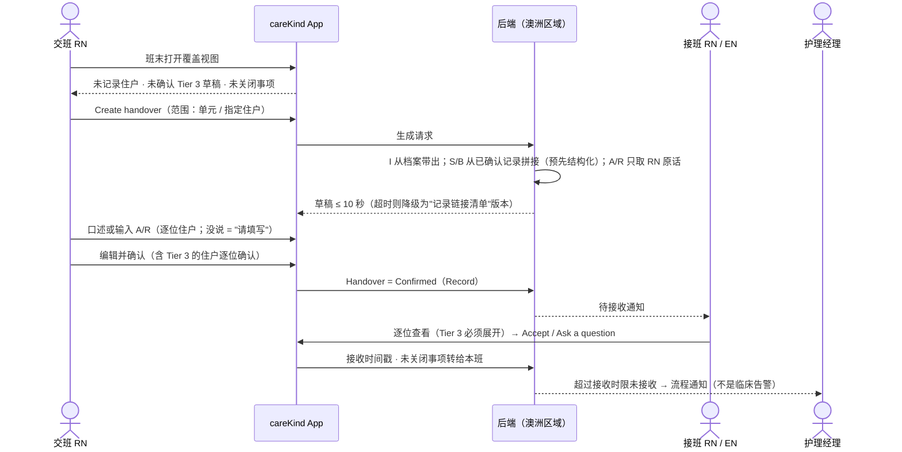
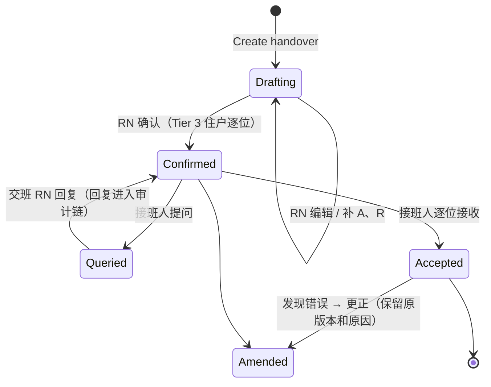
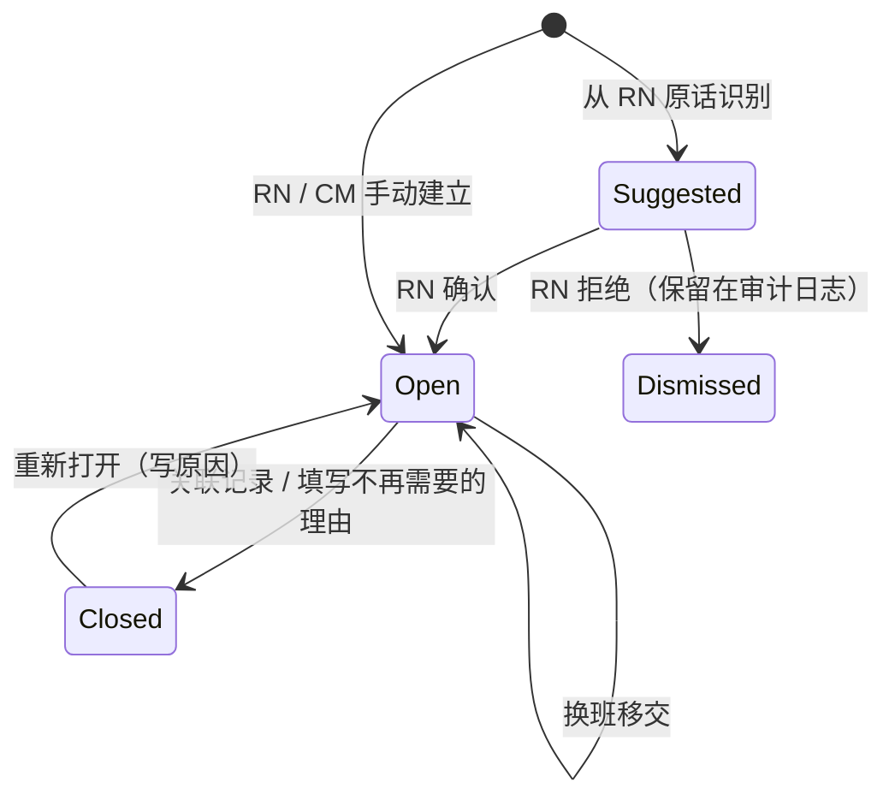

# PRD：班末 ISBAR 交接 + 跨班次未完成事项 + 班次覆盖视图 + 护理经理单元总览

Owner: Lightman (PO) · Status: **Draft** · Last reviewed: 18/10/2026
Parent: [docs/PRD.md](../PRD.md)（§4 突破 5、§7.4、§7.5、§8 Hand over / Manage）
Related: [2026-10-04-shift-capture-and-resident-records.md](2026-10-04-shift-capture-and-resident-records.md)（上游：记录如何产生与确认，本 PRD 不重复）· `06-app-development/product/document-templates/daily-shift-handover-isbar.md`（字段定义以此为准）· `06-app-development/research/care-documentation-process-flows.md` §1、§9、§10 H9、§11 · `03-legal-compliance/references/paperwork-requirements-by-event.md` §2、§3 · `01-strategy/competitive-research/how-competitors-solve-it.md` §10、§11

> 一句话：班末 RN 一键从**本班已确认的记录**生成每位住户的 ISBAR 交接草稿（S/B 复述已确认记录，A/R 只用 RN 原话，没说就"请填写"），连同**跨班次未完成事项**一起交给下一班；下一班在 App 里确认接收并留痕。班次覆盖视图只告诉护士"哪些住户本班还没有 careKind 记录"；护理经理看到单元总览。全部是**文书流程提示，不是临床判断**。

---

## 1. 问题

### 1.1 谁、在什么场景、遇到什么问题
- **交班 RN**：班末要把 10–30 位住户的情况口头或手写交接。交接的 A、R 栏是交班人自己的评估和建议，最容易被模板化或漏写（research §1.3）。同一观察已经写过 progress note，交接时又要重写一次。
- **接班 RN / EN**：交接"是否已接收"在很多机构没有留痕（research §1.3，推测）。跨多个班次的事项（跌倒后 24–48 小时观察、PRN 效果复查、P1 SIRS 5 天补充信息、care plan 复核）靠口头传递，容易丢失（research §9 第 2 条）。
- **护理经理 / DON**：需要证明 Outcome 3.3"关键信息有效沟通"和 Action 3.3.2(d)"交接使用结构化沟通系统"已经做到，并能发现本班没有任何记录的住户，安排补记。
- **主 PRD 的结构缺口**：数据模型以 ShiftSession 为单位，**没有"跨班次事项"的概念**（research §11 第 3 条）。本 PRD 补上。

### 1.2 证据（诚实标注）
| 证据 | 来源 | 强度 |
|---|---|---|
| 护士访谈 | `10-feedback/` 为空 | **n = 0，以下都是假设** |
| 交接必须用结构化沟通系统；风险、变化、恶化、事件必须进入交接 | SQS Action 3.3.1、3.3.2(c)(d)（本地 PDF 第 27 页）；Rules 15-20(6)(b)（第 89–90 页） | 强（法规原文） |
| 交接 AI 适合度高、TGA 风险低 | `03-legal-compliance/references/paperwork-taxonomy.md` §1.2；`paperwork-requirements-by-event.md` §2 | 中（法规与模板分析） |
| 跌倒后观察跨 24–48 小时、4–6 个班次 | `PT/vic-health-standardised-care-process-falls.pdf`（生命体征每小时 ×4 → 每 4 小时至 24 小时；无人目击时 neuro obs）；QLD post-fall pathway（research §2.2） | 强（时间表是事实）；漏观察的发生率是推测 |
| 竞品：Notive 有"本班完成进度"，但没有"哪些住户本班没有任何记录"；没有竞品公开"下一班确认接收" | `how-competitors-solve-it.md` §10 第 5 条、§12 | 弱到中（只看公开页面） |
| Heidi 有 SBAR 交接（护士版）；Aria、Notive 有交接摘要 | `competitor-matrix.md`；`profiles/notive.md` | 中（公开页面） |

**必须先验证的假设**
- **H-HO1**：RN 愿意班末口述 A/R（而不是只读一份 AI 摘要），且"审核 + 补 A/R"比自己写交接更快。
- **H-HO2**：接班人愿意在 App 里逐位确认接收，而不是把它当成额外负担。
- **H-HO3**：跨班次事项列表能减少交接遗漏（试点中对比基线抽样）。
- **H-HO4**：护理经理会用覆盖视图安排补记，而不是把它当成员工考核工具。

---

## 2. 目标与指标

### 2.1 目标
1. 交接内容 100% 来自已确认记录或 RN 原话，可逐句追溯。
2. 跨班次事项不会因换班而消失：直到有人关闭，它一直跟着住户走。
3. 交接有"谁交、谁接、几点接"的留痕，支撑 SQS 3.3.2(d) 的审计证据。
4. 交接生成快到不打断班末流程。

### 2.2 指标（试点）
| 指标 | 定义与测量方法 | 目标 |
|---|---|---|
| **交接摘要生成时长** | 从点击 "Create handover" 到草稿可编辑；后端埋点，按单元住户数分组统计 p95 | **p95 ≤ 10 秒；> 30 秒为不合格**（`rules/02-code-rules.md` §0.1） |
| A/R 栏 AI 自写内容 | 抽样交接中 A/R 栏出现非 RN 原话的句数（评测 + 试点每周抽样 20 份） | **0** |
| S 栏事实一致性 | S 栏每句都能链接到已确认记录，且意思一致（临床顾问抽样） | ≥ 99% {{TBD：临床顾问确认}} |
| 接收确认率 | 已确认交接中，下一班在 {{TBD：60}} 分钟内确认接收的比例（系统时间戳） | ≥ 90% {{TBD}} |
| 跨班次事项丢失 | 抽样中"口述或 RN 写明有后续、但没有出现在事项列表或交接里"的比例（与原话对照） | ≤ 2% {{TBD}} |
| 交接编辑耗时 | 草稿生成到 RN 确认的中位时长；对比试点前基线（时间研究） | 比基线缩短 {{TBD：基线后设定}} |
| RN 主观负担 | 试点第 4、12 周问卷（5 分量表） | 不低于基线 |

---

## 3. 用户故事

| 角色 | 用户故事 |
|---|---|
| 交班 RN | 作为交班 RN，我想一键从本班已确认的记录生成全单元的 ISBAR 草稿，Tier 3 事件置顶，**以便我只需审核和口述 A/R**。 |
| 交班 RN | 作为交班 RN，我想看到本班还**没确认**的 Tier 3 草稿，而不是被它们悄悄排除在交接之外。 |
| 交班 RN | 作为交班 RN，我说"下一组观察 02:20"，系统把它记成一个跨班次事项，**以便下一班不会漏**。 |
| 接班 RN / EN | 作为接班人，我想逐位查看交接（Tier 3 必须打开），确认接收，有疑问可以退回提问。 |
| PCW | 作为 PCW，我想在开班时看到我负责住户的跨班次事项（只读），**以便知道这班要记录什么**。 |
| RN / PCW | 作为护士，我想在班末看到哪些住户本班还没有 careKind 记录；如果我已在 CMS 里记录，可以标"Recorded elsewhere"。 |
| 护理经理 | 作为护理经理，我想看单元总览：交接是否已接收、待审核积压、Tier 3 清单、未记录住户、未关闭事项。 |
| Provider 管理员 | 作为管理员，我想配置班次时间、交接接收时限、哪些角色可以接收交接、机构的事项时间表模板（如 post-fall 观察时间表）。 |

---

## 4. 方案

### 4.1 核心概念（新增实体，挂在主 PRD §6.2 数据模型上）
| 实体 | 关键字段 | 说明 |
|---|---|---|
| `Handover` | 单元、班次、交班人、接班人、范围、状态、生成时间、确认时间、接收时间、版本 | 一份交接 = 一个单元一个班次；确认后是 Record，只能 Amended（G7） |
| `HandoverEntry` | 住户、I/S/B/A/R 字段、每句来源（record ID 或原话片段 ID）、最高 Tier、接收状态 | 每位住户一条 |
| `FollowUp`（跨班次事项） | 住户、来源（RN 原话片段 / RN 手动 / 机构模板 + RN 选定起点 / CM 手动）、类型、时间点列表、负责角色、状态、关闭人、关闭理由、关联记录 | **挂在 Event 或 Resident 上，不挂在 ShiftSession 上**，所以能跨班 |
| `CoverageSnapshot` | 单元、班次、每位住户的状态（已确认 / 只有草稿 / 无 careKind 记录 / 已标 Recorded elsewhere / AI 文书已退出） | 只统计记录数量，不推断原因 |

### 4.2 主流程

### 4.3 交接状态机

- 交班 RN 下班后仍未回复提问 → 提问转给接班 RN 和护理经理，原交接保持 Confirmed，**不阻塞接班**。

### 4.4 ISBAR 起草规则（字段以 `daily-shift-handover-isbar.md` §4、§7 为准）
| 栏 | 来源 | 规则 |
|---|---|---|
| I | 住户档案 | 至少 3 项识别信息（姓名 + DOB + Resident ID）+ 房间；**不从口述猜**（G4；ISBAR fact sheet 第 1 页"at least 3"） |
| S | 本班**已确认**记录 | 每句附来源链接；可以压缩合并，但不改变事实；**不把"否认撞到头"写成"无头部受伤"**；不写"stable / within normal limits"等判断（除非是已确认记录里 RN 的原话） |
| B | 档案中已有条目（care plan、BSP、近期事件） | 只引用，不总结病史；标出引用条目日期 |
| A | 交班 RN 原话 | 只用原话（rules/03 §6）；没说 → **"请填写"**；AI 不润色成临床术语 |
| R | 交班 RN 原话 | 同上；AI 不补任何建议（禁止 "monitor closely"、"consider X-ray"、"watch for delirium"） |
| Latest values | 已确认记录中的数值 | 原值 + 时间；不标正常 / 异常（G3） |
| Pending | 未关闭 FollowUp + 记录中的"请填写" | 见 §4.5 |
| 未确认 Tier 3 | 本班 PendingRN 的 Tier 3 草稿 | **单独一节 "Not yet confirmed"，不能隐藏**；内容只显示标题和链接，不进入 S 栏 |
- **排序**：只按 Tier 和事件类型（Tier 3 → Tier 2 → 其他 → 未记录住户），**不按病情严重程度**，不显示优先级分数。
- **A/R 的原话怎么来**：RN 在交接界面按住口述，或在班中口述时说"for handover…"；系统只把**归属到该住户、说话人是该 RN** 的片段放进 A/R，原话逐字显示，仅做标点和明显口误标注（标注要高亮）。

### 4.5 跨班次未完成事项（FollowUp）
| 来源 | 例子 | 怎么建立 |
|---|---|---|
| RN 原话 | R 栏："next set at 02:20" | 系统**建议**一个事项，RN 点确认才建立 |
| RN 手动 | "Ring Karen after GP review" | RN 输入 |
| 机构模板 + RN 选定 | 机构配置的 post-fall 观察时间表；RN 选择模板和起点时间 | 时间表由机构临床治理配置（依据其 post-fall procedure），**careKind 不提供默认时间表、不判断该用哪个** |
| CM 手动 | P1 notice 已提交 → 5 天内补充信息（Rules 165A-25(6)） | CM 录入"已提交时间"后建立；careKind 不判定是否 P1（G6） |

规则：
1. **不能删除，只能关闭**；关闭必须选"已完成（关联记录）"或"不再需要（填写理由）"；关闭人和时间进入审计链。
2. 未关闭的事项**自动随交接移交**，出现在下一班的 Pending 和覆盖视图里，直到关闭。
3. 时间点到达而**没有关联记录**时，显示 "02:20 — no linked note yet"。这是文书提示：**不说"overdue obs"、不说"at risk"、不根据数值改变提醒**。
4. 事项不进入 CMS 的正式记录；它是工作流数据。交接（含 Pending 一栏）作为记录导出。
5. 页面固定显示：*"This list helps you hand over documentation tasks. Follow your facility's observation chart and procedures."*

**FollowUp 状态机**

### 4.6 班次覆盖视图（Care coverage）
- 对象：本班单元名单上的每位住户；状态：`Confirmed notes` / `Draft only` / `No careKind notes this shift` / `Recorded elsewhere`（员工手动标记，例如已直接写入 CMS）/ `AI drafting off`（住户已退出 AI 文书，提示手动记录）。
- 按房间号排序，**不按"风险"排序**；不显示"被忽视""遗漏照护"等字样；不推断没有记录的原因。
- 文案："No notes yet this shift"（✅）；"Missed residents" / "Neglected" / "At risk"（❌）。
- 班末结束班次前显示一次（不强制，未记录住户不阻止结束班次；待分配队列仍按主 PRD §7.8 阻止）。

### 4.7 下一班确认接收
- 可接收的角色由机构配置（默认 RN / EN）；含 Tier 3 的住户条目**必须展开查看后**才能接收（有意识的动作，主 PRD 设计原则 1）。
- 接收是逐位住户的；可以"全部接收"只对不含 Tier 3、且已逐位展开的条目开放。
- 超过机构配置的接收时限（默认 {{TBD：60}} 分钟）未接收 → 通知护理经理。这是流程通知。
- 接收后，未关闭的 FollowUp 的负责班次自动改为接收班次。

### 4.8 护理经理单元总览（Phase 2）
| 卡片 | 内容 | 禁止 |
|---|---|---|
| 交接 | 各班交接：已确认 / 已接收 / 有提问 / 未接收 | — |
| 审核积压 | 按角色队列显示待审核数量和最长等待时长 | **不按员工个人排名、不显示个人完成率**（G10；`rules/06-adlc-rules.md` §9.4 同一精神） |
| Tier 3 清单 | 本班 / 近 24 小时 Tier 3 记录（链接） | 不做"本周 3 次跌倒"之类趋势汇总（🟡，见 §5） |
| 覆盖 | 各班"无 careKind 记录"的住户数和名单 | 不推断原因 |
| 未关闭事项 | 按住户列出，显示"no linked note yet"的时间点 | 不评分、不排序为"最危险" |

### 4.9 性能设计（≤ 10 秒）
1. **预结构化**：记录在 Confirmed 时就生成该住户的 S 栏候选句（附来源），交接时只做拼接和去重，不在班末重新跑全部 LLM。
2. 班末 LLM 只做一件事：把同一住户多条已确认句子压缩成 S 栏，每句仍附来源；并发按住户切分。
3. **降级**：LLM 超时（> 8 秒）或不可用 → 直接给出"按住户列出已确认记录链接 + 原句"的确定性版本，标明 *"Summary unavailable — showing confirmed notes"*；RN 仍可完成交接（主 PRD 原则 6：失败要安全）。
4. 性能底线写成自动化测试：30 位住户、每位 5 条已确认记录的合成单元，p95 ≤ 10 秒（`rules/02-code-rules.md` §0.1）。

### 4.10 异常流程
| 情况 | 系统行为 |
|---|---|
| 本班有未确认的 Tier 3 草稿 | 交接里单列 "Not yet confirmed"；确认交接前弹出对话框要求 RN 选择"已口头交接"或"先去审核"（不能静默跳过） |
| 住户退出 AI 文书 | I 栏照常；S/B 只引用手动记录（如有）；A/R 由 RN 手动输入；覆盖视图显示 `AI drafting off` |
| 交接确认后发现错误 | Amended，保留原版本；如果已接收，通知接收人更正内容 |
| 住户转院 / 回院 | 用同一模板生成 transition 交接（`daily-shift-handover-isbar.md` §1）；ACP 只显示存放位置（SQS 3.1.6） |
| 网络中断 | 草稿本地加密缓存；接收确认离线排队，恢复后上传并保留设备时间 |
| AI 服务不可用 | 降级版本（§4.9 第 3 条） |

### 4.11 范围
| ✅ MVP（试点） | ⏭ Phase 2 | ❌ 不做 |
|---|---|---|
| ISBAR 交接草稿（S/B 汇总、A/R 原话或"请填写"）+ RN 确认 + 导出 PDF / 剪贴板 | 下一班 App 内确认接收与提问 | AI 生成 A/R 或任何建议 |
| 班次覆盖视图（含 Recorded elsewhere、AI drafting off） | 机构配置的事项时间表模板 | 根据数值或时间判断"需要观察 / 需要就医" |
| FollowUp：RN 原话建议 + RN 手动建立、关闭、随交接移交（**建议提前到 MVP**，见 §13） | 护理经理单元总览 | 风险评分、病情严重程度排序、趋势汇总 |
| 性能底线 + 降级版本 | CM 录入的 SIRS 补充时限事项 | 按员工个人统计完成率、排名 |

---

## 4.5 法律依据（本地参考文件）✅

> 按 `legal-reference-check` 步骤手动执行（18/10/2026）；PDF 条款已用 `pdftotext -layout` 在本地原文核对。运营参考，不是法律意见。

| 主题 | 本地文件 | 条款 / 页码 | 对本功能的约束 |
|---|---|---|---|
| 交接必须结构化 | `03-legal-compliance/references/law-library/strengthened-aged-care-quality-standards-nov-2025.pdf` | Outcome 3.3 statement、Action 3.3.1、3.3.2(c)(d)，第 27 页 | 固定 ISBAR 结构；"risks emerge, change, deterioration or an incident" 必须进入交接 → Tier 3 / Tier 2 置顶，未确认 Tier 3 不能隐藏 |
| 同一义务的 Rules 版本 | `03-legal-compliance/references/law-library/aged-care-rules-2025-vol1-compilation-2026-08-01.pdf` | r 15-20(6)(b)，第 89–90 页 | "critical information … communicated effectively between aged care workers" → 接收留痕作为证据 |
| 信息准确、按时可得 | SQS（同上） | Action 2.7.2(a)(b)，第 19 页 | S 栏只复述已确认记录、逐句可追溯；"right information at the right time" 支持接收时限通知 |
| ISBAR 结构 | `03-legal-compliance/references/paperwork-templates/sa-health-isbar-clinical-handover-fact-sheet.pdf` | 第 1 页（Identify：patient identifiers at least 3；Recommendation：assign and accept responsibility；"customise … minimum set of information"） | I 栏 ≥ 3 项识别信息；R 栏要写明责任人；机构可配置最小数据集。**版权说明矛盾（`PT/index.md` D1 ⚠️），只参考结构，不复制措辞和版式** |
| 记录保存 | Rules vol1（同上） | r 154-1000(1)(d)、(2)，第 242–243 页 | progress notes 和"other clinical records"保存 7 年 → 交接导出到 CMS；careKind 审计日志（谁生成、谁确认、谁接收）保留 ≥ 7 年 {{TBD}} |
| SIRS 时限（事项来源之一） | Rules vol1 | r 165A-20（尽快告知）、r 165A-25(1)(6)，第 299–301 页；`03-legal-compliance/references/paperwork-requirements-by-event.md` §5 | P1 24 小时 + 5 天补充信息可以作为 CM 手动建立的事项；**交接和覆盖视图不替代 r 165A-20 的口头告知**，careKind 不判定 reportable（G6） |
| 跌倒后观察跨班 | `03-legal-compliance/references/paperwork-templates/vic-health-standardised-care-process-falls.pdf` | Post-fall assessment 一节（生命体征每小时 ×4 → 每 4 小时至 24 小时；无人目击或可能撞头时 neuro obs） | 观察时间表因州和机构而异 → **时间表由机构配置或 RN 选定**，careKind 不内置默认值、不判断是否需要 |
| 事件驱动的文书清单 | `03-legal-compliance/references/paperwork-requirements-by-event.md` | §2（Shift handover 行）、§3（跌倒：progress note + handover，Tier 3 需 RN 签署） | 交接 A/R 只用原话；含 Tier 3 的交接只能由 RN 确认 |
| TGA 边界 | `03-legal-compliance/references/law-library/tga-digital-scribes-summary.md`；`03-legal-compliance/tga-samd-boundary.md` | TGA 页面 2026-01-30；红绿灯表"Handover 汇总（只复述已记录事实）"🟢、"提示可能缺失的字段"🟡、"汇总趋势"🟡 | 见 §5 |
| TGA 动态 | `01-strategy/competitive-research/how-competitors-solve-it.md` | §11 第 1 条（TGA 2026-10-16 审查 12 个 scribe，8 个可能构成医疗器械，免责声明不够） | 边界必须写进产品行为（A/R 禁止 AI 写），不能只靠免责声明 |
| 护士专业责任 | `03-legal-compliance/references/law-library/nmba-code-of-conduct-for-nurses-2018.pdf`；`ahpra-ai-in-healthcare-summary.md` | Code 4.x（"clearly and accurately communicate relevant and timely information about the person to colleagues"）；AHPRA："practitioner is responsible for checking the accuracy" | RN 必须审核整份交接；接收人逐位确认 |
| 自动化决策透明度 | `03-legal-compliance/references/law-library/oaic-app-1-7-1-9-adm-transparency-flowchart-2026-09.pdf` | APP 1.7–1.9（2026-12-10 生效） | Tier 排序和覆盖统计属于流程辅助；是否落入"辅助决策"⚠️ 需律师确认 → 隐私政策先按披露处理 |
| 各州差异 | `03-legal-compliance/references/state-by-state-comparison.md` | §3.6（护士配比，只影响公营排班） | 交接结构无州法差异；`state-clinical-practice-rules.md`（18/10/2026 研究草稿）未覆盖 post-fall 观察的州差异，暂以机构政策为准 ⚠️ 需核实 |

### 本地资料缺口
- ⚠️ **"知悉时间"的法律含义**：交接中出现 Tier 3 事件、接收时间戳，是否会被认定为 provider "becomes aware"（r 165A-25(1)）的证据——本地无资料，需律师确认 → **上线门槛**（与 research §11 第 2 条同一问题）。
- ⚠️ **工作场所监控 / 员工工作记录**：单元总览若显示任何按员工个人的统计，可能触及工作场所监控法（`rules/legal-reference-map.md` 缺口表）——本地无资料，需律师确认 → 设计上不做个人统计；**如要加，先过律师**。
- ⚠️ SA Health ISBAR fact sheet 的许可（© all rights reserved vs CC 链接）→ 需核实；在核实前不引用其措辞。

### 可能过时的资料
- `PT/sa-health-isbar-clinical-handover-fact-sheet.pdf`：2016-02 版本。
- `PT/vic-health-standardised-care-process-falls.pdf`：2022-08 版本。
- `LL/acqsc-sirs-guidelines-residential-providers-v1-8-2022-legacy.pdf`：旧法版本，本 PRD 未依赖。

---

## 5. TGA boundary check ✅

**Verdict: 🟡**（ISBAR 汇总和覆盖视图 🟢；跨班次事项的时间点提示和单元总览 🟡）。

| 功能 | 判定 | 理由 |
|---|---|---|
| I/S/B 复述已确认记录 | 🟢 | 红绿灯表"Handover 汇总（只复述已记录事实）" |
| A/R 只用 RN 原话 | 🟢 | 没有生成临床人员没说过的评估或建议；若让 AI 写 A/R 即越过 TGA 页面"not explicitly stated by the healthcare practitioner"一句 → 🔴，禁止 |
| 覆盖视图（哪些住户没有记录） | 🟢 | 文书流程提示，不涉及临床判断 |
| FollowUp 时间点"no linked note yet" | 🟡 | 接近红绿灯表"提示可能缺失的字段"；守边界：时间表只来自 RN 原话、RN 选择或机构配置；提示只说"没有关联记录"，不说"需要观察"；不随数值变化 |
| 单元总览 Tier 3 清单 | 🟡 | 只列当前记录链接是 🟢；一旦做"本周 N 次跌倒"的趋势就进入 🟡 的"汇总趋势"→ MVP / Phase 2 都不做 |
| 按 Tier 排序 | 🟢 | 审核流程路由，不是严重程度判断 |

**Risky wording → safer alternative**
- "Overdue observations" → "No linked note yet for 02:20"
- "Residents at risk / missed residents" → "No notes yet this shift"
- "Monitor condition overnight"（AI 写）→ 不生成；只显示 RN 原话
- "Stable" / "Within normal limits"（AI 写）→ 只显示原值和时间
- "Clinical insights for managers" → "Unit documentation overview"

**Required next step**：临床顾问 + 法规顾问审查 FollowUp 提示和单元总览的文案与行为，结论写 ADR。
运营参考，不是法规意见；🟡/🔴 需要法规顾问确认。

---

## 6. 隐私影响 ✅

| 问题 | 回答 |
|---|---|
| 新收集的数据 | 交接内容（住户健康信息，Restricted；来自已有记录，不是新收集）；RN 的 A/R 口述片段（Restricted）；接收和提问的时间戳与人员（员工信息，Confidential）；FollowUp（健康信息相关工作流数据，Restricted）；"Recorded elsewhere"标记 |
| 是否必要 | 是：交接是法定结构化沟通（SQS 3.3.2(d)）；接收留痕是审计证据 |
| 存哪里 | 澳洲区域（G9、ADR-0001）；LLM 压缩 S 栏用境内端点、零保留 |
| 保留多久 | 交接导出到 CMS 后按过渡层规则（Shift Capture PRD §7）；A/R 原话音频按口述音频规则 {{TBD：7}} 天；FollowUp 关闭后 {{TBD：90}} 天删除工作流数据，审计日志 ≥ 7 年 {{TBD}} |
| 是否出境 | 否 |
| 新子处理方 | 无（沿用 LLM 和云平台）；如果交接要发送到接班人的推送通知，**通知内容不得包含住户姓名或健康信息**（只写 "You have a handover to accept"） |
| 员工数据用途 | 接收时间戳只用于交接留痕和流程通知，**不用于绩效**（G10）；单元总览不做个人统计 |
| 住户退出 | 退出 AI 文书的住户仍在交接中（I 栏、手动记录、RN 手动 A/R），不经过 LLM |
| PIA / 隐私政策 | 更新 PIA：新增交接汇总、接收元数据、FollowUp；隐私政策披露"按事件类别排序和覆盖统计"（APP 1.7–1.9，⚠️ 需律师确认是否触发） |

---

## 7. 临床危害 ✅

以下为新提出（**Proposed**），等临床顾问接受后才写入 `hazard-log.md`。

| ID（临时） | 危害 | 原因 | 潜在伤害 | 初始风险 | 控制措施 | 状态 |
|---|---|---|---|---|---|---|
| HAZ-P-HO-01 | 未确认的 Tier 3 事件没有进入交接 | S 栏只汇总已确认记录 | 下一班不知道跌倒、行为事件 | 高 | "Not yet confirmed"独立一节、不可隐藏；确认交接前强制选择；Tier 3 实时推送 RN（research §11 第 1 条） | Proposed |
| HAZ-P-HO-02 | AI 在 A/R 写入评估或建议 | 生成越界 | 错误照护；TGA 越界 | 高 | A/R 字段在代码层只接受 RN 原话片段或 RN 手动输入；评测门槛 0；禁用短语检查 | Proposed |
| HAZ-P-HO-03 | S 栏压缩改变含义（"denied hitting her head" → "no head injury"） | 摘要过度 | 漏掉神经观察需要 | 高 | 逐句来源链接；否定 / 阴性结论比对；关联 HAZ-001、HAZ-006 | Proposed |
| HAZ-P-HO-04 | 跨班次事项丢失或被误关闭 | 换班、误操作 | 观察或复查未做或未记录 | 高 | 不能删除；关闭需理由；自动移交；覆盖视图和交接 Pending 同时显示 | Proposed |
| HAZ-P-HO-05 | 覆盖视图被误读（"有记录 = 照护完成"，或 CMS 里已记录却显示"无记录"） | 统计口径只看 careKind | 漏补记，或误以为被忽视 | 中 | `Recorded elsewhere` 手动标记；固定说明文字；不推断原因 | Proposed |
| HAZ-P-HO-06 | 接班人没有看到 Tier 3 就接收 | 一键全部接收 | 交接信息丢失 | 高 | Tier 3 必须展开后接收；全部接收只对非 Tier 3 开放；未接收超时通知 CM | Proposed |
| HAZ-P-HO-07 | 员工依赖 FollowUp 代替机构观察表 | 自动化偏差 | 观察时间表错误或遗漏 | 中 | 时间表只来自 RN / 机构；固定说明"Follow your facility's observation chart"；培训 | Proposed |
| HAZ-P-HO-08 | Latest values 过时却被当成当前值 | 时间戳不醒目 | 错误判断 | 中 | 数值必须和时间一起显示；不标正常 / 异常（G3） | Proposed |
| HAZ-P-HO-09 | 交接条目挂到错误住户 | I 栏识别错误 | 错误照护、隐私泄露 | 高 | I 栏只从档案带出、≥ 3 项识别信息；关联 HAZ-003、HAZ-009（Proposed） | Proposed |

---

## 8. AI 评测

在 `clinical-safety/evaluation-plan.md` 基础上新增"交接评测集"（合成，临床顾问编写，不使用真实住户数据）：
- 20 个合成班次 × 每班 15–30 位虚构住户；包括：未确认 Tier 3、否认 / 阴性陈述、同一住户多条记录互相矛盾、RN 没有说 A/R、RN 说了含糊的 R（"keep an eye on her"）、数值多次测量、退出 AI 文书的住户、LLM 超时。

| 指标 | 发布门槛 |
|---|---|
| A/R 栏非原话内容 | **0** |
| S 栏句级来源覆盖率 | 100% 有链接 |
| S 栏事实一致性（含否定陈述保留） | ≥ 99% {{TBD}} |
| Tier 3 进入交接（已确认 + 未确认两节合计） | **100%** |
| FollowUp 建议召回（RN 原话中带时间的后续安排） | ≥ 95% {{TBD}}；误建议只需 RN 拒绝，不计入安全指标 |
| 禁用措辞（stable、WNL、monitor closely、at risk、overdue 等 AI 自写） | 0 |
| 生成时长 p95（30 住户合成单元） | ≤ 10 秒 |

每次模型、提示词变更跑全量；结果存 `evaluations/`，临床顾问 + Lin 签字。

---

## 9. 无障碍与多语言

- WCAG 2.2 AA；交接卡片用现有 `ck-card`、`ck-accordion`（Tier 3 展开）、`ck-badge`（Tier）、`ck-alert`（"Not yet confirmed"、降级提示）、`ck-dialog`（确认前选择）；**不新增评分或风险组件**（`COMPONENTS.md` §1.5）。来源链接、原话高亮、确认动作属于 DS-4（R3），按 DS-4 规格实现，不自行发明。
- 接收按钮足够大、单手可点；可调字号；屏幕阅读器按"住户 → I → S → B → A → R → Pending"顺序朗读。
- 交接输出语言：澳式英语。PCW 母语口述的记录进入交接时，S 栏使用**已确认的英文版本**，原文链接保留（见多语言 PRD `2026-10-18-multilingual-dictation-and-person-centred-language.md`）。
- 界面文字示例：*"Create handover"* · *"Please complete"*（请填写）· *"No notes yet this shift"* · *"Recorded elsewhere"* · *"No linked note yet for 02:20"* · *"Accept handover for Edna Hall"*。

---

## 10. 上线计划与回滚

1. **Alpha**：合成交接评测集达到 §8 门槛；性能测试通过。
2. **法律门槛**：律师意见覆盖"知悉时间"和单元总览的员工数据（§4.5 缺口）→ 🧑 Lightman 批准。
3. **试点**（沿用 Shift Capture PRD §11 的单元）：第 3 周起加入交接 + 覆盖视图；第 5 周起 FollowUp；接收确认和单元总览进入 Phase 2。试点前做交接耗时基线和交接遗漏抽样。
4. **回滚**：
   - A/R 出现任何非原话内容 → 关闭 S/B 的 LLM 压缩，只用降级版本（确定性列表），按 AI 事故流程处理。
   - Tier 3 未进入交接 → P1 临床安全事件，暂停交接功能，回到机构原交接流程（纸质 / CMS）。
   - 性能连续 {{TBD}} 天 p95 > 30 秒 → 默认使用降级版本。

---

## 11. Demo 与示例数据

| 项目 | 内容 |
|---|---|
| 对应功能 | ISBAR 交接、FollowUp、覆盖视图、下一班接收、护理经理单元总览 |
| 展示的用户结果 | 交班 RN 从一班已确认记录得到一份可确认的 ISBAR 交接；下一班看到并接收；未完成事项跨班保留 |
| Demo 入口（计划） | ① 产品介绍页 "See a sample handover"（只读完整交接，靠近价值说明和试点咨询入口）；② App 内 "Demo workspace — Wattle Grove (fictional)"，可切换演示身份：Daniel Reyes RN（交班）→ Sofia Martins RN（接班）→ Grace Liu（Care Manager）；③ 覆盖视图空状态里的 "View an example" |
| 虚构场景 | Wattle Grove Residential Care（虚构，VIC）· 18/10/2026 PM shift → Night。**Mrs Edna Hall**（虚构，88 岁）15:10 浴室跌倒、右手腕擦伤、意识清醒，已通知 RN 和女儿 Karen Hall（虚构）；Dr Amelia Brooks（GP，虚构）次日查房。**Mr Tomasz Nowak**（虚构，81 岁，痴呆，有 BSP）16:40 出口门行为事件。员工 Priya（PCW，虚构）、Daniel Reyes RN（虚构）、Sofia Martins RN（虚构，夜班，沿用模板示例）、Grace Liu（虚构）。另需一位"本班无记录"的虚构住户演示覆盖视图 → ⚠️ 需主 agent 确认是否加入统一示例集 |
| 示例内容 | Edna 和 Tomasz 的完整 ISBAR 以 `daily-shift-handover-isbar.md` §6 为准（Tomasz 的 A = "请填写"，演示 rules/03 §6）；FollowUp："Neuro obs as per post-fall procedure — next set 02:20"（来自 Daniel 的 R 原话，RN 确认后建立）；02:20 时夜班视图显示 "No linked note yet for 02:20"，Sofia 关联一条观察记录后关闭；"Pending: incident review — SIRS assessment to be recorded by Grace Liu"；一条"Not yet confirmed" Tier 3 草稿用于演示确认前对话框 |
| 预生成 vs 真实执行 | S 栏摘要为**预生成**（基于固定 fixture，不调用 LLM，界面标注 *"Pre-generated example"*）；确认、提问、接收、关闭事项为**真实交互**，只写入当前体验者的隔离 Demo 数据；不发真实通知、不导出到 CMS |
| 示例数据位置与性质 | 字段与文本来源：`06-app-development/product/document-templates/daily-shift-handover-isbar.md`、`daily-progress-note.md`；App 内 fixture 路径 {{TBD：App 技术栈确定后放在 app 仓库受版本管理的 demo fixtures 目录}}；全部明确标注虚构 |
| 隔离与重置 | 每位体验者独立 Demo 会话；"Reset demo" 只重置 Demo 数据；页面持续显示 "Demo — fictional data"；"Exit demo" 返回自己的工作区且不改动原有数据 |
| 验收方式 | 桌面 + 手机布局截图；从介绍页和空状态找到入口；以 Daniel 身份生成交接、补 A/R、确认；切到 Sofia 展开 Tier 3 并接收；关闭 02:20 事项；以 Grace 查看总览；重置；两个浏览器会话互不影响；退出后原工作区不变。**当前状态：未实现，未验收** |

---

## 12. 开放问题
1. FollowUp 是否进入 MVP（本 PRD 建议是：试点里一定会有跌倒，48 小时观察跨 4–6 个班次）？→ Lightman + 临床顾问
2. 交接以"单元 × 班次"为单位，还是"RN × 负责住户"？机构差异大 → 试点访谈
3. 接收时限默认值、可接收角色 → 机构配置；默认值需临床顾问建议
4. "Recorded elsewhere"是否需要填写 CMS 记录时间？（多一步 vs 审计价值）
5. 没有 CMS 集成时，交接 PDF 存到哪里才算"进入正式记录"？→ 与过渡层 ADR 一起决定

## 13. 对主 PRD 的变更建议（不在本 PRD 内修改）
- §6.2 数据模型：新增 `Handover`、`HandoverEntry`、`FollowUp`（挂 Event / Resident，不挂 ShiftSession）、`CoverageSnapshot`。
- §6.3 状态机：班次会话 `Closing → Closed` 的条件改为"交接已确认"（不要求已接收）；新增 Handover、FollowUp 状态机。
- §7.4：补充"未确认 Tier 3 单列""接收时 Tier 3 必须展开""未接收超时通知 CM""降级版本"。
- §8 分期：把"FollowUp（RN 建立 + 移交）"从未列出改为 MVP；"下一班确认接收"保持 Phase 2。
- §9 护栏建议新增（需 ADR）：**G12 覆盖、事项和总览只做文书提示：不推断原因、不按严重程度排序、不做个人员工统计**。
- §11 指标：加入"交接生成 p95 ≤ 10 秒""A/R 非原话内容 = 0"。

## 14. 建议 registry 登记行
| PRD | 标题 | 阶段 | Assignee | Reviewer | 复杂度 | 风险 | Parent | Blocked | 更新 |
|---|---|---|---|---|---|---|---|---|---|
| 2026-10-18-isbar-handover-and-care-coverage | ISBAR 交接 + 跨班次事项 + 覆盖视图 + 单元总览 | idea | （留空，需 Lightman 确认） | — | **M** | **R3** | — | — | 18/10/2026 |

- **复杂度 M（5 分）**：范围 2（交接、FollowUp、覆盖、总览，4 个模块）+ 技术面 2（LLM 汇总 + 性能底线）+ 不确定性 0（方案清楚；法律问题不计入技术不确定性）+ 依赖 1（依赖 Shift Capture PRD 的已确认记录和多语言 PRD）。
- **风险 R3**：触及临床记录确认路径（交接确认、接收）、AI 生成行为（S 栏压缩）、TGA 🟡、护栏 G1/G2/G3/G7/G10。

## 15. 审批
| 角色 | 姓名 | 日期 |
|---|---|---|
| 产品 | | |
| 临床顾问 | | |
| CTO / Tech Lead | | |
| 法律意见（知悉时间、员工数据） | | |
