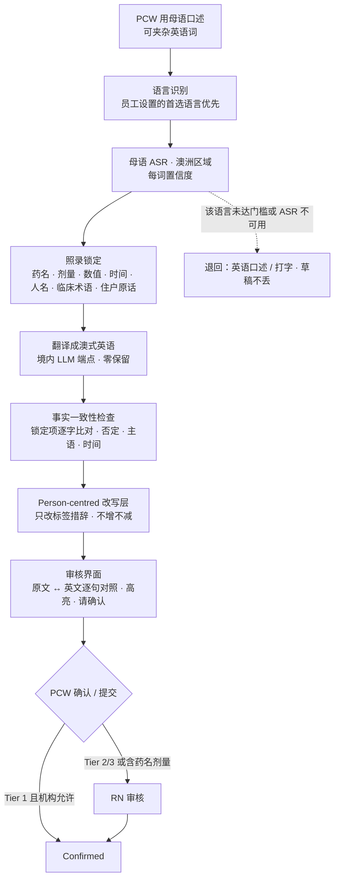

# PRD：母语口述 → 澳式英语记录 + Person-centred 语言改写

Owner: Lightman (PO) · Status: **Draft** · Last reviewed: 18/10/2026
Parent: [docs/PRD.md](../PRD.md)（§4"其他亮点"多语言口述 / Person-centred 语言、§6.6 起草规则 3、5、§8 Understand Phase 2）
Related: [2026-10-04-shift-capture-and-resident-records.md](2026-10-04-shift-capture-and-resident-records.md)（上游录音与归属，本 PRD 不重复）· [2026-10-18-isbar-handover-and-care-coverage.md](2026-10-18-isbar-handover-and-care-coverage.md)（下游交接）· `06-app-development/product/document-templates/daily-progress-note.md`（改写示例与起草规则）· `clinical-abc-behaviour-chart.md` · `06-app-development/clinical-safety/hazard-log.md` HAZ-004、HAZ-006、HAZ-008 · `01-strategy/competitive-research/ai-features-comparison.md` §2、`how-competitors-solve-it.md` §10 第 6 条、§11 第 4 条

> 一句话：PCW 用自己最顺口的语言（候选 Hindi、Nepali、Mandarin、Cantonese、Indonesian，**需访谈确认，n = 0**）口述观察；careKind 生成规范的澳式英语草稿，**原文和译文逐句对照**，低置信度、药名、数值和临床术语**照录不翻译并要求确认**；标签化措辞改写成可观察的描述，但**不增加事实、不弱化事件**，每处改写都高亮。护士仍是作者。

---

## 1. 问题

### 1.1 谁、在什么场景、遇到什么问题
- **英语非母语的 PCW / EN**：观察很具体，但用英文写下来慢、怕写错，结果记录变短、变笼统（"resident settled"），或者请同事代写（主 PRD 原则 5；research §1.3"PCW 英语非母语，写英文记录慢"——推测，需试点验证）。
- **审核 RN**：看不懂"直译腔"的记录，或者看到标签化的词（"aggressive"、"difficult"、"wandering"）而没有可观察的事实，只能退回追问。
- **护理经理 / 审计**：记录要准确完整（SQS 2.7.2(b)）、person-centred、不贬低住户（SQS 1.2.2）；同时 Quality Standards 要求给英语为第二语言的员工可用的支持（SQS 2.9.3）。
- **风险方向相反的两件事**：翻译可能改变临床含义（HAZ-008）；"润色"可能把事件写轻（HAZ-006）或者编出没观察到的细节（HAZ-001）。

### 1.2 证据（诚实标注）
| 证据 | 来源 | 强度 |
|---|---|---|
| 护士访谈 | `10-feedback/` 为空 | **n = 0；语种清单和需求都是假设** |
| Uniting Buddy（自建，居家）支持 Hindi、Nepali、Indonesian、Mandarin、Cantonese，"按护工构成挑选" | `ai-features-comparison.md` §2（S70）；`profiles/provider-in-house-builds.md` | 中（公开报道）；**不是 residential，也不是我们的用户** |
| residential 专用工具里只有 Heidi（通用平台，"母语口述输出英文"）公开支持多语言；Notive 未提多语言 | `how-competitors-solve-it.md` §10 第 6 条；`profiles/heidi-health.md`、`profiles/notive.md` | 中（公开页面，未试用） |
| Aria Care 有翻译和"Dignity + Risk Guardian"标出含糊措辞；Beam 有实时翻译 Interpret | `how-competitors-solve-it.md` 输出对比表；`profiles/aria-care.md`、`profiles/beam.md` | 中 |
| scribe 对非英语口音识别准确率更低 | `how-competitors-solve-it.md` §11 第 4 条（S101，⚠️ 报告未见原始数据） | 弱 |
| "describe the behaviour, not the label"；"Include only facts" | `03-legal-compliance/references/paperwork-taxonomy.md`（ABC 字段、§ 客观叙述规范第 5 条） | 中（行业模板） |

**必须先验证的假设**
- **H-ML1**：目标机构 PCW 的母语分布集中在少数几种语言（试点前做员工匿名问卷，只统计语种，不关联个人）。
- **H-ML2**：PCW 用母语口述 + 看对照审核，比用英语口述或打字更快，且 RN 退回率不升高。
- **H-ML3**：PCW 能读懂英文草稿到足以确认（否则需要"母语回读"，见 §4.4）。
- **H-ML4**：RN 和护理经理认为改写后的记录"更具体、更尊重"，而不是"AI 味"。

---

## 2. 目标与指标

### 2.1 目标
1. PCW 可以用母语口述，得到可审核、可追溯的澳式英语记录。
2. 翻译不改变临床含义：药名、剂量、数值、否定、时间、谁做了什么，一个都不能变。
3. 记录语言 person-centred，但事实不增、事件不减。
4. 每种语言都单独过评测门槛才上线；过不了就不上，退回英语口述或打字。

### 2.2 指标（试点）
| 指标 | 定义与测量方法 | 目标 |
|---|---|---|
| ⭐ CALD PCW 每条记录耗时 | 口述开始到提交的中位时长（埋点），对比基线时间研究 | 比基线缩短 {{TBD：基线后设定}} |
| 草稿采纳率（分语言） | 提交时只有小幅编辑的比例 | ≥ 70%，且各语言与英语差距 ≤ {{TBD}} |
| RN 退回率（翻译记录 vs 英语记录） | 退回数 / 提交数 | 不高于英语记录 + {{TBD}} |
| 临床含义错误进入正式记录 | 每周抽样（双语临床审阅者）+ 护士报告 | **0**（出现即 P1 临床安全事件） |
| 低置信度标记率（分语言） | 每条记录被标"请确认"的片段比例 | 跟踪；用于发现口音偏差 |
| 改写弱化事件 | 抽样中 Tier 3 记录的事件关键词丢失或软化次数 | **0** |
| 改写新增事实 | 抽样中改写后出现原话没有的事实 | **0** |

---

## 3. 用户故事

| 角色 | 用户故事 |
|---|---|
| PCW（英语非母语） | 作为 PCW，我想用 Hindi 说出我看到的事，得到英文记录，**并能逐句对照我说的原话**。 |
| PCW | 作为 PCW，我说的药名和数字要原样保留；系统不确定的地方要问我，不要猜。 |
| PCW | 作为 PCW，我看不太懂英文草稿时，想用母语看一遍"英文草稿说的是什么意思"，再决定提交。 |
| RN | 作为 RN，我审核翻译记录时，想看到哪些句子是翻译、哪些是改写、哪些词照录待确认。 |
| RN | 作为 RN，我需要知道住户原话是不是由 careKind 翻译的，而不是专业口译员翻译的。 |
| 护理经理 | 作为护理经理，我想按语言看评测和退回情况，确认这个语言可以继续启用。 |
| Provider 管理员 | 作为管理员，我想按单元开启或关闭某种语言，并看到每种语言的处理地点和子处理方。 |

---

## 4. 方案

### 4.1 管线

### 4.2 语种上线规则
- 候选：Hindi、Nepali、Mandarin、Cantonese、Indonesian（来自竞品 Uniting Buddy 的公开选择，**不是我们的用户数据**）；Punjabi、Tagalog、Vietnamese 等按试点问卷补充。
- **每种语言单独上线**，三个条件都满足才能启用：① 评测达到 §8 门槛；② ASR 和翻译都能在**澳洲区域**处理（G9；`vendor-subprocessor-register.md`"语音转写：必须确认在澳洲境内处理"）；③ 至少一位双语临床审阅者签字。
- 任一条件不满足 → 该语言在界面上显示 "Not available yet"，PCW 用英语口述或打字。**不允许为了某种语言把音频送出境。**
- 中英夹杂（code-switching）是常态：英语词照录，不"翻译回"英语以外的形式。

### 4.3 照录锁定（不翻译、只照录、要求确认）
| 类别 | 规则 | 关联 |
|---|---|---|
| 药名（通用名、商品名、俗称） | **原样照录**说出的词（如 "Panadol"）；不换成通用名、不补剂量；标 "Please confirm the medicine name"；含药名的条目至少 Tier 2，由 RN 确认 | HAZ-004；research §10 H3；不写给药记录（research §11 第 12 条） |
| 剂量、数值、单位 | 保留数字和单位；母语说的数字（如 "पाँच सौ"）转阿拉伯数字时，原文并排、标"请确认"；不推算、不补单位 | G3；HAZ-004 |
| 时间 | 口述中的时间原样保留并转成 24 小时制；"昨晚""刚才"之类相对时间不换算成具体时间，标"请确认事件时间" | Shift Capture HAZ-012 |
| 临床术语和体征 | 说的是英语术语就照录；说的是母语描述就**直译描述**，不升级为术语（"她有点糊涂" → "she seemed confused"，**不写 "delirium"**） | G2；TGA |
| 否定和不确定 | "没撞到头""好像""她说"必须保留；翻译后逐句比对否定词 | HAZ-001、HAZ-008 |
| 住户原话 | 住户自己说的话放引号，标明 "translated by careKind — not an interpreter"；住户说英语就逐字照录 | Act s23(8) |
| 人名、房间号 | 照录；归属仍按 Shift Capture PRD（G4） | HAZ-003 |

### 4.4 审核界面（组件按 DS-4 规格，不自行发明）
- **逐句对照**：左边母语转写（可回放音频），右边英文草稿；点任一句高亮对应句。
- 标记：🔶 低置信度（ASR 或翻译）；🔒 照录锁定项（要求确认）；✏️ person-centred 改写（悬停显示原措辞和改写理由）。
- **母语回读（可选，默认开）**：把英文草稿再用 PCW 首选语言显示一遍"草稿的意思"，帮助确认；明确标注 *"Meaning check only — the English note is the record"*。回读不进入记录。
- PCW 不能确认含 🔒 未确认项的条目；Tier 3 照主 PRD 只能由 RN 逐条确认（G5）。
- RN 视图显示："Dictated in Hindi · translated by careKind · 2 items confirmed by author"。

### 4.5 Person-centred 改写规则（主 PRD §6.6 第 3、5 条的细化）
| 允许 | 例子 | 条件 |
|---|---|---|
| 标签 → 原话中**已有**的可观察描述 | "aggressive" + "pushing the door, hitting it with his hand" → 只写后者 | 可观察事实必须出现在原话里 |
| 标签但没有可观察描述 | 原话只有 "she was difficult" | **不编**；保留为员工原话（引号）并提示 "Please describe what you saw or heard" |
| 贬低或非 person-centred 用语 → 中性用语 | "wanderer" → "walking around the unit"（如果原话有）；"the dementia patient" → 住户姓名 | 不改变事实 |
| 用新法用语 | "older person"、"resident"、"aged care worker" | — |

| 禁止 | 例子 |
|---|---|
| **弱化事件** | "hit" → "made contact"；"fell" → "was found on the floor"（除非原话如此）；"bleeding" → "minor mark"；删除 "refused"、"yelled"、"pushed"、"bruise" |
| 增加事实 | 原话没说的原因、动机、时长、"no injury"、"calm and settled" |
| 临床化 | "confused" → "delirium"；"sad" → "depressed"；"didn't want to eat" → "poor appetite due to …" |
| 改写住户原话 | 住户的话只能翻译，不能改写成更"礼貌"的版本 |

- **Tier 3 记录**：事件描述中的动作动词和伤害描述**逐字保留**（翻译后），改写只作用于标签词。
- 每处改写都高亮，作者可以一键还原原措辞。
- 改写不是"评价员工"：不显示"你用了 3 个不当词"之类统计（G10）。

### 4.6 数据与设置
- 员工设置：首选口述语言（可多选）、是否开启母语回读。**由员工自己选择、随时可改、可以不填**（不填 = 英语）。
- 住户档案已有"语言与沟通需求"（Shift Capture PRD §4.4），本功能只用于在住户原话处提示"住户说的是 Polish"，不做住户语言识别。

### 4.7 异常流程
| 情况 | 系统行为 |
|---|---|
| 语言识别错误 | 显示识别出的语言，PCW 一键改正后重跑；原音频保留到确认 |
| ASR / 翻译不可用 | 草稿保留；提示改用英语口述或打字（主 PRD 原则 6） |
| 整段低置信度（噪声、口罩） | 不生成英文正文，只给转写和"请重述或打字" |
| 药名无法识别 | 照录近似拼写 + 🔒，RN 必须确认；不从药物库"猜"最接近的药 |
| 作者发现翻译错误（确认后） | Amended（G7）+ 一键 "Report AI error" → AI 事故流程 + 评测集 |

### 4.8 范围
| ✅ 本 PRD（Phase 2，主 PRD §8） | ⏭ 以后 | ❌ 不做 |
|---|---|---|
| 1–3 种首批语言（按试点问卷），逐语言门槛 | 更多语言 | 代替专业口译与住户沟通（实时口译） |
| 逐句对照、照录锁定、低置信度、母语回读 | 机构自定义改写词表 | 把记录翻译成住户或家属语言对外发送 |
| Person-centred 改写层 + 高亮 + 一键还原 | | 药名自动纠正为药物库条目、补剂量 |
| 英语口述同样使用改写层（改写规则与语言无关） | | 用改写统计评价员工语言能力或绩效 |

---

## 4.5 法律依据（本地参考文件）✅

> 按 `legal-reference-check` 步骤手动执行（18/10/2026）；PDF 条款已用 `pdftotext -layout` 在本地原文核对。运营参考，不是法律意见。

| 主题 | 本地文件 | 条款 / 页码 | 对本功能的约束 |
|---|---|---|---|
| TGA：翻译不属于医疗器械 | `03-legal-compliance/references/law-library/tga-digital-scribes-summary.md` | TGA 页面 2026-01-30："transcribe and translate … without performing analysis or interpretation" | 翻译是 🟢；"临床化"（confused → delirium）就是分析解读 → 禁止 |
| TGA 红绿灯 | `03-legal-compliance/tga-samd-boundary.md` | 🟢 "翻译（多语言口述 → 英文）"、"语法、拼写、person-centred 语言改写" | 两项核心功能都在 🟢 列，前提是不生成没说过的内容 |
| TGA 动态 | `01-strategy/competitive-research/how-competitors-solve-it.md` | §11 第 1 条（2026-10-16 审查，免责声明不够） | 边界写进管线（照录锁定、禁止临床化），不靠免责声明 |
| 住户的语言权利 | `03-legal-compliance/references/law-library/aged-care-act-2024-compilation-2026-07-01.pdf` | s 23(8)，第 53 页（"communicate in the individual's preferred language … with access to interpreters"）；同一 Act 的多样性原则 (x)"bilingual aged care workers and interpreters being made available if required"（⚠️ 所在条号待核实） | careKind 翻译**不是口译服务**：住户原话标注 "translated by careKind — not an interpreter"；不用于和住户沟通的场景 |
| 员工支持与 ESL | `03-legal-compliance/references/law-library/strengthened-aged-care-quality-standards-nov-2025.pdf` | Action 2.9.3，第 20 页（"accessible for aged care workers with English as a second language and be culturally sensitive"） | 支撑价值主张；但不能对外说"帮机构满足 2.9.3"（ACL ⚠️） |
| Person-centred、尊重 | SQS（同上） | Outcome 1.1、Action 1.2.2（第 9–10 页） | 改写为中性、尊重的用语 |
| 记录准确完整 | SQS（同上） | Action 2.7.2(b)，第 19 页 | 改写不增不减；照录锁定；逐句可追溯 |
| 交接与沟通 | SQS（同上） | Action 3.2.9、3.3.1，第 26–27 页 | 下游交接使用已确认英文版，原文可追溯 |
| 记录保存 | `03-legal-compliance/references/law-library/aged-care-rules-2025-vol1-compilation-2026-08-01.pdf` | r 154-1000(1)(d)、(2)，第 242–243 页 | 正式记录是英文版；原文转写和翻译对照作为来源的保存期 → 过渡层 ADR 决定；审计日志 ≥ 7 年 {{TBD}} |
| 敏感信息定义 | `03-legal-compliance/references/law-library/oaic-app-guidelines-consolidated-2026-05.pdf` | Chapter B，B.141–B.142（第 28 页）："racial or ethnic origin"；"clearly implies" | 员工首选语言可能"暗示"族裔 → 按 sensitive 处理：员工自选、可不填、只用于选择 ASR 模型，不进入报表 ⚠️ 需律师确认 |
| 跨境披露 | 同上 | Chapter 8 APP 8.1 | 任何语言的音频和文本不得出境；做不到就不上线该语言 |
| 商用 AI 隐私 | `03-legal-compliance/references/law-library/oaic-guidance-commercial-ai-products-summary.md`；`oaic-checklist-privacy-use-of-commercial-ai-products-2024.pdf` | APP 3（AI 生成的信息也是收集）、APP 10（准确性） | 翻译和回读的输出属于收集的个人信息 → 同样加密、同样保留规则；ASR / 翻译供应商逐项对照清单 |
| AI 偏差与公平 | `03-legal-compliance/references/law-library/acsqhc-ai-clinical-use-guide-2025-08.pdf` | 第 3 页"Data representation"、"Fairness and equity … biases … ethnicity" | 必须分语言、分口音评测；发布门槛按组设定 |
| ambient scribe 安全 | `03-legal-compliance/references/law-library/acsqhc-ai-safety-scenario-ambient-scribe-2025-08.pdf` | "Monitoring: … hallucinations"；"timely review of all AI summaries" | 翻译错误报告入口；RN 审核 Tier 2/3 |
| 护士专业责任 | `03-legal-compliance/references/law-library/nmba-code-of-conduct-for-nurses-2018.pdf`；`ahpra-ai-in-healthcare-summary.md` | Code（"clearly and accurately communicate … to colleagues"；"meet the specific language, cultural, and communication needs"）；AHPRA："responsible for checking the accuracy" | 作者确认英文版；RN 审核时能看到原文 |
| 文书字段与客观叙述 | `03-legal-compliance/references/paperwork-taxonomy.md` | ABC 字段（"describe the behaviour, not the label"）；客观叙述规范第 5 条 | 改写规则的直接来源；"不能添加员工没有观察到的事实" |
| 自有模板示例 | `06-app-development/product/document-templates/daily-progress-note.md` | §6 改写说明、§7 起草规则 | "a bit grumpy" → "said she was unhappy about being lifted"；"talking normal" 不写成 GCS |
| 危害日志 | `06-app-development/clinical-safety/hazard-log.md` | HAZ-004、HAZ-006、HAZ-008 | 本 PRD 的控制措施是这三条的细化 |

### 本地资料缺口
- ⚠️ **机器翻译用于临床记录 / 口译标准**（例如 NAATI、各州卫生系统关于口译的政策）：本地无资料，需律师和临床顾问确认 → **上线门槛**（尤其是住户原话的翻译）。
- ⚠️ **员工语言偏好是否构成 sensitive information**：本地只有 OAIC 定义，没有具体指引 → 需律师确认 → 上线门槛（在确认前按 sensitive 处理）。
- ⚠️ **工作场所监控**：如果有人想用改写统计评价员工，触及缺口表主题 → 产品不提供此类统计。
- ⚠️ **Australian Consumer Law**：对外宣称语言支持和准确率前需要 ACCC 指引（缺口表）→ 营销门槛。
- 技术前提（不是法律缺口，但同样是门槛）：各候选语言在澳洲区域是否有可用的 ASR → 技术 spike。

### 可能过时的资料
- `LL/oaic-app-guidelines-consolidated-2026-05.pdf` 内 Chapter B 页脚显示 "Version 1.4, December 2022"，需在采用前确认是否最新。

---

## 5. TGA boundary check ✅

**Verdict: 🟢**（守住下面的禁止项；任何一条被突破就变成 🔴）。

| 功能 | 判定 | 理由 |
|---|---|---|
| 母语转写 + 翻译成英文 | 🟢 | TGA 原文明确把 "transcribe and translate" 排除在医疗器械之外 |
| Person-centred 改写 | 🟢 | 红绿灯表 🟢 列；只改措辞不改事实 |
| 照录锁定 + 低置信度确认 | 🟢 | 只是要求人确认，不做判断 |
| 母语回读 | 🟢 | 是对已有草稿的翻译 |
| 把描述升级成诊断术语（confused → delirium） | 🔴 禁止 | 生成了员工没说过的诊断 |
| 药名纠正为药物库条目、补剂量 | 🔴 禁止 | 接近用药核对（红绿灯 🔴"用药核对"） |

**Risky wording → safer alternative**
- "Clinically accurate translation" → "Translates your words into English for you to check"
- "Detects inappropriate language" → "Suggests person-centred wording — you choose"
- "Medical interpreter" → 不使用；"Not an interpreter service"

**Required next step**：无需 ADR；临床顾问审阅禁止项清单和评测集；每次模型或语言变更复核预期用途。
运营参考，不是法规意见；🟡/🔴 需要法规顾问确认。

---

## 6. 隐私影响 ✅

| 问题 | 回答 |
|---|---|
| 新收集的数据 | ① 员工首选口述语言（员工个人信息，**按 sensitive 处理** ⚠️）；② 母语音频和转写（住户健康信息，Restricted，含员工声音）；③ 英文译文、改写记录、母语回读文本（AI 生成的个人信息，同样 Restricted） |
| 必要性 | ① 只用于选择 ASR 模型和回读语言；② ③ 是生成和核对记录必需 |
| 存哪里、子处理方 | 全部澳洲区域；ASR 供应商（每种语言可能不同）和 LLM 端点写入 `04-security/vendor-subprocessor-register.md`，**逐语言写明处理地点**；变更按 DPA 提前通知客户 |
| 出境 | 不允许；做不到 → 该语言不上线（§4.2） |
| 保留 | 音频：同口述音频（确认后 {{TBD：7}} 天）；转写 / 译文 / 回读：同草稿（导出后 {{TBD：30–90}} 天）；员工语言设置：账号存续期间，删除账号即删 |
| 谁能看到员工语言设置 | 员工本人和系统；管理员只看到"该单元启用了哪些语言"，**不看到谁用哪种语言**；报表只按语言聚合，单元人数少于 {{TBD：5}} 时不显示 |
| 训练 | 不用客户音频或文本训练通用模型（G9）；评测只用合成数据 |
| 住户退出 | 住户退出 AI 文书 → 有关该住户的口述不起草（主 PRD §7.8），与语言无关 |
| PIA / 隐私政策 | 更新 PIA（新数据类别①、新子处理方）；隐私政策和员工告知写明"语言设置的用途和可不填"；DPA 子处理方附表按语言列出 |

---

## 7. 临床危害 ✅

已有危害沿用并细化：**HAZ-008**（翻译改变临床含义）、**HAZ-004**（药名剂量错误）、**HAZ-006**（事件弱化）、HAZ-001（幻觉）、HAZ-005（自动化偏差）。新提出（**Proposed**）：

| ID（临时） | 危害 | 原因 | 潜在伤害 | 初始风险 | 控制措施 | 状态 |
|---|---|---|---|---|---|---|
| HAZ-P-ML-01 | 中英夹杂中的药名被识别成另一种药或被"翻译" | code-switching、商品名、口音 | 用药错误风险 | 高 | 照录锁定 + 🔒 确认；含药名至少 Tier 2；不从药物库猜；分语言药名评测 | Proposed |
| HAZ-P-ML-02 | 否定或不确定在翻译中丢失（"没撞到头" → "hit her head"） | 翻译错误 | 错误照护（漏或多做观察） | 高 | 否定词逐句比对；不一致则不生成该句、标请确认；评测门槛 100% | Proposed |
| HAZ-P-ML-03 | 改写弱化事件（hit → made contact） | 风格改写过度 | 事件未按 SIRS 评估 | 高 | Tier 3 动作动词逐字保留；禁止弱化词表；评测门槛 0 | Proposed |
| HAZ-P-ML-04 | 改写为了"描述行为"而编造细节 | 原话只有标签 | 虚假记录 | 高 | 没有可观察事实时保留原话并提示补充；新增事实检查 | Proposed |
| HAZ-P-ML-05 | PCW 读不懂英文就确认 | 语言能力、时间压力 | 错误进入记录 | 中 | 母语回读；🔒 项必须逐项确认；RN 审核 Tier 2/3 | Proposed |
| HAZ-P-ML-06 | 住户原话被翻译后当成住户本人英语原话 | 未标注来源 | 误解住户意愿或同意 | 中 | 标注 "translated by careKind — not an interpreter"；涉及同意、拒绝照护的原话提示 RN 按机构流程安排口译 | Proposed |
| HAZ-P-ML-07 | 识别错语言或方言导致整段错误 | 语言识别错误 | 记录错误 | 中 | 显示识别语言、一键改正；整段低置信度不生成英文 | Proposed |
| HAZ-P-ML-08 | 某语言 / 口音的错误率系统性更高，导致这组员工审核负担更重或错误更多 | ASR 偏差 | 公平性问题；错误进入记录 | 中 | 分组评测和门槛；试点中按语言监测低置信度率和退回率；不达标即关闭该语言 | Proposed |
| HAZ-P-ML-09 | 相对时间被错误换算（"昨晚" → 具体时间） | 翻译推断 | 事件时间错误 | 中 | 相对时间不换算、标请确认 | Proposed |

---

## 8. AI 评测

新增**多语言评测集**（合成；由临床顾问编写英文场景，双语护理人员用目标语言自然口述并录音；**不使用真实住户数据**）：
- 每种语言 ≥ {{TBD：100}} 条，覆盖：跌倒、行为事件、拒绝照护、疼痛描述、饮食、PRN 叙述（药名夹英语 / 母语 / 商品名）、否定和不确定、相对时间、住户原话、背景噪声、不同口音和方言（如 Cantonese vs Mandarin、Hindi 夹 Punjabi）。
- **改写评测集**（与语言无关）：200 条含标签措辞的英文和翻译后句子，覆盖"有可观察事实""只有标签""Tier 3 事件"三类。

| 指标 | 发布门槛（每种语言单独） |
|---|---|
| 锁定项（药名、数值、单位、时间）逐字一致 | **100%**（不一致必须被标出） |
| 否定 / 不确定保留 | **100%** |
| 临床含义等价（双语临床审阅者，句级） | ≥ 98% {{TBD：临床顾问确认}} |
| 临床化（新出现诊断或术语） | **0** |
| 母语 ASR 错误率（WER / CER） | ≤ {{TBD}}，且与英语组差距 ≤ {{TBD}} |
| 改写：Tier 3 事件关键词保留 | **100%** |
| 改写：新增事实 | **0** |
| 改写：标签被替换为可观察描述（有事实时） | ≥ 90% {{TBD}} |
| 低置信度召回（真正有错的片段被标出） | ≥ 95% {{TBD}} |

流程同 `evaluation-plan.md`；每次模型、提示词、ASR 供应商或语言新增都跑全量，双语审阅者 + 临床顾问 + Lin 签字。**没有双语临床审阅者的语言不能上线。**

---

## 9. 无障碍与多语言

- 本功能本身就是多语言功能；界面语言（菜单、按钮）MVP 仍为澳式英语，回读和提示语句支持首选语言 {{TBD：是否本地化界面}}。
- WCAG 2.2 AA；对照视图在手机上改为上下堆叠，点句子联动；标记不只靠颜色（🔶🔒✏️ 配文字和图标）；字号可调；屏幕阅读器读出"translated / rewritten / please confirm"。
- 字体需覆盖 Devanagari（Hindi、Nepali）、简繁中文、拉丁扩展字符 → DESIGN.md token 补充 {{TBD：Gary}}。
- 界面文字示例：*"Dictated in Hindi — translated by careKind for you to check"* · *"Please confirm the medicine name"* · *"Meaning check only — the English note is the record"* · *"Please describe what you saw or heard"* · *"Not available yet — dictate in English or type"*。

---

## 10. 上线计划与回滚

1. **语言选择**：试点机构员工匿名问卷（只统计语种），选首批 1–3 种。
2. **技术 spike（Lin）**：每种候选语言在澳洲区域的 ASR 可用性和质量；翻译端点。
3. **评测**：按 §8 逐语言过门槛；找到双语临床审阅者。
4. **法律门槛**：§4.5 缺口（机器翻译 / 口译、员工语言设置）律师意见 → 🧑 Lightman 批准。
5. **试点**：先开 person-centred 改写（英语记录也适用）；再按语言逐个开启，前 2 周每天抽样双语审阅。
6. **回滚**：任一语言出现临床含义错误进入正式记录 → 立即关闭该语言（其他语言不受影响），走 AI 事故流程；改写出现弱化或新增事实 → 关闭改写层，只保留翻译。

---

## 11. Demo 与示例数据

| 项目 | 内容 |
|---|---|
| 对应功能 | 母语口述 → 英文草稿；照录锁定；母语回读；person-centred 改写 |
| 展示的用户结果 | PCW 用 Hindi 口述一次跌倒和一次行为事件，得到逐句对照、标注清楚的英文记录，RN 能看出哪里是翻译、哪里是改写、哪里需要确认 |
| Demo 入口（计划） | ① 产品介绍页 "See a Hindi → English example"（完整对照页，靠近多语言价值说明）；② App Demo workspace（Wattle Grove，虚构）中以 Priya（PCW）身份打开示例草稿；③ 设置页"口述语言"空状态的 "View an example" |
| 虚构场景 | Wattle Grove Residential Care（虚构，VIC）· 18/10/2026。Priya（PCW，虚构）· Daniel Reyes RN（虚构）· Mrs Edna Hall（虚构，88 岁，15:10 浴室跌倒、右手腕擦伤、意识清醒，已通知 RN 和女儿 Karen Hall（虚构））· Mr Tomasz Nowak（虚构，81 岁，痴呆，有 BSP） |
| 预生成 vs 真实执行 | 所有转写、译文、改写均为**预生成**（固定 fixture，不调用 ASR / LLM，标注 *"Pre-generated example"*）；确认 🔒 项、还原改写、提交给 RN 为**真实交互**，只写入当前体验者的隔离 Demo 数据 |
| 示例数据位置与性质 | 本节示例 + `daily-progress-note.md` §6 的英文版本；App fixture 路径 {{TBD：App 技术栈确定后}}；全部虚构。**Hindi 文本需母语者校对 ⚠️ 后才能放进 Demo** |
| 验收方式 | 桌面 + 手机截图；对照联动、三种标记、母语回读、确认 🔒、还原改写、提交、重置、两个会话隔离、退出返回原工作区。**当前状态：未实现，未验收** |

**示例 1：Edna 跌倒（Priya 15:35 口述，Hindi 夹英语，预生成）**
> 原文："Edna, room twelve. तीन बजकर दस मिनट पर मैंने उनकी आवाज़ सुनी, वो bathroom के floor पर बैठी थीं। उन्होंने कहा towel लेते समय wet mat पर पैर फिसल गया। उन्होंने कहा सिर नहीं लगा, सिर्फ़ wrist। Right wrist पर खरोंच है, थोड़ा खून था। वो normal बात कर रही थीं। मैंने bell दबाया, Daniel तुरंत आए।"

英文草稿（🔒 = 照录锁定待确认；✏️ = 改写；其余为翻译）：
- At 🔒**15:10** I heard Edna call out. I found her sitting on the bathroom floor.
- Edna said her foot slipped on the wet mat when she reached for her towel.
- Edna said she **did not** hit her head, only her wrist.（否定保留）
- There is a graze on her right wrist with a small amount of bleeding.
- ✏️ She was talking as usual for her.（原："normal बात कर रही थीं"；**没有**写成 "alert and orientated" 或 GCS）
- I pressed the bell and Daniel Reyes RN came straight away.
- 母语回读（不进入记录）：显示上述英文的 Hindi 意思供 Priya 核对。
- 归类 Tier 3 · 只能由 Daniel 逐条确认（G5）。

**示例 2：Tomasz 行为事件 + PRN 叙述（预生成）**
> 原文："Tomasz आज बहुत aggressive था, exit door को धक्का दे रहा था और हाथ से मार रहा था, बोल रहा था 'Let me out, I need to go home'। Garden में घुमाया तो शांत हो गया। बाद में Daniel ने उसे Panadol दिया क्योंकि घुटने में दर्द था।"

英文草稿：
- ✏️ Tomasz was pushing the exit door and **hitting it with his hand**, saying "Let me out, I need to go home."（改写说明：标签 "aggressive" 被原话里已有的可观察行为替代；"hitting" **逐字保留，不软化**；作者可一键还原）
- After a walk in the garden, he became calm.
- Later Daniel gave him 🔒**"Panadol"** because his knee was sore.（药名照录，不换成通用名、不补剂量；"Please confirm the medicine name"；给药细节以 eNRMC 为准；含药名 → RN 审核）
- RN 视图提示："Please check the BSP and consent record"（主 PRD §14 行为 / 限制性措施行；只提示）。

**反例（评测集中必须被拦下）**：把 "हाथ से मार रहा था" 译成 "touched the door"（弱化，HAZ-P-ML-03）；把 "Panadol" 写成 "paracetamol 1 g"（补剂量，HAZ-P-ML-01）；把 "normal बात" 写成 "no signs of confusion"（新增阴性结论）。

---

## 12. 开放问题
1. 首批语言选哪 1–3 种？→ 试点问卷（H-ML1）
2. 母语回读默认开还是关？对时间的影响 → 原型测试
3. 住户原话涉及同意或拒绝照护时，是否强制提示"安排口译"？→ 临床顾问
4. 原文转写是否随英文记录一起导出到 CMS（审计价值 vs 数据最小化）？→ 过渡层 ADR
5. 英语口述是否默认开启改写层？（本 PRD 建议是，规则相同）

## 13. 对主 PRD 的变更建议（不在本 PRD 内修改）
- §6.2 `Staff.语言`：注明"员工自选、可不填、按 sensitive 处理、只用于选择模型"。
- §6.5 风险分级：**含药名或剂量的叙述至少 Tier 2**（与 research §10 H3 一致），翻译记录也适用。
- §6.6 起草规则：补"照录锁定清单"（药名、剂量、数值、时间、否定、住户原话）和"禁止临床化、禁止弱化词表"。
- §8：Understand Phase 2 写明"逐语言评测门槛 + 境内 ASR 才上线"；改写层可在 MVP 对英语记录先开。
- §9 护栏建议（需 ADR）：**G13 不把员工描述升级为诊断或临床术语；药名只照录，不纠正、不补剂量**。
- §11 指标：加入"分语言草稿采纳率与退回率"。

## 14. 建议 registry 登记行
| PRD | 标题 | 阶段 | Assignee | Reviewer | 复杂度 | 风险 | Parent | Blocked | 更新 |
|---|---|---|---|---|---|---|---|---|---|
| 2026-10-18-multilingual-dictation-and-person-centred-language | 母语口述 → 澳式英语记录 + person-centred 改写 | idea | （留空，需 Lightman 确认） | — | **L** | **R3** | — | 首批语种待试点问卷；境内 ASR 可用性待 spike | 18/10/2026 |

- **复杂度 L（6 分）**：范围 1（ASR / 翻译 / 审核界面，2–3 个模块）+ 技术面 2（多语言 ASR + LLM）+ 不确定性 2（逐语言新技术选型、境内可用性未知）+ 依赖 1（Shift Capture PRD、ADR-0001 / 子处理方选型）。
- **风险 R3**：AI 生成行为和提示词；临床记录确认路径；健康数据新子处理方；护栏 G2、G3、G9。跨方向多（ai-eval + 前端 + 后端），建议安排协助者。

## 15. 审批
| 角色 | 姓名 | 日期 |
|---|---|---|
| 产品 | | |
| 临床顾问 | | |
| CTO / Tech Lead | | |
| 双语临床审阅者（每种语言） | | |
| 法律意见（机器翻译 / 员工语言设置） | | |
