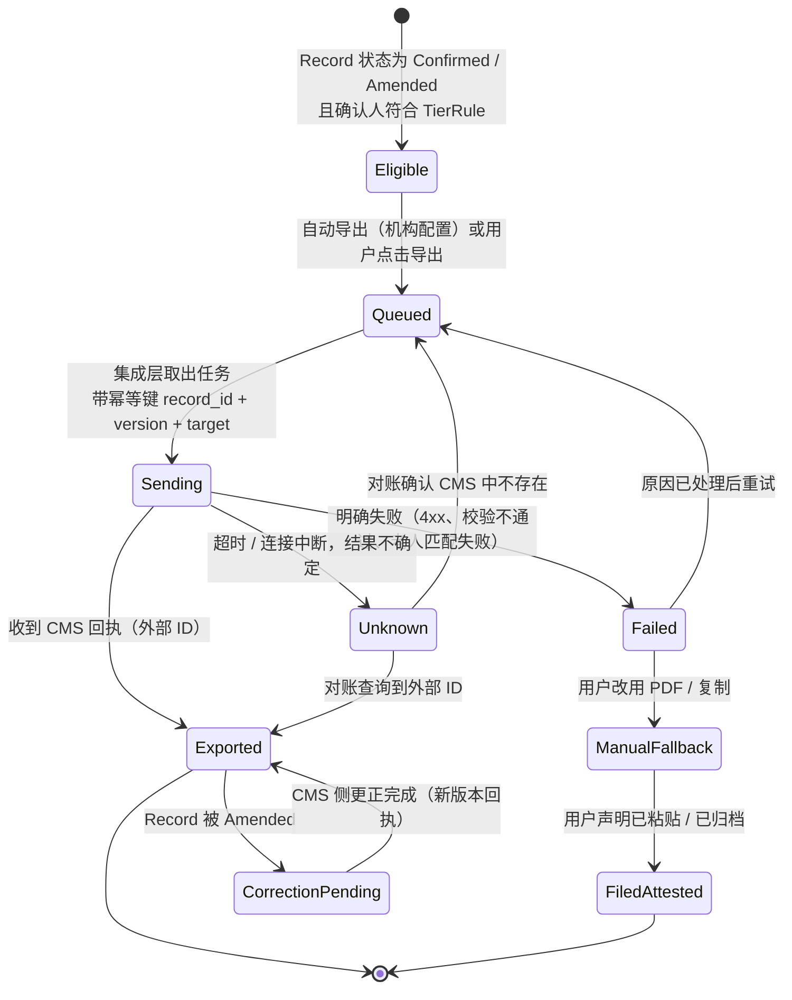

# PRD：已确认记录导出与 CMS 集成（Record Export & CMS Integration）

Owner: Lightman (PO) · Status: **Draft** · Last reviewed: 18/10/2026
Parent: [docs/PRD.md](../PRD.md)
Related: [Shift Capture + 老人档案](2026-10-04-shift-capture-and-resident-records.md)（§4.4 过渡层 / 记录系统 ADR、按老人导出）· [Demo 工作区与合成数据](2026-10-18-demo-workspace-and-synthetic-data.md) · `03-legal-compliance/references/paperwork-requirements-by-event.md` · `06-app-development/product/document-templates/` · `01-strategy/competitive-research/how-competitors-solve-it.md` · `06-app-development/engineering/architecture.md` · `04-security/data-classification-and-retention.md`

> 一句话：护士（或授权确认人）确认后的记录，要**一次、准确、可追溯**地进入机构的正式系统（CMS / IMS）。MVP 用 PDF、按 CMS 字段顺序的分字段复制、结构化文件三种方式；Phase 2 做第一家 CMS 的直接写入。机构 CMS 是 record of truth，careKind 只在必要的最短时间内保留副本。
>
> 运营参考，不是法律意见。本 PRD 不替 Lightman / Lin 选定 CMS 和技术栈，相关事项列为 ADR 建议（§13）。

---

## 1. 问题

### 1.1 谁、在什么场景、遇到什么问题
- **RN / EN / PCW**：careKind 生成并确认的记录如果还要手工重抄进 CMS，"说一次，处处归档"（主 PRD 突破 2）就不成立，反而多了一个系统。产品原则 9："融入，不替代"。
- **护理经理 / DON**：需要确定每条已确认记录**都进入了**正式系统、**只进入了一次**、挂在**正确的老人**名下、更正后 CMS 里也是最新版本。否则 Quality Standard 2.7.2(b)（准确完整）和 3.3（交接）都会出问题。
- **Provider 管理员 / IT / 隐私**：要知道数据流向哪里、谁导出了什么、careKind 那边保留多久、合同终止时数据怎么拿回来。
- **careKind**：采购问卷会问"能不能写回 Telstra Health Clinical Manager / Leecare / AutumnCare"。竞品 AccuNote 已经声称"works alongside" Telstra Health Clinical Manager、AlayaCare、PCS，但没有说明方式（`how-competitors-solve-it.md` §4、S106 ⚠️）。

### 1.2 证据（诚实标注）
| 证据 | 来源 | 强度 |
|---|---|---|
| 护士 / 机构访谈 | 无（`10-feedback/` 为空） | **n = 0，以下都是假设** |
| 澳洲 residential CMS 大多是原生 system of record；除 Mirus 有"集成与 API 模块"外，**其他厂商对第三方写入的 API 都未公开** | `01-strategy/competitive-research/competitor-matrix.md` 一、`profiles/*.md` | 中（公开资料，未联系厂商） |
| "做 CMS 的伙伴"路径可行：PainChek 靠 CMS 集成覆盖约 80% 床位（厂商自报） | `competitor-matrix.md` 四（S80） | 弱到中（自报） |
| 行业多数 AI 新创只能复制粘贴或"叠加层"（Aria "Not yet"，Notive 未说明） | `how-competitors-solve-it.md` §3 | 中 |
| 写入 CMS 是状态机里的最后一道门（H12），用药系统不在写入范围 | `06-app-development/research/care-documentation-process-flows.md` §10 H12、§11 第 12 条 | 中（基于法规和流程分析） |
| Progress notes 和临床记录要保存 7 年 | Rules 154-1000(1)(d)、(2)（见 §4.5） | 强（法规原文） |

**必须先验证的假设**
- **E1**：MVP 阶段护士愿意用"分字段复制 → 粘贴到 CMS"，而且这比直接在 CMS 里写更快。
- **E2**：至少一家 CMS 厂商愿意开放写入接口或合作（Leecare 公开表示在找 AI 合作伙伴，S4）。
- **E3**：机构接受"careKind 不长期保存记录，CMS 是唯一正式来源"。

---

## 2. 目标与指标

### 2.1 目标
1. 每条已确认记录都进入正式系统，而且只进入一次（不重复、不遗漏、不错挂）。
2. 导出失败时**看得见、不丢失、可以退回手动**，不会让人误以为已经归档。
3. 每次导出都有审计记录；careKind 端的副本在 CMS 确认收到后按约定的最短期限删除。

### 2.2 指标（试点）
| 指标 | 定义与测量方法 | 目标 |
|---|---|---|
| ⭐ 归档完成率 | 班次结束 24 小时内状态为 `Exported` 或 `Filed (attested)` 的已确认记录 / 全部已确认记录；从 ExportJob 表统计 | ≥ {{TBD：基线后设定}} |
| **重复写入** | CMS 里同一 careKind 记录版本出现 ≥ 2 次；每周由护理经理按导出回执抽样核对 | **0** |
| **错挂老人** | 导出到 CMS 后挂在错误老人名下；抽样核对 + 事故报告 | **0**（出现即 P1） |
| **未确认内容被导出** | 状态不是 `Confirmed` / `Amended` 却生成了导出；自动审计查询 | **0**（出现即 P1，违反 G1） |
| 静默失败 | 导出失败但界面没有显示"未归档"的次数；用故障注入测试 + 生产告警日志核对 | **0** |
| 更正同步时长 | Amended 到 CMS 侧更正完成（或更正任务被确认）的中位时长 | 跟踪，{{TBD}} |
| 分字段复制耗时（MVP） | 一条 progress note 从打开导出页到标记"已粘贴"的中位时长；试点时间研究 | 跟踪，和基线手写对比（不对外使用） |

---

## 3. 用户故事
| 角色 | 用户故事 |
|---|---|
| RN | 作为 RN，我确认一条记录后，希望它自动或一键进入 CMS，并能看到"已写入"的回执，**以便我不用再抄一遍**。 |
| PCW / EN | 作为护理员，我想按 CMS 表单的字段顺序逐个复制，**以便粘贴时不放错格子**。 |
| RN | 作为 RN，导出失败时我希望马上知道，并能改用 PDF 或复制，**以便交接前记录一定在 CMS 里**。 |
| 护理经理 | 作为护理经理，我想看到本单元哪些已确认记录还没进入 CMS，**以便安排补录**。 |
| 护理经理 | 作为护理经理，更正一条已导出的记录时，我想知道 CMS 里的版本有没有同步更正。 |
| Provider 管理员 | 作为管理员，我想配置导出目标、字段映射、谁可以导出、careKind 端保留多久，并能查到每次导出的审计记录。 |
| 隐私负责人 | 作为隐私负责人，我想确认数据只流向我们指定的系统，合同终止时可以完整拿回数据。 |

---

## 4. 方案

### 4.1 范围
| ✅ MVP（试点） | ⏭ Phase 2 | ⏭ Phase 3 | ❌ 不做 |
|---|---|---|---|
| PDF 导出（单条 / 按老人 / 按班次） | 首个 CMS 直接写入（厂商由 ADR 决定） | 多家 CMS 适配 / 合作 API | 导出未确认的草稿 |
| 按 CMS 字段顺序的分字段复制 + "已粘贴到 CMS"确认 | IMS（事故系统）写入，如该 CMS 支持 | 双向同步（从 CMS 拉老人名单） | 写入用药系统 / eNRMC、生成给药记录 |
| 结构化导出（CSV / JSON，按机构的字段映射配置） | 更正自动同步到 CMS | | 代替 provider 提交 SIRS 或 My Aged Care 报告（G6） |
| ExportJob 状态、回执、审计日志 | 导出失败告警推送给护理经理 | | 屏幕自动化 / RPA 写入（未经 ADR 和厂商许可） |
| "未归档"列表（单元级） | | | 通过邮件发送记录 |
| careKind 端保留期配置 + 删除日志 | | | |

### 4.2 导出资格（护栏 G1）
1. 只有状态为 `Confirmed` 或 `Amended` 的 `Record` 可以导出（主 PRD §6.3）。`Drafted`、`PendingPCW`、`PendingRN`、`Returned`、`Unassigned` 的内容**在任何导出路径（包括复制按钮）都不可用**，后端校验，不只靠前端隐藏。
2. 记录的确认人必须符合该记录 Tier 的 `TierRule`：Tier 2 由 RN（EN 按机构政策），Tier 3 只能由 RN 逐条确认（G5）。不符合的记录不能导出，并作为 P1 缺陷上报。
3. 谁能触发导出：机构按角色配置（默认 RN、护理经理、管理员；PCW 只能导出自己在机构允许下确认的 Tier 1 记录）。
4. 判断字段（IMS 的"是否 reportable"、评估、调查，`incident-report-ims.md`；SIRS 的 P1/P2）**在导出里保留为空或人工填写的原值**，careKind 不预填（`care-documentation-process-flows.md` §11 第 15 条）。

### 4.3 MVP 三种导出方式
| 方式 | 做什么 | 状态 | 关键规则 |
|---|---|---|---|
| **PDF** | 生成单条、按老人或按班次的 PDF：页眉有老人 3 项识别信息、文书类型、作者、确认人、确认时间、版本号、careKind 记录 ID；更正版加"Amended"标记和原因 | `Exported (PDF)` | 只在机构管理的设备或指定位置保存（`rules/00-company-rules.md` §3 禁止下载到个人设备）；管理员可以关闭 PDF 下载；PDF 在澳洲区域内渲染，不用外部 PDF SaaS |
| **分字段复制** | 按机构 CMS 表单的字段顺序列出字段，每个字段一个"Copy"按钮；最后由用户点击"I've pasted this into the CMS" | `Filed (attested)` | careKind **无法验证**粘贴是否成功，所以状态叫"已声明"，和有回执的 `Exported` 分开；复制时顶部持续显示老人姓名 + 房间 + 照片，防止粘贴到别人的页面；剪贴板内容在系统允许的平台上 {{TBD：60}} 秒后清除 |
| **结构化文件** | 按机构的**字段映射配置**输出 CSV / JSON，供机构 IT 批量导入 | `Exported (file)` | 每行带 careKind 记录 ID + 版本号，供导入端去重；文件只能下载到管理员指定的位置 |

**字段映射配置（CMS mapping profile）**：careKind 模板字段（例如 `incident-post-fall-record.md` 的 P01–P24、`incident-report-ims.md` 的 F01 起的编号）→ 机构 CMS 表单字段的名称和顺序。按机构、按文书类型配置，有版本号；上线时由我们和机构一起根据机构的表单（用合成数据截图）建立，由机构的护理经理确认。没有映射的字段在导出里单独列为"Not mapped — please file manually"，不静默丢弃。

> MVP 规则（回应 `care-documentation-process-flows.md` §11 第 5 条）：MVP 没有 incident 草稿。Tier 3 事件的 progress note 导出页会显示"Please record this incident in your facility's incident management system"，由机构按原流程完成 IMS。

### 4.4 Phase 2：首个 CMS 集成（候选与公开信息）
> 只写公开可查的信息；"未公开"不代表没有。**选哪家由 Lightman（商业）和 Lin（技术）决策，建议写 ADR**（§13）。

| 候选 | 公开的集成方式 | 第三方写入 API | 对 careKind 的意义 | 来源 |
|---|---|---|---|---|
| **Leecare**（Platinum6） | 自有 system of record；在开发 P6 与 Tell Touch 的接口 | 未公开 | 2025-07 表示在推进"several AI partnerships"，可能是合作切入口；480+ 家机构、30,000+ 床（自报） | `profiles/leecare.md`（S1、S4） |
| **AutumnCare** | 自有 system of record；移动端床旁记录 | 未公开 | 未发现 AI，客户可能缺少内置 AI；需要确认是否开放写入 | `profiles/autumncare.md`（S6–S8） |
| **Telstra Health Clinical Manager** | 自有系统；已与 PainChek、AusDi、Simple Foods、My Health Record 集成 | 未公开 ⚠️ | 80,000+ 床（自报）；养老 AI（Corus）2028 年才上线，窗口期内是目标客户群 | `profiles/telstra-health.md`（S9、S11） |
| **Person Centred Software**（Clinical Care System） | 自有 system of record；英国端接入 Teton 传感器数据 | 澳洲端未公开 | 只有语音转写，未见生成式 AI | `profiles/person-centred-software.md`（S16、S115） |
| **AlayaCare** | 原生；已有自家 AI Note Assistant（2026-06 early access） | 未公开 | 自己做 AI，合作意愿可能较低；它的客户对独立工具的需求可能被内置功能吸收 | `profiles/alayacare.md`（S19、S20） |
| Mirus（MirusPlus） | 自有系统 + **"集成与 API"模块**（2026-03） | 有模块，细节未公开 | 唯一公开提到 API 模块的澳洲 residential CMS；规模未公开 | `profiles/mirus-australia.md`（S33） |

**ADR 建议的评估维度**：试点机构用哪家（首个试点在 VIC）；是否有文档化的写入 API 和沙箱；可写入范围（progress notes / IMS / charts）；是否支持幂等写入或外部 ID；数据驻留；合作条款和费用；厂商自己的 AI 路线是否冲突。**不使用未经厂商许可的屏幕自动化**（类似 Heidi 的 computer-use agent，`how-competitors-solve-it.md` §2）：写错的后果难以控制，也可能违反厂商条款。

### 4.5 导出状态机


### 4.6 幂等、不重复写入
1. **幂等键** = `record_id + record_version + target`。同一键只会产生一次成功写入；重复点击、网络重试、任务重放都返回同一个结果。
2. **结果不确定（Unknown）时不盲目重试**：先按外部 ID 或幂等键向 CMS 对账；CMS 不支持查询时，转为人工确认（"请在 CMS 中检查这条记录是否存在"），确认后再决定。
3. 结构化文件每行带记录 ID + 版本号，导入端可以去重；PDF 和复制路径对同一版本**再次导出**时提示"该版本已于 {{时间}} 由 {{人}} 导出 / 声明已归档"，需要再确认。
4. 更正（Amended）是**新版本**，不是覆盖：直接集成时按 CMS 支持的方式写入更正（追加更正条目或更新并保留历史），不能删除 CMS 中的原条目（G7）。CMS 不支持更正时，生成"CMS 更正任务"给护理经理。
5. 已进入 IMS 的事件记录被更正时，提示"这可能是需要报告给 Commission 的 significant new information，请按机构流程判断"（只提示，不判定；`care-documentation-process-flows.md` §11 第 11 条、G6）。

### 4.7 安全失败（写入失败时）
| 情况 | 系统行为 |
|---|---|
| CMS 不可用 / 超时 | 任务排队重试（指数退避，上限 {{TBD}}）；记录卡片显示 "Not yet in CMS"；单元"未归档"列表显示；交接摘要里列出未归档记录 |
| 老人匹配失败（CMS ID、DOB、姓名任一不符） | **不写入**，`Failed`，提示人工核对；不按姓名模糊匹配（对应 G4 精神） |
| 部分写入（例如正文成功、附件失败） | 标为 `Unknown`，进入对账；不再自动写正文 |
| 字段校验失败（必填缺失、长度超限） | `Failed`，显示具体字段；不截断、不自动改写内容 |
| 一直失败超过 {{TBD：班次结束前 / 4 小时}} | 通知护理经理；提供 PDF / 复制的手动退路；careKind 端副本**不进入删除倒计时** |
| careKind 自身故障 | 已确认记录持久化后才显示"已确认"；恢复后继续排队；不丢失 |

### 4.8 导出审计
每次导出（包括复制和 PDF）写一条审计记录：记录 ID、版本、导出方式、目标、字段映射版本、发起人和角色、时间、幂等键、结果、CMS 外部 ID / 回执、重试次数、失败原因代码。**审计日志不写健康内容**（`architecture.md`：日志脱敏）。护理经理和管理员可以按老人、按时间、按人查询。审计日志保留期 {{TBD：≥ 7 年}}，对齐 Rules 154-150 / 154-1000 的 7 年（`data-classification-and-retention.md` 待定项）。

### 4.9 保存期与谁保存（record of truth）
```mermaid
flowchart LR
    A[已确认记录<br/>careKind 澳洲区域] -->|导出 + 回执| B[机构 CMS / IMS<br/>record of truth]
    B --> C[机构按 Rules 154-1000 保存 7 年<br/>+ 州健康记录法]
    A -->|回执确认后开始计时| D[careKind 副本<br/>保留期 TBD 天，按合同配置]
    D --> E[删除 + 删除日志<br/>不含健康内容]
    A -.->|未收到回执 / 只有"已声明"| F[不进入删除倒计时<br/>直到机构确认]
```
1. **机构 CMS 是 record of truth**，7 年保存义务由 provider 承担（Rules 154-1000(1)(d)、(2)；州法见 `state-by-state-comparison.md` §3.2、§4.5）。
2. careKind 端：音频、转写、草稿按 Shift Capture PRD §7 的短期保留；已确认记录副本在**收到 CMS 回执后**保留 {{TBD：30–90}} 天（用于更正和支持），然后删除。
3. **不能删除唯一副本**：只有 `Filed (attested)` 或从未导出的记录，不进入删除倒计时；保留期到时提示管理员处理（导出完整副本或确认已在 CMS 中）。
4. 删除时生成删除日志（老人内部 ID、期间、日期，不含健康内容），满足 ACT Principle 4.2 和 NSW s25(2)–(3) 的删除记录要求（`state-by-state-comparison.md` §4.5 ⚠️ 需律师确认）。
5. 这一节**依赖** Shift Capture PRD §4.4 的 ADR（过渡层还是记录系统）。本 PRD 按"过渡层"设计；如果 ADR 选"记录系统"，§4.9 要重写。

### 4.10 数据驻留与客户数据归属
- 导出任务、PDF 渲染、文件生成都在澳洲区域内完成（G9、ADR-0001）；不经过境外的集成平台（iPaaS）或文档服务。
- 数据的去向只能是机构指定的目标；CMS 的托管地点由机构负责（多家 CMS 的澳洲驻留情况"未公开"，`competitor-matrix.md`）。
- **客户数据归客户**（`rules/01-operations-rules.md` §2 不能让步的条款）：合同终止时提供完整导出（结构化 + PDF），之后删除并出具删除证明（`paperwork-requirements-by-event.md` 合同事项第 19 条）。
- 导出内容不用于训练模型（G9）。

### 4.11 界面要点
- 记录卡片的归档状态徽章：`Not yet in CMS` · `Sent — awaiting receipt` · `In CMS ✓`（有回执）· `Filed by you (not verified)`（已声明）· `Check needed`（Unknown）。文字示例用澳式英语。
- 单元"未归档"列表：按 Tier 3 → Tier 2 → Tier 1 排序。
- 组件从 `06-app-development/design/COMPONENTS.md` 选用（Badge、List、Alert、Toast、Dialog）；不写死颜色。

---

## 4.5 法律依据（本地参考文件）✅
> 按 `legal-reference-check` 步骤手动执行（18/10/2026）。Rules 和 SQS 的条款用 `pdftotext` 在本地 PDF 中核实。运营参考，不是法律意见。

| 主题 | 本地文件 | 条款 / 页码 | 对本功能的约束 |
|---|---|---|---|
| 临床记录保存 7 年 | `03-legal-compliance/references/law-library/aged-care-rules-2025-vol1-compilation-2026-08-01.pdf` | **r 154-1000(1)(d)、(2)**，印刷页 242–243 | "medical records, progress notes and other clinical records" 自形成之日起保存 7 年 → 责任在 provider；careKind 必须保证先进入 CMS 再删除自己的副本（§4.9） |
| 事件记录保存 | 同上 | r 154-150，印刷页 234 | r 164-25(1) 的事件细节保存 7 年 → IMS 写入（Phase 2）同样不能删除唯一副本 |
| IMS 字段 | 同上；`06-app-development/product/document-templates/incident-report-ims.md` | r 164-25(1)，印刷页 282 | (b) 是否 reportable、(g) 评估、(k) 调查是判断字段 → 导出不预填（§4.2 第 4 条） |
| 转交记录 | 同上 | r 149-80(3)(4)，印刷页 216 | 新 provider 请求后 28 天内转交 154-1000 的记录 → 机构从 CMS 转交；careKind 支持按老人导出（Shift Capture PRD §4.4） |
| 信息准确完整、来源整合 | `03-legal-compliance/references/law-library/strengthened-aged-care-quality-standards-nov-2025.pdf` | Action 2.7.1、2.7.2(b)(e)，第 18–19 页 | 导出不能重复、错挂或丢字段；"information from different sources is integrated" → 直接写入 CMS 比并行存放两套记录更符合要求 |
| 汇总表 | `03-legal-compliance/references/paperwork-requirements-by-event.md` | Progress notes 一行；"要点"第 1 条；合同事项第 19 条 | 154-1000 的 7 年；careKind 端保留期要在 DPA 约定；试点结束返还和删除 |
| 州健康记录法 | `03-legal-compliance/references/state-by-state-comparison.md` | 表 A；§3.1、§3.2、§4.5 | VIC HPP 4 / NSW s25 / ACT Principle 4 的 7 年 / 25 岁由 provider 承担；ACT、NSW 删除需留删除记录 ⚠️ |
| 数据驻留 | 同上 | §4.3 | 默认澳洲区域；NSW 公营要求数据不出 NSW（需客户同意）→ 导出组件在主区域运行 |
| 隐私：安全与销毁 | `03-legal-compliance/references/law-library/oaic-app-guidelines-consolidated-2026-05.pdf` | Chapter 11（APP 11.1；APP 11.2 第 11.29–11.32 段） | 不再需要时销毁或去标识化 → careKind 副本按回执后保留期删除 |
| 隐私：跨境 | 同上 | Chapter 8（APP 8） | 导出链路不经境外服务 |
| 数据泄露 | `03-legal-compliance/references/law-library/oaic-quick-reference-responding-to-data-breaches-2026-06.pdf` | Part A 四步（Contain、Assess…）；Part B | 导出到错误老人、错误机构或错误地址可能构成 eligible data breach → 走 `incident-triage`，并按合同 24 小时通知客户（`state-by-state-comparison.md` §4.4） |
| 人工确认 | `03-legal-compliance/references/law-library/ahpra-ai-in-healthcare-summary.md`；`docs/PRD.md` §9.1 | G1 | 只有确认后的记录可以导出 |
| TGA 边界 | `03-legal-compliance/references/law-library/tga-digital-scribes-summary.md`；`03-legal-compliance/tga-samd-boundary.md` | TGA 页面 30/01/2026；红绿灯表"模板管理、导出、集成"为 🟢 | 导出不能加入分析或解读；判断字段不预填 |
| SIRS 责任 | `docs/PRD.md` §9 G6；`03-legal-compliance/references/law-library/aged-care-rules-2025-vol1-compilation-2026-08-01.pdf` | r 165A-25（印刷页 299） | 集成不向 Commission 提交任何报告 |
| 文书字段 | `03-legal-compliance/references/paperwork-taxonomy.md` | §7 第 8 条 | 审计链与按老人导出 |

### 本地资料缺口
- ⚠️ **CMS 厂商接口条款与 API 文档**：本地无资料（全部"未公开"）→ Phase 2 上线门槛：拿到厂商书面许可和接口文档。
- ⚠️ **careKind 作为 vendor 的保存和删除义务**（ACT "record keeper"、NSW HSP 认定）：`state-by-state-comparison.md` §4.5 已标需律师确认 → 上线门槛（DPA 条款）。
- ⚠️ **记录中是否要写 AI 辅助说明**（PDF / CMS 条目末尾的 provenance 行）：本地无明确依据，需临床顾问和律师意见。
- ⚠️ Shift Capture PRD 已列的监控设备法等缺口与本功能无直接关系，不重复。

### 可能过时的资料
- `aged-care-rules-2025-vol1-compilation-2026-08-01.pdf` 是 Compilation No. 10；每季度检查新的 compilation。
- `law-library/index.md` §1a 说"新 Rules 没有通用护理记录保留期"，已被 `paperwork-requirements-by-event.md` 更正为 154-1000（建议由 `compliance-review` 更新 index，本 PRD 不改）。

## 5. TGA boundary check ✅
```
Verdict: 🟢
Reasons:
- 导出、集成、模板映射在 tga-samd-boundary.md 红绿灯表中属于 🟢（"模板管理、导出、集成"）。
- 导出内容是护士已确认的记录原文，不新增分析或解读；字段映射只改变位置，不改变内容。
- 判断字段（reportable、评估、调查、P1/P2）不预填；不写入用药系统；不提交 SIRS。
- TGA 2026-10-16 审查 12 个 scribe、8 个可能构成医疗器械（how-competitors-solve-it.md §6，S99）：本功能不扩大预期用途。
Risky wording → safer alternative:
- "Automatically files compliant records" → "Sends your approved notes to your clinical system"
- "Never miss a record" → "Shows which approved notes are not yet in your clinical system"
- "Smart field mapping" → "Lays out each note in your form's field order"
Required next step: none（界面文字上线前仍跑 tga-boundary-check）
```
运营参考，不是法规意见；🟡/🔴 需要法规顾问确认。

## 6. 隐私影响 ✅
| 问题（`rules/03-product-design-rules.md` §2） | 回答 |
|---|---|
| 1 TGA | 🟢（§5） |
| 2 新数据 | ExportJob、审计日志、字段映射配置、CMS 外部 ID；不新增健康信息类别。存澳洲区域。保留：审计日志 {{TBD：≥ 7 年}}；careKind 记录副本回执后 {{TBD}} 天 |
| 3 系统替人做选择？ | 字段映射是机构配置的规则，老人匹配不符就失败、不猜；不属于对个人的自动化决策。APP 1.7–1.9 ⚠️ 沿用 Shift Capture PRD 的律师确认项 |
| 4 护士在哪一步确认？ | 导出前已确认（G1）；复制路径另有"已粘贴"声明 |
| 5 最坏情况 | 错挂老人、重复事件、静默失败导致交接遗漏（§7） |
| 6 provider 法定义务 | 154-1000 / 154-150 保存、149-80 转交、164-25 IMS |
| 7 州差异 | 州健康记录法保存期和删除记录（VIC、NSW、ACT）；NSW 公营的数据驻留 |
| 8 老人退出 | 退出 AI 文书的老人没有 careKind 记录可导出；已导出的记录属于机构正式记录，按机构流程处理访问和更正（APP 12、13） |

- **新子处理方**：MVP 无。Phase 2 的 CMS 厂商是**机构自己的供应商**，不是 careKind 的子处理方；但集成凭证和数据流要写进 DPA 和安全资料包（`04-security/vendor-subprocessor-register.md` 选型清单照做）。
- **需要更新**：PIA（导出数据流、PDF 下载、剪贴板）；DPA（careKind 端保留期、合同终止返还、删除证明）；隐私政策（数据流向机构指定系统）。

## 7. 临床危害 ✅
新提出的危害（`Proposed`），由临床顾问接受后才写入 `hazard-log.md`。

| ID（临时） | 危害 | 原因 | 潜在伤害 | 初始风险 | 控制措施 |
|---|---|---|---|---|---|
| HAZ-P-EXP-01 | 同一记录在 CMS 里出现两次 | 重试、重复点击、超时后重发 | 一次跌倒被当成两次；记录混乱 | 高 | 幂等键；Unknown 先对账；再次导出要确认 |
| HAZ-P-EXP-02 | 导出到 CMS 里错误的老人 | 老人 ID 映射错；复制时粘贴到别人的页面 | 错误照护；隐私泄露 | **极高** | CMS ID + DOB + 姓名全部一致才写入；复制页持续显示老人身份；事故按 P1 处理 |
| HAZ-P-EXP-03 | 导出失败但大家以为已归档 | 静默失败；"已声明"被当成"已收到" | 交接遗漏、照护延误 | 高 | 状态徽章区分回执和声明；未归档列表；交接摘要列出；超时通知护理经理 |
| HAZ-P-EXP-04 | 未确认的草稿被导出 | 前端漏洞；权限配置错 | AI 内容未经审核进入正式记录（G1） | 高 | 后端资格校验；自动审计查询；P1 |
| HAZ-P-EXP-05 | 更正没有同步到 CMS | CMS 不支持更正；任务被遗忘 | 照护依据过时的记录 | 中到高 | CorrectionPending 状态；CMS 更正任务；护理经理列表 |
| HAZ-P-EXP-06 | 内容放进 CMS 的错误字段 | 字段映射配置错 | 数值、通知信息被误读 | 中 | 映射有版本、由机构确认；试点前用合成记录逐字段核对；未映射字段单独列出 |
| HAZ-P-EXP-07 | careKind 删除了唯一副本 | 声明已粘贴但实际没有 | 记录丢失（违反 154-1000） | 中 | 只有回执才进入删除倒计时；到期提示管理员 |
| 关联 HAZ-003 / HAZ-009 (Proposed) | 归属错误 | 上游 | — | — | 本 PRD 不放松上游控制 |

## 8. AI 评测
本功能**不调用模型**，不新增 AI 评测场景。新增**集成测试集**（非 AI）：用合成记录覆盖重复点击、超时、部分写入、老人不匹配、字段超长、更正、CMS 不可用。发布门槛：重复写入 0、错挂 0、静默失败 0、未确认导出 0（故障注入全部通过）。测试数据只用合成数据（Wattle Grove，见 §12）。

## 9. 无障碍与多语言
- 分字段复制要支持屏幕阅读器（每个 Copy 按钮朗读字段名）；触控目标 ≥ token `target-min`；戴手套可用。
- 导出内容保持英文原文；界面提示可以本地化，但**不翻译导出内容**。多语言口述的原文对照留在 careKind，不写进 CMS（除非机构配置）。

## 10. 上线计划与回滚
1. **MVP**：PDF + 分字段复制 + 结构化文件；试点前和机构一起建立字段映射，用合成记录逐字段核对（🧑 护理经理签字）。
2. **试点第 1–2 周**：每天抽样核对 careKind 回执 / 声明和 CMS 实际内容。
3. **Phase 2**：ADR 选定 CMS → 厂商许可和接口文档 → 沙箱集成测试 → 单个单元灰度 → 扩大。
4. **回滚**：直接集成出现一次重复或错挂 → 关闭自动导出，切回复制 / PDF → 走 `11-workflows/incident-response.md`；影响记录格式的变更按 `release-process.md` 提前通知客户。

## 11. 非功能需求
| 类别 | 要求 |
|---|---|
| 可靠性 | 已确认记录写入持久化存储后才显示确认；导出任务至少一次投递 + 幂等 = 效果上恰好一次 |
| 时延 | 自动导出在确认后 {{TBD：≤ 5}} 分钟内得到回执或失败 |
| 安全 | 集成凭证在密钥管理中；最小权限；租户隔离；日志脱敏 |
| 数据驻留 | 澳洲区域（ADR-0001） |
| 可观测 | 导出失败率、Unknown 数量、未归档积压的告警（不含健康内容） |

## 12. Demo 与示例数据
- **Demo 入口**：Demo 工作区（[Demo PRD](2026-10-18-demo-workspace-and-synthetic-data.md)）里每条已确认记录的"Export"页；公开介绍页的"See an example"区块展示 PDF 预览和分字段复制样张。
- **虚构场景**：Wattle Grove Residential Care（虚构，VIC）· 18/10/2026 PM shift。Mrs Edna Hall（虚构，88 岁）15:10 浴室跌倒、右手腕擦伤、意识清醒，Priya（PCW，虚构）口述，Daniel Reyes RN（虚构）补充 assessment 并确认；已通知 Dr Amelia Brooks（GP，虚构）、女儿 Karen Hall（虚构）和 Grace Liu（Care Manager，虚构）。字段与 `daily-progress-note.md` §6 示例一致。
  - 展示 1：Edna 的 progress note → PDF（含确认人、版本号）。
  - 展示 2：同一条 → 分字段复制，字段顺序来自一份**虚构的"Example CMS（fictional）"表单**；不模仿任何真实 CMS 厂商的界面、名称或商标。
  - 展示 3：Mr Tomasz Nowak（虚构，81 岁，痴呆，有 BSP）16:40 的行为事件 progress note → 结构化 JSON 预览，判断字段为空并标 "To be completed by RN / Care Manager"。
  - 展示 4：一条模拟的写入失败 → "Not yet in CMS" 状态、手动退路、未归档列表。
  - 展示 5：Edna 的记录被更正（Amended）→ CorrectionPending。
- **标注**：PDF 和 JSON 是**真实执行**（用正式渲染代码处理 Demo 数据，只在本人 Demo 会话内）；"Send to CMS" 是**模拟动作**，显示 "Simulated — nothing was sent"；回执和失败状态是**预生成**。Demo 环境没有任何 CMS 连接器和出站凭证。
- **示例数据位置**：Demo PRD 定义的受版本管理的数据集（建议路径见该 PRD §4.4，尚未创建）；字段映射样例建议放在同一数据集的 `export-profiles/example-cms-fictional.json`（建议，未创建）。
- **验收**：在 Demo 中依次完成展示 1–5；桌面和手机截图存证；确认网络日志里没有发往外部系统的请求。

## 13. 开放问题与需要的决策
1. 🧑 **首个 CMS 选哪家**（Lightman 商业 + Lin 技术）→ **建议写 ADR**（§4.4 的评估维度）。
2. 🧑 **过渡层还是记录系统**（Shift Capture PRD §4.4 已列）→ 本 PRD §4.9 依赖它。
3. 🧑 **careKind 端保留期默认值**（回执后多少天、审计日志多久）→ DPA + 律师确认。
4. 技术 ADR（Lin）：导出队列和幂等实现、对账机制、PDF 渲染方案（境内）。
5. MVP 是否默认开启"确认后自动导出"，还是每次手动？（建议：直接集成上线前不存在自动导出；复制 / PDF 都是手动）
6. PDF / CMS 条目末尾是否加入 AI 辅助说明（临床顾问 + 律师）。

## 14. 建议 registry 登记行
| PRD | 标题 | 阶段 | Assignee | Reviewer | 复杂度 | 风险 | Parent | Blocked | 更新 |
|---|---|---|---|---|---|---|---|---|---|
| 2026-10-18-record-export-and-cms-integration | 已确认记录导出与 CMS 集成 | idea | （留空，需 Lightman 确认） | — | **L** | **R3** | — | 首个 CMS 待 ADR · 等 Lightman / Lin | 18/10/2026 |

- **复杂度 L（6/8）**：范围 2（导出、审计、保留、管理后台、集成层，跨 4 个以上模块）+ 技术面 1（前后端；不调用模型）+ 不确定性 2（要集成外部 CMS，厂商接口未公开）+ 依赖 1（Shift Capture PRD 和"过渡层"ADR）。
- **风险 R3**：触及临床记录的写入路径和 G1、G7（`rules/06-adlc-rules.md` §3.2）。
- 跨方向多（backend、frontend、infra-security）：建议安排协助者，是否拆分由 Lightman 决定。

## 15. 审批
| 角色 | 姓名 | 日期 |
|---|---|---|
| 产品 | | |
| 临床顾问 | | |
| CTO | | |

## 变更记录
| 日期 | 版本 | 变更 | 作者 |
|---|---|---|---|
| 18/10/2026 | v0.1 | 初稿 | Claude（待 Lightman 审阅） |
