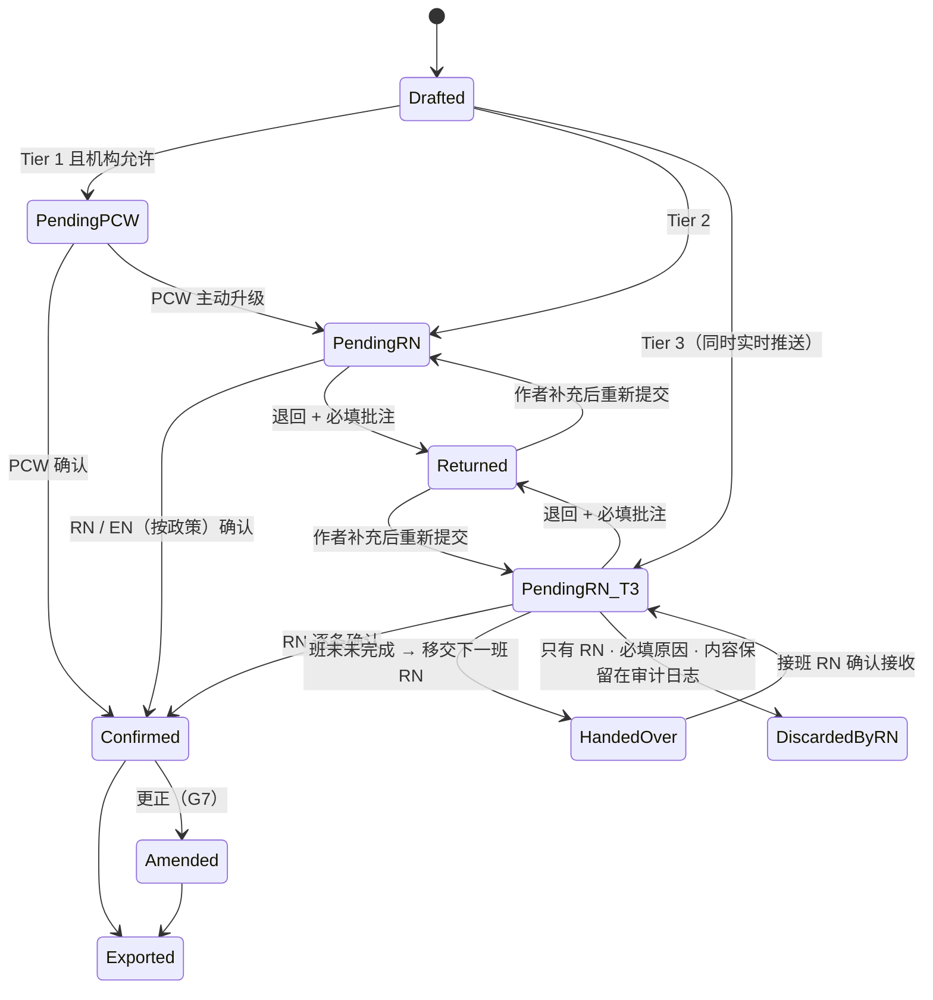
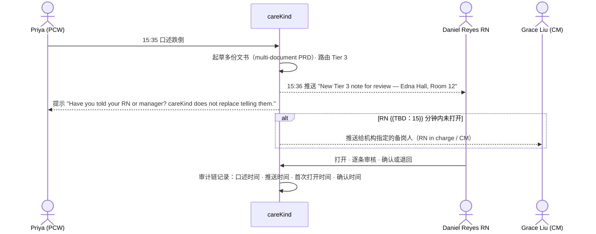
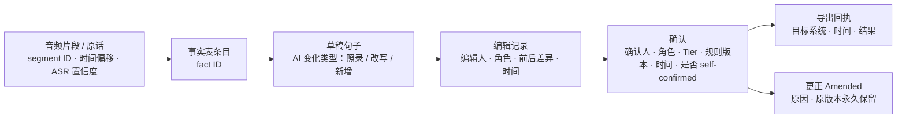

# PRD：分级审核（PCW 起草 → RN 按 Tier 审核）与证据级审计链

Owner: Lightman (PO) · Status: **Draft** · Last reviewed: 18/10/2026
Parent: [docs/PRD.md](../PRD.md)（§4 突破 3、4；§6.3 状态机；§6.5 分级规则；§7.2 RN 审核；§9 G1、G5、G7）
Related: [2026-10-04-shift-capture-and-resident-records.md](2026-10-04-shift-capture-and-resident-records.md)（上游：审核收件箱、归属）· [2026-10-18-event-to-multi-document-drafting.md](2026-10-18-event-to-multi-document-drafting.md)（上游：一事件多份草稿）· `06-app-development/research/care-documentation-process-flows.md` §10、§11 · `06-app-development/product/document-templates/`

> 一句话：PCW 口述生成的草稿按 Tier 1 / 2 / 3 路由给有权确认的人；**Tier 3 草稿一生成就实时推送给 shift RN**，只能由 RN 逐条确认、不能一键全过、PCW 不能删除；退回必须写批注；没审完的跨班次移交；每句话都能追溯到"原话 ↔ 句子 ↔ 编辑人 ↔ 确认时间"。机构可以配置分级，但有不可下调的底线。

---

## 1. 问题

### 1.1 谁、在什么场景、遇到什么问题
- **PCW** 记录大部分日常照护，但多数不是 AHPRA 注册从业者；**RN** 对临床记录和委派负责——"Accountability cannot be delegated"（`nmba-registered-nurse-standards-for-practice-2016.pdf`，已核实）。现在两者之间没有结构化的"谁起草、谁把关"流程。
- **审核时机冲突**：主 PRD §7.1 写"空档 / 班末审核"，但 Rules r 165A-20 要求员工知悉 reportable incident 后 "as soon as possible" 告知，SIRS 和报警的 24 小时从 provider 知悉起算（流程图 §11 第 1 条）。Tier 3 草稿等到班末才被 RN 看到，可能造成延误。
- **PCW 可以删除 Tier 3 草稿**：shift-capture PRD §4.3 ④ 允许"删除（误录）"，PCW 可能在 RN 看到之前删掉一段虐待指称（流程图 §11 第 4 条）。
- **跨班次事件没有归宿**：post-fall 观察 48 小时、PRN 效果复查、P1 5 天补充等跨多个班次，数据模型以班次为单位（流程图 §9 第 2 条、§11 第 3 条）。
- **自动化偏差**：临床人员容易把 AI 输出当作准确完整（`acsqhc-ai-safety-scenario-ambient-scribe-2025-08.pdf` 第 2–3 页，已核实）。

### 1.2 证据（诚实标注）
| 证据 | 来源 | 强度 |
|---|---|---|
| 护士访谈 | 无（`10-feedback/` 为空） | **n = 0，全部为假设** |
| 公开竞品都是作者自审或单级签署，没有按风险分级的 PCW → RN 审核 | `01-strategy/competitive-research/how-competitors-solve-it.md` §7、§10 第 1 条、§12 | 弱到中 |
| TGA 2026-10-16 审查 12 个 scribe，8 个可能构成医疗器械；免责声明不能作为豁免 | 同上 §0 第 5 条、§11 第 1 条（S99，媒体转引） | 中 |
| 审核时机与 r 165A-20 的冲突、PCW 删除 Tier 3 风险 | `care-documentation-process-flows.md` §11 第 1、4、6 条；Rules r 165A-20（已核实） | 中（法规结构事实） |

**假设**：H-TR1 RN 能在照护间隙处理实时推送而不被过度打断；H-TR2 机构愿意给 PCW 确认 Tier 1 的权限；H-TR3 抽样审计不会被员工理解为绩效监控。

---

## 2. 目标与指标

### 2.1 目标
1. 每条记录都有明确的作者和确认人；敏感事件只由 RN 逐条确认（G5）。
2. Tier 3 尽快到达 RN，不等班末；careKind 的推送**不替代**员工按机构程序口头上报。
3. 审计链经得起 ACQSC 审计和内部调查。
4. 2026-12-10 前，为 APP 1.7–1.9 准备好自动化处理披露。

### 2.2 指标
| 指标 | 定义 / 测量方法 | 目标 |
|---|---|---|
| Tier 3 到达时延 | 草稿生成 → RN 首次打开的时间（中位数、P90），系统日志 | 中位 ≤ {{TBD：15}} 分钟（试点中测定后再定） |
| Tier 3 当班确认率 | 当班内被 RN 确认或退回的 Tier 3 比例 | ≥ {{TBD：95%}} |
| **Tier 3 被批量确认** | 系统不变量检查（每次确认动作只含 1 个 Tier 3 条目） | **0** |
| **Tier 3 被非 RN 丢弃** | 审计日志查询 | **0** |
| 审计链完整率 | 已确认记录中，每句都有 来源片段 + 编辑人 + 确认人 + 时间 的比例 | **100%** |
| 退回率与原因分布 | 退回数 / 提交数；按原因类别统计 | 跟踪（不设目标，用于培训） |
| 抽样审计差异率 | 护理经理每周抽样，"草稿与原话不符但被确认"的比例 | ≤ {{TBD}}，并逐月下降 |
| 跨班次移交接收率 | 移交的未完成项中被下一班确认接收的比例 | ≥ {{TBD：98%}} |

---

## 3. 用户故事
| 角色 | 用户故事 |
|---|---|
| PCW | 作为护理员，我确认自己的饮食和活动记录（机构允许时），把疼痛、跌倒类记录提交给 RN，**以便我不用为临床判断负责**。 |
| PCW | 作为护理员，被退回的草稿要告诉我缺了什么，我补充后再提交。 |
| RN | 作为 shift RN，PCW 口述了跌倒，我希望几分钟内就收到推送，而不是班末才在队列里看到。 |
| RN | 作为 RN，我审核 Tier 3 时要逐条看原话和 AI 改写，系统不允许我一键全部通过。 |
| RN | 作为交班 RN，没审完的 Tier 3 和"下一次观察时间"要随交接交给下一班，并有接收记录。 |
| Care Manager | 作为护理经理，我每周随机抽查一些记录，对比原话和最终记录，用于质量改进，而不是考核个人。 |
| Provider 管理员 / 隐私负责人 | 作为管理员，我能配置分级，但不能把跌倒降为 Tier 1；我能导出一份说明，写进我们的隐私政策。 |

---

## 4. 方案

### 4.1 分级规则（默认值 + 机构可配置 + 不可下调底线）
| Tier | 默认类别 | 谁可以确认 | 批量确认 | **不可下调的底线**（机构不能改） |
|---|---|---|---|---|
| Tier 1 常规 | ADL、饮食、活动、情绪、社交、睡眠 | PCW（机构允许时）/ EN / RN | ✅（仍逐条展开显示） | 含任何数值、药名、剂量的条目至少 Tier 2 |
| Tier 2 临床观察 | 疼痛、皮肤、排泄变化、食欲变化、生命体征叙述、PRN 效果 | RN；EN 视机构政策 | ❌ | — |
| Tier 3 敏感事件 | 跌倒、伤害、行为事件、限制性措施、疑似虐待或忽视、病情变化、失踪、临终与死亡、用药事件；**精神类 PRN 或"为了让他安静"类给药叙述** | **只有 RN，逐条** | ❌ | 这些类别不能调到 Tier 1 / 2；只能上调，不能下调 |

- 一条 progress note 里的条目可以属于不同 Tier，整条按最高 Tier 路由（`daily-progress-note.md` §2）。
- 分级判断只用于**审核路由**，不是临床判断；对外不能说"检测风险"（主 PRD §6.5）。
- **配置变更**：只有 DON / 指定管理员可改；每次变更生成新版本（`TierRuleVersion`：谁、何时、改了什么、原因），草稿记录它是按哪个版本路由的；变更在下一班生效。
- EN 能否确认 Tier 2、RN 能否自审自己口述的 Tier 3（主 PRD §7.2 第 5 条）是机构配置项；**RN 自审在审计链中标为 "self-confirmed"**，机构可选择要求第二位 RN。

### 4.2 状态机（对主 PRD §6.3 的细化）

- **PCW 对 Tier 3 没有"删除 / 丢弃"按钮**；只能"Add a note to the RN"（例如"I said the wrong room"）。
- Tier 3 条目在 RN 打开前不能被作者修改原话；作者可补充，补充内容单独标注时间。
- PCW 可以结束自己的班次，但未审核的 Tier 2 / 3 不会消失：它们留在 RN 队列；RN 班次结束时仍未完成 → 必须走 HandedOver。

### 4.3 Tier 3 实时推送（回应"班末审核与 r 165A-20 冲突"）

- 推送依据是**口述内容的类别**（跌倒、伤害等），不是任何数值或"严重程度"，属于文书流程通知（G3 不受影响）。
- 推送文案不用"alert / risk / urgent"，用 "New note needs your review"。
- **careKind 不定义"provider 知悉时间"**。审计链保存"口述时间""推送时间""RN 首次打开时间"作为事实；SIRS 计时起点由 CM 在 SIRS 流程中手动填写（`incident-sirs-assessment-prep.md` A03）。这些时间戳对 provider 的法律含义 → ⚠️ 律师确认（上线门槛）。
- 推送失败（无网络、RN 未登录）→ 降级为队列置顶 + 班次面板红点；不能静默失败。

### 4.4 审核界面规则（自动化偏差控制）
| 控制 | 规则 |
|---|---|
| 逐条确认 | Tier 3 每个条目、每份关联文书分别确认；**没有"Confirm all"按钮**；Tier 2 也不批量 |
| 必看来源 | AI 改写或新增的句子、低置信度词、数值与药名：必须展开原话（或回放音频片段）后，该条的确认按钮才可用 |
| "请填写"不能跳过 | 草稿中仍有 "Please complete" 的必填字段时不能确认；可以改为 "Not stated"（员工确认没有该信息），审计链记录 |
| 确认语义 | 按钮文案 "I've checked this against what was said — confirm"；确认人姓名和角色显示在记录上 |
| 退回批注 | 必填；原因类别（缺信息 / 归属错误 / 事实错误 / 措辞 / 其他）+ 自由文字；作者收到通知 |
| 抽样审计 | 护理经理每周按单元随机抽 {{TBD：N}} 条已确认记录，对比原话 ↔ 草稿 ↔ 最终记录，记录差异类型；结果按**单元**汇总 |
| 确认节奏指标 | 只统计到单元 / 机构层面（如 Tier 3 每条中位审核时长、零编辑确认比例）；**不做员工排名，不给 HR 导出**（G10 精神；⚠️ 工作场所监控法本地无资料） |
| 培训 | 上线培训包含"AI 草稿常见错误"示例（来自 Demo 场景） |

### 4.5 跨班次待办（Follow-up）
- 新实体 `FollowUp`：挂在 Event 上；类型：未审核 Tier 3、RN 选定的观察时间点（post-fall）、PRN 效果复查、紧急约束后通知 RPSDM、P1 5 天补充（只提示）、事后 care plan 复核（只提示）。
- 来源：**只能由人创建或由人选定的计划生成**（例如 RN 在跌倒后记录里填写了观察计划）；系统不建议观察频率（TGA 红灯）。
- 提醒只说"该时间点还没有记录"（"No entry yet for 17:15"），不涉及数值和是否需要观察 → 🟡。
- 交接时（`daily-shift-handover-isbar.md`）未完成的 FollowUp 自动列入；接班 RN 点 "Accept handover" 留痕；未接收 → 仍挂在交班 RN 名下并提醒 CM。

### 4.6 证据级审计链
每个已确认句子可追溯：

- 日志只追加（append-only），带哈希链防篡改；任何人（含 careKind 员工）不能修改历史。
- 导出到 CMS 的记录尾部附简短出处："Drafted with careKind AI from dictation by Priya (PCW), 18/10/2026 15:35. Reviewed, edited and confirmed by Daniel Reyes RN, 16:20."（ACSQHC："Label records indicating AI was involved"）。
- **保留期冲突**：音频按 shift-capture PRD 7 天删除、转写 30–90 天删除，但审计链要支持 7 年追溯（r 154-150、r 154-1000(1)(d)）。建议：已确认记录保留"原话文本摘录 + 音频哈希"作为出处，保留期跟随记录、按 provider 指示；音频本身仍按期删除 → **需 ADR + 律师确认 + DPA 约定**。
- 审计包导出：按住户 / 事件导出"原话 ↔ 草稿 ↔ 编辑 ↔ 确认"对照，供 ACQSC 审计、调查、访问请求（APP 12）。

### 4.7 回应流程图研究的缺口
| # | 缺口 | 本 PRD 的处理 |
|---|---|---|
| 1 | 班末审核与 r 165A-20 冲突 | §4.3 实时推送 + 备岗人 + "不替代口头上报"提示 |
| 2 | SIRS 计时起点未定义 | 只记录事实时间戳；起点由 CM 填写；⚠️ 律师确认 |
| 3 | 无跨班次待办 | §4.5 FollowUp + HandedOver 状态 |
| 4 | PCW 能删除 Tier 3 草稿 | §4.2：只有 RN 能丢弃，必填原因，内容保留 |
| 6 | MVP 单级审核与 G5 不清 | 建议 MVP 就做最小两级：PCW 提交 → RN 队列 + Tier 3 实时推送 + 退回批注 + 审计链（见变更建议 T1）。只要 PCW 口述 Tier 3，就必须有 PCW → RN 流转，否则 G5 无法满足 |
| 9 | 精神类 PRN 归 Tier 2 | 默认表把精神类 PRN / 行为管理目的的给药叙述列入 Tier 3（底线） |
| 11 | P1 5 天、报警 24 小时、final report 未出现 | FollowUp 只提示类型中包含这些时限（数值见 multi-document PRD §4.5 法律表） |

### 4.8 对主 PRD 的变更建议（不在本 PRD 内修改主 PRD）
| 编号 | 位置 | 建议 |
|---|---|---|
| T1 | §13 开放问题 3、§8 Review 行 | 关闭开放问题 3：MVP 做最小两级审核（Tier 2/3 路由给 RN），机构配置界面和抽样审计看板放 Phase 2 |
| T2 | §7.1 时序图、§7.3 | "班末逐位老人审核"改为"Tier 3 实时推送给 RN；Tier 1/2 在空档或班末审核" |
| T3 | §6.3 状态机 | 加入 `PendingRN_T3`、`HandedOver`、`DiscardedByRN`；Unassigned → Discarded 中，Tier 3 内容只能由 RN 丢弃 |
| T4 | §6.2 数据模型 | 新增 `FollowUp`、`TierRuleVersion`；`ReviewAction` 增加 `ai_change_type`、`source_viewed`、`self_confirmed` |
| T5 | §9 | 新增护栏 **G13**："Tier 3 内容只有 RN 能丢弃，丢弃内容永久保留在审计日志"；**G14**："careKind 的通知不替代员工按机构程序上报"（需 ADR） |
| T6 | §6.5 | 写明"不可下调的底线"；精神类 PRN 升为 Tier 3 |

### 4.9 范围
| ✅ MVP（建议，T1） | ⏭ Phase 2 | ❌ 不做 |
|---|---|---|
| 默认分级表 + 底线；PCW → RN 路由 | 机构自定义分级界面 + 版本管理界面 | 按数值或"严重程度"路由 / 报警 |
| Tier 3 实时推送 + 备岗人 | 抽样审计看板、单元级确认节奏统计 | 员工个人绩效排名、HR 导出 |
| 逐条确认、必看来源、退回批注 | FollowUp 观察时间点提醒（🟡，需审查） | 系统建议观察频率 |
| PCW 不能丢弃 Tier 3 | 审计包导出 UI | careKind 判定"知悉时间" |
| append-only 审计链 + 导出出处 | APP 1.7–1.9 披露包（**须在 10/12/2026 前完成**，不论阶段） | 机构自定义多级审批链（Phase 3） |

---

## 4.5 法律依据（本地参考文件）
> 按 `legal-reference-check` 步骤手动执行（18/10/2026）。"已核实"= 用 `pdftotext` 打开本地 PDF 查看原文。运营参考，不是法律意见。

| 主题 | 本地文件 | 条款 / 页码 | 对本功能的约束 |
|---|---|---|---|
| 员工尽快上报 | `03-legal-compliance/references/law-library/aged-care-rules-2025-vol1-compilation-2026-08-01.pdf` | **r 165A-20，第 299 页；r 164-20(e)(f)(g)，第 281 页（已核实）** | Tier 3 不能等班末；推送不替代员工告知 responsible person / 主管 / 指定人员；IMS 要规定员工和 responsible person 的角色 → 备岗人和接收人可配置 |
| P1 24 小时从知悉起算 | 同上 | **r 165A-25(1)（已核实）** | 时间戳可能被视为知悉证据 → 只记事实，不定义起点；⚠️ 律师 |
| IMS 记录人 | 同上 | **r 164-25(1)(l)（已核实）** | 审计链和导出必须有记录人姓名和联系方式；作者 = 口述员工，不是 careKind |
| 记录保存 | 同上 | **r 154-1000(1)(d)（已核实）**；r 154-150；r 164-25(2) 7 年（已核实） | 审计链、更正记录支持 7 年追溯；与音频短期删除的冲突需 ADR |
| 信息准确完整 | `03-legal-compliance/references/law-library/strengthened-aged-care-quality-standards-nov-2025.pdf` | **Action 2.7.2(b)（已核实）** | 确认前必看来源、"请填写"不能跳过 |
| 临床治理、在职责范围内工作 | 同上 | **Action 5.1.1(c)、5.1.3（已核实，第 32–33 页）** | 分级 = "在 defined scope of practice or role 内工作"的落地；治理层监测 → 抽样审计按单元汇总 |
| RN 责任不可委派 | `03-legal-compliance/references/law-library/nmba-registered-nurse-standards-for-practice-2016.pdf` | 术语表 Accountability（已核实："including documentation. Accountability cannot be delegated"）；Standard 6.3、6.4（委派与监督） | RN 确认 PCW 草稿 = 承担记录责任；界面要让 RN 清楚自己在确认什么 |
| 护士行为准则 | `03-legal-compliance/references/law-library/nmba-code-of-conduct-for-nurses-2018.pdf` | **3.3(d)（准确及时沟通）、3.5(d)（只在参与照护时访问记录）（已核实）** | 实时推送只发给本班负责该住户的 RN；访问控制按班次和单元 |
| AHPRA AI 指引 | `03-legal-compliance/references/law-library/ahpra-ai-in-healthcare-summary.md` | 2024："responsible for checking the accuracy and relevance of records created using generative AI" | G1、G5；PCW 不受 AHPRA 直接约束 → 需机构政策和 Aged Care Code of Conduct（⚠️ 本地无原文） |
| 自动化偏差、标注 AI | `03-legal-compliance/references/law-library/acsqhc-ai-safety-scenario-ambient-scribe-2025-08.pdf` | **第 2–3 页（已核实）**："susceptible to automation bias"；"All… outputs must be reviewed"；"Label records indicating AI was involved"；"Report adverse events or near misses" | §4.4 控制；导出出处；"AI 写错了"一键报告 |
| TGA | `03-legal-compliance/references/law-library/tga-digital-scribes-summary.md`；`03-legal-compliance/tga-samd-boundary.md` | TGA 页面 30/01/2026 | 分级只做审核路由；推送按内容类别不按数值；观察提醒 🟡 |
| 自动化决策透明度 | `03-legal-compliance/references/law-library/privacy-and-other-legislation-amendment-act-2024-as-made.pdf` | **Sch 1 Part 15，APP 1.7–1.9（已核实）；生效 10/12/2026（第 161 行表格，已核实）** | 隐私政策须写明：计算机程序使用的个人信息种类、完全由程序作出的决定种类、程序做了"substantially and directly related"事情的决定种类 |
| 同上（判断流程） | `03-legal-compliance/references/law-library/oaic-app-1-7-1-9-adm-transparency-flowchart-2026-09.pdf` | 流程图（已核实）："Entities that procure, configure, authorise, integrate or rely on a third-party computer program may still be in scope" | provider 和 careKind 都可能在范围内 → 提供披露包（§6） |
| 隐私方案 | `03-legal-compliance/privacy-program.md` | §3 APP 1、§7 待办 | 2026-12-10 前隐私政策加入自动化决策披露 |
| 各州 | `03-legal-compliance/references/state-by-state-comparison.md` | §3.2、§3.10、§4.5 | 保存期按州；删除需生成删除日志（ACT / NSW）；录音和员工监控按州不同 |

### 本地资料缺口
- ⚠️ **工作场所监控法**（NSW Workplace Surveillance Act 2005、ACT Workplace Privacy Act 2011）：确认节奏统计和抽样审计是否构成员工监控 → 本地无资料，需律师确认 → **抽样审计和节奏统计上线门槛**。
- ⚠️ **"provider becomes aware" 的含义**以及 careKind 时间戳的证据效力 → 需律师确认 → **Tier 3 实时推送上线门槛**（推送本身可以做，但文案和审计导出要等结论）。
- ⚠️ **APP 1.7–1.9 是否适用**于 Tier 路由、归属、文书计划（是否"significantly affect the rights or interests"）→ 需律师确认；不论结论，披露包在 10/12/2026 前准备好。
- ⚠️ **Aged Care Code of Conduct**（适用于 PCW）原文本地无资料 → 需补充到 `law-library/`。
- ⚠️ 审计链 7 年保留 vs 音频 / 转写短期删除 → ADR + 律师 + DPA。

### 可能过时的资料
- `nmba-code-of-conduct-for-nurses-2018.pdf`、`nmba-registered-nurse-standards-for-practice-2016.pdf`：版本较早，⚠️ 需核实是否有更新版。
- `acqsc-sirs-guidelines-residential-providers-v1-8-2022-legacy.pdf`：旧法时期。

> 运营参考，不是法律意见。

---

## 5. TGA boundary check ✅
```
Verdict: 🟡（审核流程和审计链 🟢；跨班次观察提醒 🟡）
Reasons:
- Tier 路由：按口述内容的文书类别决定"谁来确认"，是审核流程，不是临床判断 → 🟢
- Tier 3 实时推送：通知"有一条记录需要你审核"，触发条件是记录类别，不是体征数值或风险 → 🟢；若改成按数值或"严重程度"推送 → 🔴（tga-samd-boundary.md："根据数值自动报警"）
- 审计链、退回批注、抽样审计 → 🟢（文书管理）
- FollowUp 观察时间点提醒：只按 RN 选定的计划提示"该时间点没有记录" → 🟡（黄灯"提示可能缺失的字段"）
Risky wording → safer alternative:
- "Alerts RNs to high-risk events" → "Sends sensitive notes to your RN for review straight away"
- "Risk-tiered AI" → "Review levels set by your facility"
- "Monitors staff documentation quality" → "Helps managers sample-check records"
- "Escalates deteriorating residents" → 删除（不做）
Required next step: 产品 + 临床顾问评审 FollowUp 提醒；法规顾问确认后写 ADR
```
运营参考，不是法规意见；🟡/🔴 需要法规顾问确认。

---

## 6. 隐私影响 ✅
| 议题 | 内容 |
|---|---|
| 新增数据 | 员工审核行为日志（打开、展开来源、编辑差异、确认时间）；推送送达和打开记录；TierRuleVersion；FollowUp |
| 员工信息 | 审核日志是**员工个人信息**；只用于记录出处、临床治理和安全事件调查；不用于绩效考核（合同承诺，与 G10 一致）；聚合到单元层 |
| 住户信息 | 推送内容只含住户姓名 + 房间 + 记录类别，不在锁屏显示健康细节（锁屏文案："New note needs your review"） |
| 存储与保留 | 澳洲区域；审计链 ≥ 7 年 {{TBD}}，按 DPA；删除时生成不含健康内容的删除日志（`state-by-state-comparison.md` §4.5） |
| 子处理方 | **新增：推送通知服务**（APNs / FCM 或境内替代）→ 推送内容最小化；更新 `04-security/vendor-subprocessor-register.md` ⚠️ 选型待 ADR |
| **APP 1.7–1.9 披露包**（10/12/2026 前） | 给 provider 的隐私政策段落模板 + careKind 自己的隐私政策更新，列出：① 程序使用的个人信息种类（口述转写、住户名单、员工角色）；② 完全由程序作出的事情（归属建议、文书计划、Tier 路由、推送对象）；③ 由人作出、程序辅助的决定（记录内容、确认、SIRS 判断不在程序范围）。⚠️ 律师审核 |
| 需更新的文档 | PIA（员工审核日志、推送子处理方）；隐私政策；DPA（审计链保留、出处摘录）；员工告知（审核日志用途） |

---

## 7. 临床危害 ✅
新提出的危害（**Proposed**；本 PRD 不改 `hazard-log.md`）：

| ID（临时） | 危害 | 原因 | 潜在伤害 | 初始风险 | 控制措施 |
|---|---|---|---|---|---|
| HAZ-P-TR-01 | Tier 3 草稿到班末才被 RN 看到 | 只按队列审核 | 照护和上报延误 | 高 | 实时推送 + 备岗人 + 降级显示；时延指标 |
| HAZ-P-TR-02 | 员工以为推送 = 已上报，不再口头告知 | 依赖系统 | 违反 r 165A-20；延误 | 高 | 固定提示 "careKind does not replace telling your RN or manager"；培训；推送文案不说"reported" |
| HAZ-P-TR-03 | PCW 删除或改写 Tier 3 内容（含虐待指称） | 误操作或有意 | 指称被隐匿 | 极高 | PCW 无丢弃权限；原话锁定；RN 丢弃必填原因并永久保留 |
| HAZ-P-TR-04 | 机构把敏感类别配置为低 Tier | 配置错误 | 绕过 RN 审核 | 高 | 不可下调底线；版本化 + DON 审批 |
| HAZ-P-TR-05 | RN 草率确认（自动化偏差） | 审核量大、疲劳 | 错误进入记录 | 高 | 逐条确认、必看来源、"请填写"不可跳过、抽样审计（关联 HAZ-005、HAZ-015） |
| HAZ-P-TR-06 | 跨班次未完成项丢失 | 交接遗漏 | 漏观察、漏复查 | 高 | HandedOver 状态；接收留痕；未接收提醒 CM |
| HAZ-P-TR-07 | 审计链被篡改或丢失 | 系统缺陷或越权 | 调查和审计失去证据 | 中 | append-only + 哈希链；备份；访问审计 |
| HAZ-P-TR-08 | 推送发给不在本班的 RN，泄露住户信息 | 排班数据错误 | 隐私事件 | 中 | 只推送给本班单元 RN；锁屏不显示内容 |

---

## 8. AI 评测
本 PRD 主要是流程和权限，AI 相关评测：
- **Tier 分类评测集**：每个默认类别 + 底线类别 ≥ {{TBD：20}} 个合成场景，包括精神类 PRN 的隐含表达（"gave her something to calm down"）、虐待指称的委婉说法、临终叙述。门槛：**Tier 3 召回 ≥ {{TBD：99%}}**（漏判为 Tier 1/2 = 绕过 RN）；Tier 3 精确率跟踪（误升级只增加工作量，可接受）。
- **AI 变化类型标注准确率**（照录 / 改写 / 新增）：≥ {{TBD：98%}}，因为"必看来源"依赖它。
- 非 AI 的验收测试：批量确认 Tier 3 不可能、PCW 丢弃 Tier 3 不可能、审计链完整率 100%、推送失败降级。

## 9. 无障碍与多语言
- 推送和审核界面支持屏幕阅读器；"必看来源"的展开状态可读出。
- 退回批注提供常用原因快捷选项，方便英语非母语的 PCW 理解；批注可显示母语翻译（Phase 2，原文保留）。
- 戴手套、单手：逐条确认按钮按 `DESIGN.md` 触控尺寸；不用长按等难操作手势。

## 10. 上线计划与回滚
1. Alpha：权限与状态机单元测试、审计链完整性测试、Tier 分类评测达标。
2. 法律门槛：⚠️"知悉"时间戳含义、工作场所监控、APP 1.7–1.9 律师意见。
3. 试点第 1 周起：两级路由 + Tier 3 实时推送 + 审计链（不开抽样审计统计，直到工作场所监控意见到位）。
4. 10/12/2026 前：披露包交付所有客户。
5. **回滚**：出现一次 Tier 3 被批量确认或被非 RN 丢弃 → P1，冻结发布；推送故障 → 自动降级为队列置顶 + 班次面板提示，并通知 RN in charge。

## 11. Demo 与示例数据
> 数据全部**虚构**；界面持续显示 "Demo workspace — fictional data" 和当前 Demo 身份。

| 项目 | 内容 |
|---|---|
| Demo 入口 | 产品介绍页"Two-level review"区块旁 "Try the review flow"；App 内 "Open demo workspace → Switch demo user"；与 multi-document PRD 共用 Wattle Grove Demo 工作区 |
| Demo 身份（可切换） | Priya（PCW，虚构）· Daniel Reyes RN（虚构，shift RN）· Grace Liu（Care Manager，虚构）· "Night RN"（虚构占位账号，用于演示交接接收）。只开放受控示例操作 |
| 场景 1：跌倒 Tier 3 | Priya 视角：15:35 口述 Mrs Edna Hall（虚构，88 岁）15:10 浴室跌倒 → 看到 "Have you told your RN?" 提示；尝试删除 → 显示 "Only an RN can discard Tier 3 notes"。Daniel 视角：15:36 推送 → 打开 IMS 草稿 → 未展开来源前确认按钮不可用 → 退回批注 "Please add when you last saw Edna before 15:10" → 切回 Priya 补充 → Daniel 补伤口尺寸、逐条确认 → 审计链视图显示 原话 ↔ 句子 ↔ 编辑人 ↔ 确认时间；Karen Hall（女儿，虚构）15:55、Dr Amelia Brooks（GP，虚构）15:45 的通知记录来自 Daniel 原话 |
| 场景 2：Tier 1 / 2 | Edna 晚餐进食（Tier 1，Priya 自己确认）；Edna 自评手腕疼痛 "3 out of 10"（含数值 → 至少 Tier 2，进入 Daniel 队列） |
| 场景 3：行为事件 | Mr Tomasz Nowak（虚构，81 岁，痴呆，有 BSP）晚餐时的行为事件 → Tier 3；变体"gave his PRN so he'd settle"显示底线规则（精神类 PRN = Tier 3） |
| 场景 4：交接 | Daniel 班末仍有 1 条 Tier 3（Tomasz 的 ABC）和 1 个 RN 选定的观察时间点 → HandedOver → 切换 "Night RN" 点 "Accept handover" |
| 场景 5：管理 | Grace 视角：抽样审计 5 条记录（预生成，含 1 条"原话与最终记录不符"的示例）；分级配置页尝试把 Fall 调到 Tier 1 → 被底线规则阻止；查看 APP 1.7–1.9 披露包样稿 |
| 预生成 vs 真实执行 | 草稿、推送时间、抽样结果为**预生成**确定性数据（标 "Pre-generated sample"）；权限、状态流转、退回、确认、交接接收、审计链写入是**真实产品逻辑**，作用于每位体验者隔离的 Demo 数据；**不调用 LLM / ASR，不发真实推送**（推送以应用内模拟横幅展示，标 "Simulated notification"），不写入 CMS |
| 重置与隔离 | "Reset demo" 只重置本体验者数据；"Exit demo" 回到自己的工作区且原有资料不变；Demo 身份是权限受限的专用身份，不冒用真实用户 |
| 验收 | 实际验证：切换 4 个身份；点开队列、详情、审计链；PCW 删除 Tier 3 被拒；无 "Confirm all"；退回 → 补充 → 确认；交接接收；重置；两位体验者并发隔离；退出后原工作区不变。桌面与手机截图（队列、逐条确认、审计链、交接）存证 ⚠️ 目录待建 |
| 当前状态 | 未实现（PRD 阶段）；代码、Demo、部署、线上验收均未开始 |

## 12. 开放问题
1. T1：MVP 是否做最小两级审核？→ 🧑 Lightman + Lin。
2. 推送备岗时限（{{TBD：15}} 分钟）由机构配置还是固定默认？→ 试点协议。
3. RN 自审 Tier 3 是否默认允许？夜班只有 1 名 RN 时怎么办？→ 临床顾问。
4. 审计链出处摘录的保留期 → ADR。
5. 推送子处理方选型（境内）→ 技术 ADR。

## 13. 审批
| 角色 | 姓名 | 日期 |
|---|---|---|
| 产品 | | |
| 临床顾问 | | |
| CTO / Tech Lead | | |
| 法律意见（知悉时间、工作场所监控、APP 1.7–1.9） | | |

## 建议 registry 登记行
（主 agent 登记；本 PRD 不改 registry.md。assignee 需 Lightman 确认。）
| PRD | 标题 | 阶段 | Assignee | Reviewer | 复杂度 | 风险 | Parent | Blocked | 更新 |
|---|---|---|---|---|---|---|---|---|---|
| 2026-10-18-tiered-review-and-audit-trail | 分级审核（PCW → RN，Tier 1/2/3）与证据级审计链 | idea | | — | L | R3 | — | 律师意见（知悉时间、工作场所监控、APP 1.7–1.9）· 等 Lightman · {{TBD}} | 18/10/2026 |

- **复杂度 L（7）**：范围 2（Review、Manage、Hand over、Trust、通知子系统）+ 技术面 2（鉴权与角色权限、多租户配置、AI 分类）+ 不确定性 1（推送与审计链保留需 ADR）+ 依赖 2（shift-capture、multi-document、DS-4、CMS 导出）。
- **风险 R3**：临床记录确认路径、鉴权、健康数据存储、护栏 G1 / G5 / G7，并建议新增 G13 / G14；reviewer 必须 senior 以上且不是 assignee。
